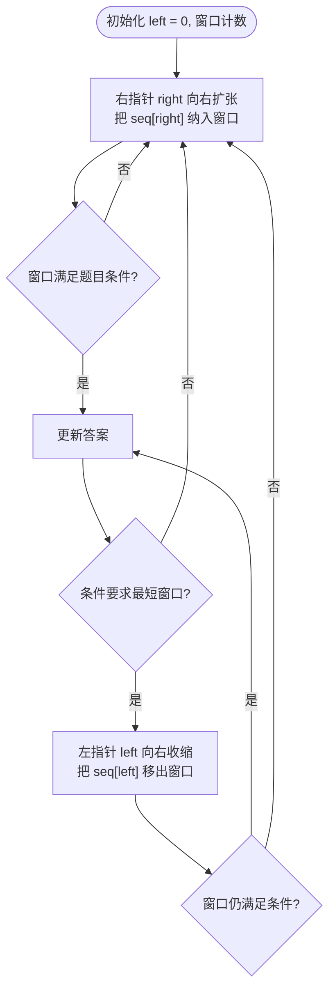

# 第 04 章 双指针与滑动窗口

> 覆盖题号：3, 11, 15, 16, 18, 30, 42, 75, 76, 125, 167, 209, 344, 345, 392, 395

## 4.1 引子：一个指针不够，就上两个

想象你在翻一本按字典序排列的电话簿，想找"两个名字，它们的首字母能拼成一个指定的单词"。最笨的办法是把每两个名字都配对试一次——n 个名字就有 n² 种配对，电话簿稍微厚一点就翻不动了。

再想象另一件事：你在看一段监控录像，想找出"最长的一段没有重复画面"的片段。最笨的办法同样是枚举所有片段，要检查 O(n²) 个候选。

这两件事的共同点是：**我们关心的不是一个点，而是一对点（或一段区间）**。双指针（two pointers）正是专门对付这类问题的武器：**用两个下标代替暴力枚举，利用数据本身的顺序或单调性，把 O(n²) 的配对压缩成 O(n) 的线性扫描**。本章先讲双指针的三种形态，再重点讲其中最常用、也最需要练习的"滑动窗口"，最后用 16 道真题 + 3 道锁题把它练透。

| 形态 | 两个指针怎么动 | 典型场景 | 本章例题 |
| --- | --- | --- | --- |
| 对撞指针 | 一头一尾，向中间夹 | 有序数组、回文、面积 | 11, 15, 16, 18, 42, 125, 167, 344, 345 |
| 快慢指针 | 一快一慢，同向前进 | 链表判环、找中点（见第 07 章） | 75（读/写指针变体） |
| 滑动窗口 | 右端扩张、左端收缩 | 连续子串/子数组的计数问题 | 3, 30, 76, 209, 395 |

## 4.2 核心思想

### 双指针为什么能省时间

暴力枚举所有数对 `(i, j)` 是 O(n²)，因为两个下标都在"乱跑"。双指针的秘诀是：**每个指针都只朝一个方向移动，从不回头**。这样两个指针合计最多移动 O(n) 次，一遍扫描就出答案。

**（1）对撞指针：从两端向中间夹**

生活类比：两个人拉一根绳子量长度，一个站在最左端，一个站在最右端，然后一步步往中间走，边走边记录——两人总共走过的路，不会超过整根绳子的长度。

适用场景：**数据有序**（两数之和、三数之和系列）、**回文类对称比较**（验证回文、反转字符串）、**两端夹逼求最值**（盛水容器）。

手推一个例子：`numbers = [2, 7, 11, 15]`，找两数之和等于 9 的下标（第 167 题，答案下标从 1 开始）。

- left=0 指向 2，right=3 指向 15：2+15=17 > 9。**15 和任何更靠左的数相加只会更大**，所以 15 不可能进答案，right 左移。
- left=0 指向 2，right=2 指向 11：13 > 9，right 再左移。
- left=0 指向 2，right=1 指向 7：2+7=9，命中，返回 `[1, 2]`。

关键在"为什么可以放心丢掉一个指针"：数组有序时，**和太大说明右指针的数太大，丢掉右指针；和太小说明左指针的数太小，丢掉左指针**——被丢掉的那个数，再也不会和任何数组成答案。这就是"夹逼"。

**（2）快慢指针：一快一慢**

快慢指针是两个指针同向前进、速度不同，最经典的战场在链表：判断是否有环（快指针每次走两步、慢指针走一步，有环则必然相遇）、找链表中点（快指针到终点时，慢指针正好在中点）——这些会在第 07 章链表里详细展开。

在数组里，快慢指针还有一种常见变体：**读指针 + 写指针**（或叫"读写指针"）。比如第 75 题颜色分类用三个指针维护三个区间；第 02 章的"移动零""移除元素"也是读写指针。本章主要用三指针解决 75 题。

**（3）滑动窗口：一段连续区间的"取景框"**

生活类比：用手机看一段长视频时，屏幕就是"窗口"；你拖动进度条，画面右端往前、左端跟着走。滑动窗口就是**用两个指针圈住一段连续区间（窗口），右指针负责"纳入"新元素，左指针负责"踢出"旧元素**，窗口像取景框一样在数组上滑过。

手推一个例子：求 `s = "abcabcbb"` 的最长无重复子串（第 3 题）。

- 右指针一路扩张到 "abc"（窗口 [0,2]）：无重复，记录 best=3。
- 右指针到下标 3 加入 'a'：窗口变 "abca"，'a' 重复 → 左指针收缩，丢掉最左的 'a' → 窗口 "bca"，恢复无重复。
- 右指针到下标 4 加入 'b'：窗口 "bcab"，'b' 重复 → 收缩丢 'b' → "cab"。
- ……右指针一路走到末尾，窗口每次都被"收缩到无重复"，答案锁定 3。

整个过程右指针走了 8 步、左指针最多也走 8 步，O(n) 完成；而暴力枚举所有子串是 O(n²)。

**什么时候能用滑动窗口？—— 窗口条件的"单调性"。**

滑动窗口的收缩逻辑依赖一个性质：**随着右指针扩张，窗口"满足条件"的程度单调变化**——要么越扩张越满足（如"和 ≥ target"：加数只会让和更大），要么越扩张越不满足（如"无重复字符"：加字符只会让重复更多）。正是这种单调性，保证"不满足就收缩、满足就更新答案"的 while 循环总能找到最优窗口。

如果条件不具备单调性（比如"窗口内元素互不相同且和为偶数"），收缩左端并不能让"和为偶数"变好或变坏，滑动窗口就不适用，往往要回到暴力或换其他算法。

## 4.3 算法流程

**对撞指针模板**（伪代码）：

```text
left, right = 0, len(seq) - 1
while left < right:
    用 seq[left] 和 seq[right] 做一次判断/计算
    if 应该丢弃左端:
        left += 1
    else:
        right -= 1
```

三句话：**循环条件 left < right**（两指针相遇即停）、**每轮只动一个指针**、**动谁由"谁更该被丢弃"决定**。

**滑动窗口模板**（伪代码，求最长）：

```text
counter = 空计数表
left = 0
for right in 0..n-1:
    把 seq[right] 计入 counter        # ① 右指针扩张
    while 窗口不满足条件:             # ② 收缩直到满足
        把 seq[left] 移出 counter
        left += 1
    best = max(best, right - left + 1)  # ③ 此刻窗口满足条件, 更新答案
```

核心就三步：**右指针扩张 → while 左指针收缩 → 更新答案**。窗口条件用一个计数器（Python 的 `Counter` 或 `dict`）维护：扩张时加一，收缩时减一，减到 0 就删除键（保证 `len(counter)` 等于窗口内不同元素的个数）。

如果求的是"最短满足条件的窗口"（第 76、209 题），把第 ③ 步挪进 while 循环里：**一旦满足就收缩，收缩的过程中顺便记录最短长度**。

## 4.4 复杂度分析

| 套路 | 时间复杂度 | 空间复杂度 | 为什么 |
| --- | --- | --- | --- |
| 对撞指针 | O(n) | O(1) | 两个指针各只朝一个方向移动，合计 O(n) 步 |
| 滑动窗口 | O(n) | O(字符集大小) | 每个元素进窗口一次、出窗口一次，共 O(2n) |
| 排序 + 对撞指针 | O(n log n) | O(1)（原地排序） | 排序是瓶颈（15/16/18/259） |
| 分组滑动窗口 | O(n) | O(单词种数) | 第 30 题按单词长度分 wl 组，每组线性 |

为什么双指针能把 O(n²) 变成 O(n)：暴力枚举所有 `(i, j)` 组合是 n² 次；而对撞/滑动窗口**利用了有序性或条件的单调性，每一轮只移动一个指针，且指针从不回退**，两个指针移动的总次数是 O(n)，每轮 O(1) 的工作量加起来就是 O(n)。

滑动窗口的空间来自计数器：统计 26 个小写字母可用长度 26 的数组，统计任意字符用 `Counter`，都是 O(字符集大小)。

## 4.5 Python 实现：可以直接套用的滑动窗口模板

下面是本章最值得抄下来的代码——滑动窗口的**最长版**和**最短版**两个模板。写任何滑动窗口题，先抄模板，再填"窗口条件"，最后决定答案在哪一步更新：

整个套路就是"右指针负责扩张、左指针负责收缩"的两段式循环：



```python
from collections import Counter


def longest_window(seq, ok):
    """模板一: 求"满足条件的最长窗口"的长度。
    ok(counter, left, right) 判断当前窗口是否满足条件;
    要求条件随右指针扩张单调变差, 才能用 while 收缩。
    """
    counter = Counter()
    left = 0
    best = 0
    for right in range(len(seq)):
        counter[seq[right]] += 1               # ① 右指针扩张
        while not ok(counter, left, right):    # ② 不满足 → 左指针收缩
            counter[seq[left]] -= 1
            if counter[seq[left]] == 0:
                del counter[seq[left]]
            left += 1
        best = max(best, right - left + 1)     # ③ 窗口满足条件, 更新答案
    return best


def shortest_window(seq, ok):
    """模板二: 求"满足条件的最短窗口"的长度, 找不到返回 0。
    要求条件随右指针扩张单调变好; 在"满足"时收缩, 收缩到刚好不满足为止。
    """
    counter = Counter()
    left = 0
    best = None
    for right in range(len(seq)):
        counter[seq[right]] += 1               # ① 右指针扩张
        while ok(counter, left, right):        # ② 满足 → 收缩并更新答案
            length = right - left + 1
            best = length if best is None else min(best, length)
            counter[seq[left]] -= 1
            if counter[seq[left]] == 0:
                del counter[seq[left]]
            left += 1
    return best if best is not None else 0


def no_repeat(counter, left, right):
    """例 1: 窗口内没有任何重复字符"""
    return max(counter.values(), default=0) <= 1


def sum_at_least(counter, left, right):
    """例 2: 窗口内数字之和 >= 7"""
    return sum(k * v for k, v in counter.items()) >= 7


if __name__ == "__main__":
    # 模板一: 无重复字符的最长子串 (LeetCode 3)
    assert longest_window("abcabcbb", no_repeat) == 3
    assert longest_window("bbbbb", no_repeat) == 1
    assert longest_window("", no_repeat) == 0
    # 模板二: 和 >= 7 的最短子数组 (LeetCode 209)
    assert shortest_window([2, 3, 1, 2, 4, 3], sum_at_least) == 2
    assert shortest_window([1, 1, 1], sum_at_least) == 0
    print("滑动窗口双模板验证通过: 最长版与最短版均正确")
```

三个要点：

1. **条件函数 `ok` 是灵魂**。它接收窗口计数器与左右端点，返回"当前窗口是否满足条件"。第 3 题的条件是"没有重复字符"（所有计数 ≤ 1），第 209 题的条件是"数字和 ≥ target"。
2. **最长版 vs 最短版**：最长版在收缩结束后更新答案（窗口此刻恰好满足）；最短版在收缩过程中更新答案（窗口一旦满足，就可能已经是"最短"的候选）。
3. **计数器的清理**：计数减到 0 就 `del` 掉键，否则 `len(counter)` 会虚高，凡是依赖"不同字符数"的条件（如第 340、159 题）都会出错。

对撞指针没有独立的"模板函数"——它就是一个三行的 while 循环（见 4.3 伪代码），直接把第 167 题的骨架抄走即可。下面进入真题精讲。

## 4.6 LeetCode 真题精讲

下面按"滑动窗口 → 有序数组对撞 → 对撞指针其他 → 三指针 → 综合"的顺序讲解。每道题都给出完整可运行的代码，你可以直接复制运行。

### 3. 无重复字符的最长子串（中等）

**题意**：给定字符串 `s`，找出其中不含有重复字符的最长子串的长度。

**思路**：这就是 4.5 模板一的直接应用。窗口条件"无重复字符"随扩张单调变差，所以一旦不满足就用 while 收缩。小优化：收缩前窗口里除了新字符外都是唯一的，**唯一可能造成重复的就是刚加入的字符 `ch`**，所以收缩条件只需盯着 `count[ch] > 1` 判断即可，不用检查整个计数器。

**代码**：

```python
from collections import defaultdict


def length_of_longest_substring(s):
    """返回最长不含重复字符的子串长度"""
    count = defaultdict(int)      # 窗口内每个字符的出现次数
    left = 0
    best = 0
    for right, ch in enumerate(s):
        count[ch] += 1                       # ① 右指针扩张
        while count[ch] > 1:                 # ② 新字符造成重复, 收缩
            count[s[left]] -= 1
            left += 1
        best = max(best, right - left + 1)   # ③ 窗口内已无重复
    return best


if __name__ == "__main__":
    assert length_of_longest_substring("abcabcbb") == 3
    assert length_of_longest_substring("bbbbb") == 1
    assert length_of_longest_substring("") == 0
    print("LeetCode 3 通过: 最长无重复子串长度计算正确")
```

**复杂度分析**：时间 O(n)（左右指针各走一遍），空间 O(字符集大小)（计数器）。

**易错点**：

- 忘记空串边界：空串应返回 0。
- 收缩时忘了 `left += 1`，死循环。
- 在收缩之前更新答案：此时窗口还有重复字符，长度虚高。

### 209. 长度最小的子数组（中等）

**题意**：正整数数组 `nums` 和整数 `target`，找出和 ≥ `target` 的最短连续子数组的长度；不存在返回 0。

**思路**：模板二（最短版）的标准用例。条件"和 ≥ target"随扩张单调变好，所以一旦满足就开始收缩，收缩过程中记录最短长度。手推：`nums = [2,3,1,2,4,3]`，target=7，最短的是子数组 `[4,3]`，长度 2——右指针到 4 时窗口 `[2,3,1,2]` 和=8 首次达标，随后一路收缩、右移，最终锁定 `[4,3]`。

**代码**：

```python
def min_sub_array_len(target, nums):
    """返回和 >= target 的最短连续子数组长度, 不存在返回 0"""
    n = len(nums)
    left = 0
    total = 0
    best = n + 1
    for right in range(n):
        total += nums[right]                 # ① 右指针扩张
        while total >= target:               # ② 满足条件, 收缩并更新
            best = min(best, right - left + 1)
            total -= nums[left]
            left += 1
    return best if best <= n else 0


if __name__ == "__main__":
    assert min_sub_array_len(7, [2, 3, 1, 2, 4, 3]) == 2
    assert min_sub_array_len(11, [1, 1, 1, 1, 1, 1, 1, 1]) == 0
    assert min_sub_array_len(100, []) == 0
    print("LeetCode 209 通过: 最短子数组长度计算正确")
```

**复杂度分析**：时间 O(n)，空间 O(1)（只用两个下标和一个和）。

**易错点**：

- 找不到时返回 0，而不是 n+1。
- 先更新答案再收缩，顺序不能反（先收缩会丢掉候选长度）。

### 76. 最小覆盖子串（困难）

**题意**：字符串 `s` 和 `t`，返回 `s` 中涵盖 `t` 全部字符（含数量）的最短子串；不存在返回空串。

**思路**：模板二 + 计数。用字典 `need` 记录"还差多少"（正数=还缺、负数=多余），用 `missing` 记录还没凑齐的字符总数：扩张时若 `need[ch] > 0` 则 `missing -= 1`，随后 `need[ch] -= 1` 记入窗口；当 `missing == 0` 时窗口已覆盖 t，开始收缩——每踢出一个字符 `need[s[left]] += 1`，若它重新变正说明不够用了，`missing += 1`，收缩期间不断更新最短记录。

手推：`s = "ADOBECODEBANC"`, `t = "ABC"`。右指针走到下标 5 时窗口 `"ADOBEC"` 首次集齐 A/B/C（长度 6）；继续右移，每次集齐就收缩，最终得到 `"BANC"`，长度 4。

**代码**：

```python
from collections import Counter


def min_window(s, t):
    """返回 s 中最短的、包含 t 中全部字符(含数量)的子串, 不存在返回空串"""
    if not t:
        return ""
    need = Counter(t)
    missing = len(t)                  # 还差多少个字符没凑齐
    left = 0
    best = (float("inf"), 0, 0)       # (长度, 起点, 终点)
    for right, ch in enumerate(s):
        if need[ch] > 0:              # 这个字符正是需要的
            missing -= 1
        need[ch] -= 1                 # 记入窗口, 可为负数表示"多余"
        while missing == 0:           # 窗口已覆盖 t, 尝试收缩
            if right - left + 1 < best[0]:
                best = (right - left + 1, left, right + 1)
            need[s[left]] += 1
            if need[s[left]] > 0:     # 移出后这个字符不够用了
                missing += 1
            left += 1
    return "" if best[0] == float("inf") else s[best[1]:best[2]]


if __name__ == "__main__":
    assert min_window("ADOBECODEBANC", "ABC") == "BANC"
    assert min_window("a", "a") == "a"
    assert min_window("a", "aa") == ""
    print("LeetCode 76 通过: 最小覆盖子串计算正确")
```

**复杂度分析**：时间 O(n)，空间 O(字符集大小)。

**易错点**：

- `need[ch] > 0` 的判断必须放在计数更新之前。
- 收缩用 while 而不是 if：连续踢出多个"多余"字符时，`missing` 可能一直不变，一次收缩不够。
- `t` 为空串时直接返回空串，避免除零/空逻辑。

### 30. 串联所有单词的子串（困难）

**题意**：字符串 `s` 和等长单词列表 `words`，找出 `s` 中恰好由 `words` 里全部单词（每个恰好一次、任意顺序）拼接而成的子串的起始下标。

**思路**：所有单词等长，记长度为 `wl`。关键优化是**按起点对 `wl` 取模分组**：对每个分组 `start ∈ [0, wl)`，把 `s` 按 `wl` 步长切成"单词序列"，问题退化成"最长窗口"式的计数问题——窗口内用 `have` 计数、`matched` 统计"计数恰好等于需求"的单词种数，`matched == len(need)` 时单词恰好凑齐；某单词超量就收缩左端；遇到不在 `words` 里的单词则整个窗口作废，`left` 跳到该单词之后。

**代码**：

```python
from collections import Counter


def find_substring(s, words):
    """返回 s 中所有由 words 全部单词(每个恰一次)拼接而成的子串起点"""
    if not s or not words:
        return []
    wl = len(words[0])
    need = Counter(words)
    result = []
    for start in range(wl):                  # 按起点模 wl 分组, 每组一个滑动窗口
        left = start
        have = Counter()
        matched = 0                          # 计数恰好等于需求的单词种数
        for right in range(start, len(s) - wl + 1, wl):
            word = s[right:right + wl]
            if word not in need:
                have.clear()                 # 出现无关单词, 窗口作废
                matched = 0
                left = right + wl
                continue
            have[word] += 1
            if have[word] == need[word]:
                matched += 1
            while have[word] > need[word]:   # 该单词超量, 收缩
                left_word = s[left:left + wl]
                have[left_word] -= 1
                if have[left_word] == need[left_word] - 1:
                    matched -= 1
                left += wl
            if matched == len(need):         # 全部单词都恰好凑齐
                result.append(left)
    return result


if __name__ == "__main__":
    assert find_substring("barfoothefoobarman", ["foo", "bar"]) == [0, 9]
    assert find_substring("wordgoodgoodgoodbestword",
                          ["word", "good", "best", "good"]) == [8]
    assert find_substring("barfoofoobarthefoobarman",
                          ["bar", "foo", "the"]) == [6, 9, 12]
    assert find_substring("aaa", ["a"]) == [0, 1, 2]
    assert find_substring("aaaa", ["a", "a"]) == [0, 1, 2]
    print("LeetCode 30 通过: 串联单词子串起点计算正确")
```

**复杂度分析**：时间 O(n)（wl 个分组，每个分组各扫一遍，总计约 n/wl × wl = n 个单词），空间 O(单词种数)。分组是关键：不分组时每个字符位置都要重新切词比较，会退化成 O(n × wl)。

**易错点**：

- 忘记分组，或分组起点漏掉 `0..wl-1` 中的某些值。
- 收缩时 `matched` 的增减条件写反（只有计数从"恰好"降到"不足"时才减一）。
- 遇到无关单词后，`left` 要跳到该单词之后（`right + wl`），而不是只前进 `wl` 一步。

### 395. 至少有 K 个重复字符的最长子串（中等）

**题意**：给定小写字符串 `s` 和整数 `k`，返回最长的子串长度，要求子串中每个字符的出现次数都不少于 `k`。

**思路**：滑动窗口的经典变体——**枚举窗口内不同字符数 `target`（1~26）**。为什么必须枚举：条件"每个字符都 ≥ k 次"本身不随扩张单调（新加入的字符可能打破平衡），但把"不同字符数恰好等于 target"也纳入约束后，窗口条件就变得可以用滑动窗口维护了。对每个 `target` 维护两个计数：

- `distinct`：窗口内不同字符数；
- `enough`：窗口内出现次数 ≥ k 的字符数。

当 `distinct == target` 且 `enough == target` 时，窗口内恰好 target 种字符、每种都 ≥ k 次，更新答案；收缩条件为 `distinct > target`。对比：另一种经典思路是分治——把全局出现次数 < k 的字符当"分隔符"递归切分，复杂度最坏 O(26n)；两种都是正解。

**代码**：

```python
def longest_substring(s, k):
    """返回最长的、每个字符出现次数都不少于 k 的子串长度"""
    if not s:
        return 0
    best = 0
    for target in range(1, 27):              # 枚举窗口内不同字符数
        count = [0] * 26
        left = 0
        distinct = 0                         # 窗口内不同字符数
        enough = 0                           # 出现次数 >= k 的字符数
        for right, ch in enumerate(s):
            idx = ord(ch) - ord("a")
            if count[idx] == 0:
                distinct += 1
            count[idx] += 1
            if count[idx] == k:
                enough += 1
            while distinct > target:         # 收缩到不同字符数不超过 target
                li = ord(s[left]) - ord("a")
                if count[li] == k:
                    enough -= 1
                count[li] -= 1
                if count[li] == 0:
                    distinct -= 1
                left += 1
            if distinct == target and enough == target:
                best = max(best, right - left + 1)
    return best


if __name__ == "__main__":
    assert longest_substring("aaabb", 3) == 3
    assert longest_substring("ababbc", 2) == 5
    assert longest_substring("ababacb", 3) == 0
    assert longest_substring("bbaaacbd", 3) == 3
    assert longest_substring("", 2) == 0
    print("LeetCode 395 通过: 至少 K 个重复字符的最长子串计算正确")
```

**复杂度分析**：时间 O(26n)，空间 O(26)（固定数组计数）。

**易错点**：

- `distinct` 与 `enough` 的增减时机：先判断、再增减，顺序错了计数会偏。
- 收缩条件必须是 `distinct > target`，而不是 `enough < target`。
- 忘记空串边界（返回 0）。

### 167. 两数之和 II - 输入有序数组（中等）

**题意**：升序数组 `numbers`，找两个数之和等于 `target`，返回它们的下标（从 1 开始计数）。

**思路**：对撞指针的入门题，手推见 4.2。**有序是关键**：和太大丢掉右端、和太小丢掉左端，正是依赖有序性才能"放心丢"。

**代码**：

```python
def two_sum(numbers, target):
    """返回和为 target 的两个数的下标(从 1 开始计数)"""
    left, right = 0, len(numbers) - 1
    while left < right:
        total = numbers[left] + numbers[right]
        if total == target:
            return [left + 1, right + 1]
        if total < target:
            left += 1
        else:
            right -= 1
    return []


if __name__ == "__main__":
    assert two_sum([2, 7, 11, 15], 9) == [1, 2]
    assert two_sum([2, 3, 4], 6) == [1, 3]
    assert two_sum([1, 2, 3, 4, 4, 9, 56, 90], 8) == [4, 5]
    print("LeetCode 167 通过: 有序数组两数之和计算正确")
```

**复杂度分析**：时间 O(n)，空间 O(1)。

**易错点**：

- 答案下标从 1 开始，返回 `[left + 1, right + 1]`。
- 循环条件是 `left < right`（不是 `<=`），否则同一个数会被用两次。

### 15. 三数之和（中等）

**题意**：数组 `nums`，返回所有和为 0 且不重复的三元组。

**思路**：排序后固定第一个数 `nums[i]`，剩下两个数用对撞指针（就是 167 的做法）找和为 `-nums[i]` 的配对。**去重是本体的重点**：排序后相同值相邻，固定数跳过重复值；对撞命中后，左右指针也要各自跳过相邻重复值。

手推：`[-1,0,1,2,-1,-4]` 排序后为 `[-4,-1,-1,0,1,2]`。固定 `-1`，对撞找到 `(-1,-1,2)` 与 `(-1,0,1)`；第二个 `-1` 与第一个重复，跳过。

**代码**：

```python
def three_sum(nums):
    """返回所有和为 0 且不重复的三元组"""
    nums.sort()
    n = len(nums)
    result = []
    for i in range(n - 2):
        if i > 0 and nums[i] == nums[i - 1]:
            continue                          # 跳过重复的固定数
        left, right = i + 1, n - 1
        while left < right:
            total = nums[i] + nums[left] + nums[right]
            if total == 0:
                result.append([nums[i], nums[left], nums[right]])
                while left < right and nums[left] == nums[left + 1]:
                    left += 1
                while left < right and nums[right] == nums[right - 1]:
                    right -= 1
                left += 1
                right -= 1
            elif total < 0:
                left += 1
            else:
                right -= 1
    return result


if __name__ == "__main__":
    assert three_sum([-1, 0, 1, 2, -1, -4]) == [[-1, -1, 2], [-1, 0, 1]]
    assert three_sum([0, 0, 0]) == [[0, 0, 0]]
    assert three_sum([0, 0, 0, 0]) == [[0, 0, 0]]
    print("LeetCode 15 通过: 三数之和计算正确")
```

**复杂度分析**：时间 O(n²)（排序 O(n log n) + 每个 `i` 做一次 O(n) 对撞），空间 O(1)（不计答案）。

**易错点**：

- 去重有三处：固定数、命中后的左指针、命中后的右指针，漏一处就会产生重复三元组。
- 命中后两个指针**都要**移动；只动一个会漏解或死循环。

### 16. 最接近的三数之和（中等）

**题意**：数组 `nums` 和目标 `target`，返回与 `target` 最接近的三数之和（保证答案唯一）。

**思路**：排序 + 固定一个 + 对撞指针。每算出一个和就与当前最优比较并更新；和比 target 小就左移左指针（让和变大），比 target 大就右移右指针（让和变小），**恰好相等直接返回 target**（不可能更近了）。

**代码**：

```python
def three_sum_closest(nums, target):
    """返回与 target 最接近的三数之和"""
    nums.sort()
    n = len(nums)
    best = nums[0] + nums[1] + nums[2]
    for i in range(n - 2):
        left, right = i + 1, n - 1
        while left < right:
            total = nums[i] + nums[left] + nums[right]
            if abs(total - target) < abs(best - target):
                best = total
            if total < target:
                left += 1
            elif total > target:
                right -= 1
            else:
                return target                 # 恰好命中, 不可能更近
    return best


if __name__ == "__main__":
    assert three_sum_closest([-1, 2, 1, -4], 1) == 2
    assert three_sum_closest([0, 0, 0], 1) == 0
    assert three_sum_closest([1, 1, 1, 0], -100) == 2
    print("LeetCode 16 通过: 最接近的三数之和计算正确")
```

**复杂度分析**：时间 O(n²)，空间 O(1)。

**易错点**：

- `best` 的初值用前三项的和，而不是 0 或无穷大（避免首轮比较失真）。
- 相等时直接返回 `target` 是正确剪枝，别忘了写。

### 18. 四数之和（中等）

**题意**：数组 `nums` 和目标 `target`，返回所有和为 `target` 且不重复的四元组。

**思路**：15 题再加一层循环：固定 `i`、固定 `j`，剩下两个数对撞。去重逻辑与 15 题完全一致——固定数跳过相邻重复值，命中后左右指针跳过相邻重复值。

**代码**：

```python
def four_sum(nums, target):
    """返回所有和为 target 且不重复的四元组"""
    nums.sort()
    n = len(nums)
    result = []
    for i in range(n - 3):
        if i > 0 and nums[i] == nums[i - 1]:
            continue
        for j in range(i + 1, n - 2):
            if j > i + 1 and nums[j] == nums[j - 1]:
                continue
            left, right = j + 1, n - 1
            while left < right:
                total = nums[i] + nums[j] + nums[left] + nums[right]
                if total == target:
                    result.append([nums[i], nums[j], nums[left], nums[right]])
                    while left < right and nums[left] == nums[left + 1]:
                        left += 1
                    while left < right and nums[right] == nums[right - 1]:
                        right -= 1
                    left += 1
                    right -= 1
                elif total < target:
                    left += 1
                else:
                    right -= 1
    return result


if __name__ == "__main__":
    assert four_sum([1, 0, -1, 0, -2, 2], 0) == [[-2, -1, 1, 2],
                                                  [-2, 0, 0, 2],
                                                  [-1, 0, 0, 1]]
    assert four_sum([0, 0, 0, 0], 0) == [[0, 0, 0, 0]]
    assert four_sum([2, 2, 2, 2, 2], 8) == [[2, 2, 2, 2]]
    print("LeetCode 18 通过: 四数之和计算正确")
```

**复杂度分析**：时间 O(n³)，空间 O(1)（不计答案）。`n ≤ 200` 时约 10⁶~10⁷ 次操作，Python 可过。

**易错点**：

- 内层固定数 `j` 的去重条件要带 `j > i + 1`（避免误伤第一轮）。
- 数组长度不足 4 时循环天然不执行，返回空列表即可。

### 11. 盛最多水的容器（中等）

**题意**：数组 `height` 表示柱子的高度，选两根柱子作容器壁，返回能盛水的最大面积。

**思路**：对撞指针。面积 = `min(height[l], height[r]) × (r - l)`，受制于**短板**。每次移动**较矮的那端**：直觉上，当前短板已经用它所能达到的最大宽度参与过计算了，把它换掉才可能遇到更高的板；而移动较高的一端，面积只会被更矮的板或更窄的宽度限制，不可能变大。因此"动短板"一定不会错过最优解。

手推 `[1,8,6,2,5,4,8,3,7]`：左 1 右 7 → 面积 1×8=8，动左端（1 太矮）；……最终 8 与 7 配对，面积 7×5=49。

**代码**：

```python
def max_area(height):
    """返回两根柱子能盛的最大水量"""
    left, right = 0, len(height) - 1
    best = 0
    while left < right:
        area = min(height[left], height[right]) * (right - left)
        best = max(best, area)
        if height[left] < height[right]:
            left += 1                         # 短板决定高度, 移动短板
        else:
            right -= 1
    return best


if __name__ == "__main__":
    assert max_area([1, 8, 6, 2, 5, 4, 8, 3, 7]) == 49
    assert max_area([1, 1]) == 1
    assert max_area([1]) == 0
    print("LeetCode 11 通过: 盛最多水的容器计算正确")
```

**复杂度分析**：时间 O(n)，空间 O(1)。

**易错点**：

- 比较的是两根柱子的**高度**（谁矮动谁），不是面积。
- 两柱等高时动哪边都行，不影响正确性。

### 125. 验证回文串（简单）

**题意**：忽略大小写和非字母数字字符，判断字符串是否为回文。

**思路**：对撞指针。左右指针各先跳过非字母数字字符，再比较（统一转小写）。内层跳过也要带 `left < right` 保护，防止指针越界。

**代码**：

```python
def is_palindrome(s):
    """忽略大小写与非字母数字字符, 判断 s 是否为回文"""
    left, right = 0, len(s) - 1
    while left < right:
        while left < right and not s[left].isalnum():
            left += 1
        while left < right and not s[right].isalnum():
            right -= 1
        if s[left].lower() != s[right].lower():
            return False
        left += 1
        right -= 1
    return True


if __name__ == "__main__":
    assert is_palindrome("A man, a plan, a canal: Panama")
    assert not is_palindrome("race a car")
    assert not is_palindrome("0P")
    print("LeetCode 125 通过: 回文串判断正确")
```

**复杂度分析**：时间 O(n)，空间 O(1)。

**易错点**：

- 跳过字符的内层 while 必须带 `left < right`，否则全是符号的字符串会越界。
- `"0P"` 不是回文：数字也要参与比较，`'0'` 与 `'p'` 不相等。

### 344. 反转字符串（简单）

**题意**：原地反转字符数组。

**思路**：对撞指针交换。Python 一行 `s.reverse()` 也能做，但面试常要求手写双指针版本。

**代码**：

```python
def reverse_string(s):
    """原地反转字符列表"""
    left, right = 0, len(s) - 1
    while left < right:
        s[left], s[right] = s[right], s[left]
        left += 1
        right -= 1
    return s


if __name__ == "__main__":
    assert reverse_string(["h", "e", "l", "l", "o"]) == ["o", "l", "l", "e", "h"]
    assert reverse_string(["H", "a", "n", "n", "a", "h"]) == ["h", "a", "n", "n", "a", "H"]
    assert reverse_string([]) == []
    print("LeetCode 344 通过: 反转字符串正确")
```

**复杂度分析**：时间 O(n)，空间 O(1)。

**易错点**：交换后两个指针都要移动；空数组与单元素数组应直接跳过循环。

### 345. 反转字符串中的元音字母（简单）

**题意**：只反转字符串中的元音字母（含大小写），其他字符位置不动。

**思路**：对撞指针，左右各自跳过非元音，找到一对元音就交换。元音集合为 `set("aeiouAEIOU")`，注意**大写元音别漏**。

**代码**：

```python
def reverse_vowels(s):
    """只反转元音字母的位置, 其余字符保持原位"""
    vowels = set("aeiouAEIOU")
    chars = list(s)
    left, right = 0, len(chars) - 1
    while left < right:
        while left < right and chars[left] not in vowels:
            left += 1
        while left < right and chars[right] not in vowels:
            right -= 1
        chars[left], chars[right] = chars[right], chars[left]
        left += 1
        right -= 1
    return "".join(chars)


if __name__ == "__main__":
    assert reverse_vowels("hello") == "holle"
    assert reverse_vowels("leetcode") == "leotcede"
    assert reverse_vowels("aA") == "Aa"
    print("LeetCode 345 通过: 反转元音字母正确")
```

**复杂度分析**：时间 O(n)，空间 O(n)（`list(s)` 的复制；若面试要求 O(1) 可改用字节数组）。

**易错点**：

- 元音含大小写，集合里漏掉大写就会输出错误。
- 跳过循环的 `left < right` 边界保护不能省。

### 392. 判断子序列（简单）

**题意**：判断 `s` 是否为 `t` 的子序列（即删除 `t` 中若干字符后能得到 `s`）。

**思路**：贪心 + 双指针：`i` 指向 `s`，扫描 `t` 时每匹配一个字符就让 `i` 前进一步。这也是"快慢指针"的变体——`s` 的指针只在匹配时前进。贪心的正确性：**越早匹配越有利**，不会错过任何机会。

**代码**：

```python
def is_subsequence(s, t):
    """判断 s 是否为 t 的子序列"""
    i = 0
    for ch in t:
        if i < len(s) and ch == s[i]:
            i += 1
    return i == len(s)


if __name__ == "__main__":
    assert is_subsequence("abc", "ahbgdc")
    assert not is_subsequence("axc", "ahbgdc")
    assert is_subsequence("", "ahbgdc")
    assert not is_subsequence("abc", "")
    print("LeetCode 392 通过: 子序列判断正确")
```

**复杂度分析**：时间 O(len(t))，空间 O(1)。

**易错点**：

- `s` 为空返回 True；`t` 为空而 `s` 非空返回 False。
- 匹配条件别忘了 `i < len(s)`，防止越界访问 `s[i]`。

### 75. 颜色分类（中等）

**题意**：原地把只含 0/1/2 的数组排序，使 0 在前、1 在中、2 在后，要求一遍扫描 O(n)。

**思路**：三指针荷兰国旗问题。用三个下标维护三个区间的不变量：

- `[0, zero)`：全是 0；
- `[zero, i)`：全是 1；
- `(two, n-1]`：全是 2；
- `[i, two]`：未处理区域。

扫描规则：`nums[i] == 0` 就与 `nums[zero]` 交换（换来的必是 1，`i` 可放心自增）；`nums[i] == 2` 就与 `nums[two]` 交换（**换回来的值还没检查过，`i` 不能自增**）；`nums[i] == 1` 直接 `i += 1`。

手推 `[2,0,2,1,1,0]`：i=0 的 2 与末尾 0 换 → `[0,0,2,1,1,2]`；随后 0、0 各就各位，最终 `[0,0,1,1,2,2]`。

**代码**：

```python
def sort_colors(nums):
    """荷兰国旗: 原地把 0/1/2 排成 0...0 1...1 2...2"""
    zero = 0                     # [0, zero) 全是 0
    two = len(nums) - 1          # (two, 末尾] 全是 2
    i = 0
    while i <= two:
        if nums[i] == 0:
            nums[zero], nums[i] = nums[i], nums[zero]
            zero += 1
            i += 1
        elif nums[i] == 2:
            nums[two], nums[i] = nums[i], nums[two]
            two -= 1             # i 不自增: 换来的 nums[i] 还没检查
        else:
            i += 1
    return nums


if __name__ == "__main__":
    assert sort_colors([2, 0, 2, 1, 1, 0]) == [0, 0, 1, 1, 2, 2]
    assert sort_colors([2, 0, 1]) == [0, 1, 2]
    assert sort_colors([1, 2, 0]) == [0, 1, 2]
    assert sort_colors([0]) == [0]
    print("LeetCode 75 通过: 颜色分类正确")
```

**复杂度分析**：时间 O(n)（一遍扫描），空间 O(1)。

**易错点**：

- **换 2 时 `i` 不能自增**：换回来的数可能是 0 或 2，本轮还要再处理。
- 循环条件是 `i <= two`：`two` 之后都是 2，不需要再看。

### 42. 接雨水（困难）

**题意**：给 n 个非负整数表示柱子的高度，求下雨后能接住多少单位的雨水。

**思路（双指针主解法）**：对每个位置 `i`，它能接的水 = `min(左侧最高柱, 右侧最高柱) - height[i]`——只有左右两边都有更高的柱子，这里才存得住水。双指针在扫描过程中同时维护 `left_max` 和 `right_max`：

- 当 `height[left] < height[right]` 时，`left` 位置的"右侧最高"至少是 `height[right]`，已经**高过** `height[left]` 本身，所以 `left` 位置的水位只由 `left_max` 决定，可以立刻结算：`water += left_max - height[left]`，然后 `left += 1`；
- 对称地，`height[right] <= height[left]` 时结算右端。

一句话：**哪边矮就结算哪边**——矮的一侧的水位已经被另一侧封死，不需要再等。手推 `[0,1,0,2,1,0,1,3,2,1,2,1]` 得 6。

**代码**（三种解法，结果一致）：

```python
def trap(height):
    """解法一(主): 双指针。维护左右两侧遇到过的最高柱子, 哪边矮就结算哪边"""
    if not height:
        return 0
    left, right = 0, len(height) - 1
    left_max = right_max = 0
    water = 0
    while left < right:
        if height[left] < height[right]:
            left_max = max(left_max, height[left])
            water += left_max - height[left]
            left += 1
        else:
            right_max = max(right_max, height[right])
            water += right_max - height[right]
            right -= 1
    return water


def trap_stack(height):
    """解法二: 单调栈。维护高度递减的柱子下标;
    遇到更高的柱子, 就把中间的"坑"结算掉"""
    stack = []
    water = 0
    for i, h in enumerate(height):
        while stack and height[stack[-1]] < h:
            bottom = stack.pop()              # 坑底
            if not stack:
                break
            width = i - stack[-1] - 1
            depth = min(height[stack[-1]], h) - height[bottom]
            water += width * depth
        stack.append(i)
    return water


def trap_dp(height):
    """解法三: 动态规划。先预处理每列左右两侧的最大高度, 再逐列累加"""
    n = len(height)
    if n == 0:
        return 0
    left_max = [0] * n
    right_max = [0] * n
    left_max[0] = height[0]
    for i in range(1, n):
        left_max[i] = max(left_max[i - 1], height[i])
    right_max[n - 1] = height[n - 1]
    for i in range(n - 2, -1, -1):
        right_max[i] = max(right_max[i + 1], height[i])
    water = 0
    for i in range(n):
        water += min(left_max[i], right_max[i]) - height[i]
    return water


if __name__ == "__main__":
    cases = [([0, 1, 0, 2, 1, 0, 1, 3, 2, 1, 2, 1], 6),
             ([4, 2, 0, 3, 2, 5], 9),
             ([2, 0, 2], 2),
             ([], 0),
             ([1], 0)]
    for heights, expected in cases:
        assert trap(heights) == expected
        assert trap_stack(heights) == expected
        assert trap_dp(heights) == expected
    print("LeetCode 42 通过: 接雨水三种解法(双指针/单调栈/动态规划)结果一致")
```

**复杂度分析**：双指针 O(n) 时间、O(1) 空间；单调栈 O(n) 时间、O(n) 空间（栈）；动态规划 O(n) 时间、O(n) 空间（两个辅助数组）。双指针正是 DP 的空间优化版。

**补充：另外两种解法的思路**。单调栈：从左到右维护高度递减的柱子下标，遇到比栈顶更高的柱子时，栈顶就是"坑底"，弹出它，坑的宽度 = 当前下标 − 新栈顶 − 1，深度 = min(左右墙) − 坑底，每遇到一个凸起就结算一个坑（细节见第 09 章单调栈）。动态规划：先从左到右扫一遍得到每列左侧最高 `left_max[i]`，再从右到左得到 `right_max[i]`，最后逐列累加 `min(left_max[i], right_max[i]) - height[i]`。

**易错点**：

- 结算用的是 `left_max - height[left]`（可能为 0），顺序是**先更新 left_max 再结算**。
- 双指针的循环条件是 `left < right`，两端不会互相越过。

## 4.7 本章小结

**要点回顾**：

1. **双指针的实质**：让指针"只朝一个方向移动、从不回退"，用 O(n) 次移动换掉 O(n²) 次配对枚举。
2. **三类形态**：对撞指针（有序数组、回文、面积，从两端夹逼）、快慢指针（链表判环/中点，数组里的读-写指针）、滑动窗口（连续区间，右扩张左收缩）。
3. **滑动窗口三板斧**：右指针扩张 → while 左指针收缩 → 更新答案；配一个计数器维护窗口状态，计数归零要删键。
4. **能用滑动窗口的前提**：窗口条件随扩张单调变化（越扩张越满足 / 越不满足）。不满足单调性时不要硬套。
5. **去重套路**：排序后跳过相邻重复值（15/16/18/259），命中后左右指针也要跳。
6. **三指针荷兰国旗**：维护 0/1/2 三个区间的不变量，换 2 后 `i` 不动。

**常见错误**：

- 在非单调条件上硬套滑动窗口，答案错误。
- 收缩用 `if` 而不是 `while`——一次收缩往往不够。
- 答案更新位置放错：最长版在收缩后更新，最短版在收缩中更新。
- 三数/四数之和漏去重，结果出现重复三元组。
- 荷兰国旗换 2 后 `i` 自增，漏处理换回来的数。
- 计数器计数归零后没删键，`len(counter)` 虚高，影响"不同字符数"类条件。

## 4.8 扩展阅读

锁题（付费会员题）同样是高频考点，这里补 3 道。另外提一句：239 题"滑动窗口最大值"需要的是**单调队列**而不是普通计数器，请见第 09 章。

### 259. 较小的三数之和（付费）

**题意**：数组 `nums` 和整数 `target`，返回满足 `nums[i] + nums[j] + nums[k] < target` 的三元组个数（要求 `i < j < k`）。

**思路**：排序 + 固定 `i` + 对撞指针。对撞时若 `total < target`，那么固定 `i` 和 `left` 时，`right` 从当前位置到 `left+1` 的**每一个**都满足条件，直接 `count += right - left`，然后 `left += 1` 换下一个左端；否则 `right -= 1`。注意：这里统计的是"个数"，不需要去重（下标三元组天然不同）。

**代码**：

```python
def three_sum_smaller(nums, target):
    """返回满足 nums[i]+nums[j]+nums[k] < target 的三元组个数"""
    nums.sort()
    n = len(nums)
    count = 0
    for i in range(n - 2):
        left, right = i + 1, n - 1
        while left < right:
            total = nums[i] + nums[left] + nums[right]
            if total < target:
                count += right - left    # left 固定时, right 到 left+1 都满足
                left += 1
            else:
                right -= 1
    return count


if __name__ == "__main__":
    assert three_sum_smaller([-2, 0, 1, 3], 2) == 2
    assert three_sum_smaller([0, 0, 0], 0) == 0
    assert three_sum_smaller([-1, -1, -1], 0) == 1
    assert three_sum_smaller([], 0) == 0
    print("LeetCode 259 通过: 较小的三数之和计算正确")
```

**复杂度分析**：时间 O(n²)，空间 O(1)。

**易错点**：命中条件是"<"而不是"≤"；累加的是 `right - left`（个数），不是 1。

### 340. 至多包含 K 个不同字符的最长子串（付费）

**题意**：字符串 `s` 和整数 `k`，返回最多包含 `k` 个不同字符的最长子串长度。

**思路**：模板一 + 维护 `distinct`（窗口内不同字符数）。计数器里"非零键的个数"就是不同字符数，所以计数归零时必须删键。这是 395 的"简单版"：395 需要枚举 `target` 是因为还要约束"每个字符 ≥ k 次"，而这里只约束不同字符数，一个窗口直接跑完。

**代码**：

```python
from collections import defaultdict


def length_of_longest_substring_k_distinct(s, k):
    """返回最多包含 k 个不同字符的最长子串长度"""
    count = defaultdict(int)
    left = 0
    best = 0
    distinct = 0
    for right, ch in enumerate(s):
        if count[ch] == 0:
            distinct += 1
        count[ch] += 1
        while distinct > k:               # 收缩直到不同字符数不超过 k
            count[s[left]] -= 1
            if count[s[left]] == 0:
                distinct -= 1
            left += 1
        best = max(best, right - left + 1)
    return best


if __name__ == "__main__":
    assert length_of_longest_substring_k_distinct("eceba", 2) == 3
    assert length_of_longest_substring_k_distinct("aa", 1) == 2
    assert length_of_longest_substring_k_distinct("aa", 0) == 0
    assert length_of_longest_substring_k_distinct("", 2) == 0
    print("LeetCode 340 通过: 至多 K 个不同字符的最长子串计算正确")
```

**复杂度分析**：时间 O(n)，空间 O(字符集大小)。

**易错点**：`k = 0` 时窗口必须为空（返回 0）；计数归零后务必删键，否则 `distinct` 判断出错。

### 159. 至多包含两个不同字符的最长子串（付费）

**题意**：返回最多包含 2 个不同字符的最长子串长度。

**思路**：就是 340 的 `k = 2` 特例，代码几乎一模一样，把 340 的模板抄来、把 `k` 写成 2 即可。这也说明**模板 + 参数化条件**的威力：一道题学会，一串题通用。

**代码**：

```python
from collections import defaultdict


def length_of_longest_substring_two_distinct(s):
    """返回最多包含 2 个不同字符的最长子串长度 (340 的 k=2 特例)"""
    count = defaultdict(int)
    left = 0
    best = 0
    distinct = 0
    for right, ch in enumerate(s):
        if count[ch] == 0:
            distinct += 1
        count[ch] += 1
        while distinct > 2:
            count[s[left]] -= 1
            if count[s[left]] == 0:
                distinct -= 1
            left += 1
        best = max(best, right - left + 1)
    return best


if __name__ == "__main__":
    assert length_of_longest_substring_two_distinct("eceba") == 3
    assert length_of_longest_substring_two_distinct("ccaabbb") == 5
    assert length_of_longest_substring_two_distinct("") == 0
    print("LeetCode 159 通过: 至多两个不同字符的最长子串计算正确")
```

**复杂度分析**：时间 O(n)，空间 O(1)（窗口内最多 2 个键）。

**易错点**：同 340——收缩要收干净（while），删键不能省。

**延伸挑战**：本章的滑动窗口模板可以覆盖前 400 题中绝大多数"最长/最短连续区间"类问题。想更上一层楼，可以挑战：30 题（单词级滑动窗口）、76 题（最小覆盖，滑动窗口天花板）、239 题（滑动窗口 + 单调队列，见第 09 章）、395 题（分治写法对比）。把模板练成肌肉记忆，这些题都会迎刃而解。


