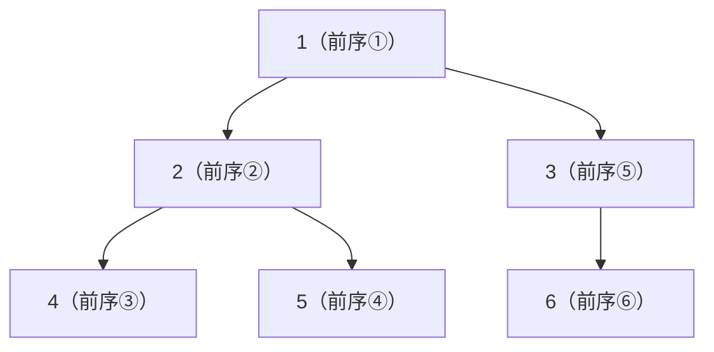

# 第 10 章 二叉树基础与遍历

> 覆盖题号：94, 100, 101, 102, 103, 104, 107, 110, 111, 112, 113, 116, 117, 129, 144, 145, 199, 226, 257

## 10.1 引子：家族族谱与文件目录

想象两样东西：

- **家族族谱**：爷爷是"根"，他有几个孩子，每个孩子又有自己的孩子……一代一代往下传。要查"爷爷的孙子的名字"，得顺着辈分一层一层找。
- **文件目录**：C 盘是根目录，里面套着文件夹，文件夹里还能再套文件夹，最里面才是文件。电脑找文件，就是沿着目录一层层"走"下去。

这两样东西的数学名字都叫**树（Tree）**。树是"分叉的线"：数组和链表是一条线走到底，而树在一个节点处分叉出多个分支。**二叉树（Binary Tree）**是最简单的树——每个节点最多分两个叉（左孩子、右孩子），却也是 LeetCode 里最重要的一棵树：二叉搜索树、堆、Trie 前缀树、线段树……全都建立在二叉树的基础之上。

这一章做三件事：

1. 学会用代码"表示"一棵二叉树（`TreeNode`）；
2. 学会"走遍"一棵树的四种方式：前序、中序、后序（深度优先）和层序（广度优先）；
3. 用 19 道真题把这些技能练熟，顺带学会**递归三要素**和**前序/后序怎么选**这两个贯穿全书的武器。

## 10.2 核心思想

### 10.2.1 二叉树长什么样：TreeNode 与基本术语

二叉树由**节点（node）**组成，每个节点是一个"小盒子"：

```text
       盒子: [ val ]
            /     \
         left    right    (指向两个孩子; 没有孩子就是 None)
```

- **根节点（root）**：最顶上的盒子，整棵树的入口；
- **叶子节点（leaf）**：没有孩子的节点，树的"尽头"；
- **子树（subtree）**：任何一个节点连同它下面的所有后代；
- **深度（depth）**：从根往下数在第几层（根在第 1 层）；
- **高度（height）**：从某个节点到它最远叶子的"台阶数"。

在 Python 里，一棵二叉树就是一个嵌套的对象：

```python
# @fragment: 仅展示 TreeNode 定义, 完整可运行版本见 10.5 节的"工具箱"
class TreeNode:
    def __init__(self, val=0, left=None, right=None):
        self.val = val        # 盒子里装的值
        self.left = left      # 左孩子(另一个 TreeNode 或 None)
        self.right = right    # 右孩子(另一个 TreeNode 或 None)
```

空树就是 `None`。LeetCode 的题目输入通常给一个"层序数组"，例如 `[3,9,20,None,None,15,7]` 表示：

```text
        3
       / \
      9   20
         /  \
        15   7
```

位置 `i` 的节点的左孩子在 `2i+1`、右孩子在 `2i+2`（0 基下标），`None` 表示那个位置没有节点。
（10.5 节的 `build_tree` 函数能把这种数组直接还原成树，本书每个用到树的代码块都会自带它。）

### 10.2.2 递归遍历三兄弟：俄罗斯套娃

遍历（traversal）就是"把树上的每个节点都访问一遍"。怎么访问？递归是天然的答案——
**递归就像俄罗斯套娃：要处理一个"大娃娃"（根节点），先打开它，里面是两个"小一号的娃娃"（左子树、右子树），处理小娃娃的规则和大娃娃一模一样，直到打开最小的空娃娃（`None`）**。

区别只在于"什么时候看自己"：

| 遍历 | 顺序 | 口诀 | 典型用途 |
| --- | --- | --- | --- |
| 前序 | 自己 → 左 → 右 | "先看自己再进孩子" | 复制树、序列化 |
| 中序 | 左 → 自己 → 右 | "看完左边再看自己" | 二叉搜索树输出有序序列 |
| 后序 | 左 → 右 → 自己 | "先看完孩子再看自己" | 先算子树再汇总（深度、路径） |

用小树手推（这也是下面代码的测试用例）：

```text
        1
       / \
      2   3
     / \   \
    4   5   6
```

- **前序**：先访问 1 → 进左子树：访问 2 → 进 2 的左子树：访问 4（叶子，返回）→ 访问 5 → 回到 1 进右子树：访问 3 → 访问 6。结果：`1, 2, 4, 5, 3, 6`。
- **中序**：先走 1 的左子树（4, 2, 5）→ 访问 1 → 走右子树（3, 6）。结果：`4, 2, 5, 1, 3, 6`。
- **后序**：左子树（4, 5, 2）→ 右子树（6, 3）→ 最后访问 1。结果：`4, 5, 2, 6, 3, 1`。

这棵小树用图表示（括号里是前序遍历的访问次序）：



> 提示：GitHub 等支持 Mermaid 的 Markdown 渲染器会直接显示上图；
> 不支持的环境会退化为文本，不影响阅读。

三个版本的递归代码只差一行——把"访问自己"放在递归调用的前、中、后：

```python
from collections import deque


class TreeNode:
    """二叉树节点: 值 + 左孩子 + 右孩子"""

    def __init__(self, val=0, left=None, right=None):
        self.val = val
        self.left = left
        self.right = right


def build_tree(values):
    """把层序数组(空节点为 None)还原成二叉树, 返回根节点"""
    if not values:
        return None
    root = TreeNode(values[0])
    queue = deque([root])
    i = 1
    while i < len(values):
        node = queue.popleft()
        if values[i] is not None:
            node.left = TreeNode(values[i])
            queue.append(node.left)
        i += 1
        if i < len(values) and values[i] is not None:
            node.right = TreeNode(values[i])
            queue.append(node.right)
        i += 1
    return root


def preorder(root):
    """前序: 自己 -> 左 -> 右"""
    if root is None:
        return []
    return [root.val] + preorder(root.left) + preorder(root.right)


def inorder(root):
    """中序: 左 -> 自己 -> 右"""
    if root is None:
        return []
    return inorder(root.left) + [root.val] + inorder(root.right)


def postorder(root):
    """后序: 左 -> 右 -> 自己"""
    if root is None:
        return []
    return postorder(root.left) + postorder(root.right) + [root.val]


if __name__ == "__main__":
    root = build_tree([1, 2, 3, 4, 5, None, 6])   # 就是上面手推的小树
    assert preorder(root) == [1, 2, 4, 5, 3, 6]
    assert inorder(root) == [4, 2, 5, 1, 3, 6]
    assert postorder(root) == [4, 5, 2, 6, 3, 1]
    # 边界: 空树、单节点
    assert preorder(None) == [] and inorder(None) == [] and postorder(None) == []
    assert preorder(TreeNode(7)) == [7]
    print("三种递归遍历与小树手推结果一致!")
```

注意递归写法的顺序：**先写"空节点直接返回"（终止条件），再写递归调用**——这两行的顺序不能反，否则会无限递归。

### 10.2.3 递归三要素：终止条件、本层做什么、返回什么

递归是全书最核心的编程技巧（第 01 章的斐波那契、第 05 章的二分、后面的回溯和动态规划都靠它）。
写任何递归函数前，先在心里回答三个问题——**递归三要素**：

1. **终止条件（base case）**：什么情况下不用再递归了？对树来说通常是"节点为空"或"节点是叶子"。
2. **本层做什么**：当前节点自己这一步要干什么？（访问它？交换它的孩子？累计一个值？）
3. **返回值是什么**：这一层要向上层"汇报"什么结果？

以第 104 题"二叉树的最大深度"为例：最大深度 = 根到最远叶子的节点数。

- 终止条件：`root is None` → 返回 0（空树没有深度）；
- 本层做什么：把左右子树的深度各加 1，取较大者；
- 返回值：以当前节点为根的子树的高度。

```python
# @fragment: 依赖 TreeNode 定义, 完整可运行版本见 104 题
def max_depth(root):
    if root is None:
        return 0                                  # ① 终止条件
    return 1 + max(max_depth(root.left),          # ③ 左子树的深度
                   max_depth(root.right))         # ③ 右子树的深度
```

手工推演 `[3,9,20,None,None,15,7]`：

```text
max_depth(3) = 1 + max( max_depth(9), max_depth(20) )
             = 1 + max( 1, 2 ) = 3
  max_depth(9)  = 1 + max(0, 0) = 1        (9 是叶子)
  max_depth(20) = 1 + max( max_depth(15), max_depth(7) ) = 1 + max(1, 1) = 2
```

看到没有：`max_depth` 的计算顺序是**先算孩子的结果，再算自己的**——这就是后序。

### 10.2.4 遍历顺序的选择：什么时候用前序，什么时候用后序

新手最常问："这题到底用前序还是后序？"记住一条经验法则：

> **如果你的答案需要"孩子的结果"才能算出来（汇总、比较、拼接），用后序——先递归孩子，再处理自己；如果你的答案在"看到自己"的当下就能决定，用前序——先处理自己，再决定怎么走孩子。**

- 用**后序**的题：104 最大深度（要左右子树的深度）、110 平衡二叉树（要左右子树的高度差）、112/113 路径总和（把"剩余目标"传到孩子、把"是否找到"从孩子收回来）、129 数字之和（收齐左右两条路径的数字）。
- 用**前序**的题：226 翻转（先交换左右孩子，再递归处理）、257 所有路径（边走边拼字符串）。
- 用**中序**的题：二叉搜索树的中序遍历结果一定有序（第 15 章会专门讲 BST）。

再直白一点：**"从下往上"的问题用后序，"从上往下"的问题用前序。**

### 10.2.5 层序遍历：排队点名

深度优先（前/中/后序）是"一条路走到黑再回头"；**层序遍历（BFS）**则是一层一层地扫——就像老师**排队点名**：先叫第一排，第一排的同学回答完，站到队伍末尾的是他们的孩子；老师再叫第二排……直到队伍空掉。

排队的规则正好是**队列（Queue，先进先出）**：

1. 根节点先入队；
2. 出队一个节点，访问它，把它的左、右孩子（非空）依次入队；
3. 重复，直到队列为空。

但只这样做，我们不知道"哪些节点是同一层的"。解决办法是**每轮循环开始时，先数一数队列里有多少人（`size = len(queue)`），然后只处理这 `size` 个人**——在处理的这 `size` 次出队中入队的新节点，全是下一层的，留给下一轮。这就是"每层长度控制"。

手工推演 `[3,9,20,None,None,15,7]`：

| 轮次 | 进入循环时的队列 | size | 本层输出 | 处理中入队 |
| --- | --- | --- | --- | --- |
| 1 | `[3]` | 1 | `[3]` | 9, 20 |
| 2 | `[9, 20]` | 2 | `[9, 20]` | 15, 7 |
| 3 | `[15, 7]` | 2 | `[15, 7]` | — |

层序遍历模板（102 题就是它，103/107/199/116/117 都是在它上面改一行）：

```python
from collections import deque


class TreeNode:
    def __init__(self, val=0, left=None, right=None):
        self.val = val
        self.left = left
        self.right = right


def build_tree(values):
    if not values:
        return None
    root = TreeNode(values[0])
    queue = deque([root])
    i = 1
    while i < len(values):
        node = queue.popleft()
        if values[i] is not None:
            node.left = TreeNode(values[i])
            queue.append(node.left)
        i += 1
        if i < len(values) and values[i] is not None:
            node.right = TreeNode(values[i])
            queue.append(node.right)
        i += 1
    return root


def level_order(root):
    """层序遍历模板: 队列 + 每层长度控制"""
    res = []
    if root is None:
        return res
    queue = deque([root])
    while queue:
        size = len(queue)              # ① 先数清本层人数
        level = []
        for _ in range(size):          # ② 只处理本层的 size 个人
            node = queue.popleft()
            level.append(node.val)
            if node.left:
                queue.append(node.left)
            if node.right:
                queue.append(node.right)
        res.append(level)              # ③ 收好本层, 进入下一轮
    return res


if __name__ == "__main__":
    root = build_tree([3, 9, 20, None, None, 15, 7])
    assert level_order(root) == [[3], [9, 20], [15, 7]]
    assert level_order(None) == []              # 边界: 空树
    assert level_order(TreeNode(1)) == [[1]]    # 边界: 单节点
    print("层序遍历模板验证通过!")
```

**102 模板的四个"改一行"变体**（后面真题逐一验证）：

| 题目 | 改哪里 | 结果 |
| --- | --- | --- |
| 103 锯齿形 | 偶数层 `level.reverse()` | 隔层反转 |
| 107 层序 II | 结束后 `res.reverse()` | 自底向上 |
| 199 右视图 | 只取 `i == size - 1` 的节点 | 每层最右一个 |
| 116/117 填充 next | 记录 `prev`，把 `prev.next` 指向当前节点 | 每层串成链表 |

## 10.3 算法流程

把本章两大套路的流程固定下来，刷题时直接对照：

**套路一：深度优先递归（以中序为例，前序/后序只挪动"访问自己"的位置）**

```text
def dfs(node):
    ① 终止条件: if node 为空: return
    ② 递归左子树: dfs(node.left)
    ③ 访问自己: 处理 node.val
    ④ 递归右子树: dfs(node.right)
```

**套路二：深度优先迭代（显式栈，以中序"一路向左压栈"为例）**

```text
stack = []
cur = root
while stack 非空 or cur 非空:
    ⑤ while cur 非空:          # 一路向左
        stack.push(cur)
        cur = cur.left
    ⑥ cur = stack.pop()        # 最左节点出栈
    ⑦ 访问 cur.val
    ⑧ cur = cur.right          # 转向右子树, 回到 ⑤
```

**套路三：层序遍历（队列 + 每层长度控制）**

```text
queue = [root]
while queue 非空:
    size = len(queue)           # 先数清本层人数
    for _ in range(size):       # 只处理本层
        node = 出队
        处理 node
        左孩子非空则入队
        右孩子非空则入队
```

**套路四：判断用前序还是后序**

```text
if 答案需要"孩子的结果"才能算:   # 深度、平衡、路径求和、数字之和
    用后序: 先递归孩子, 再用孩子的返回值处理自己
else:                           # 边走边看、边拼边走
    用前序: 先处理自己, 再递归孩子
```

## 10.4 复杂度分析

树题的复杂度几乎都是统一的，记住这三个结论：

1. **时间 $O(n)$**：无论哪种遍历，每个节点恰好被访问一次，$n$ 是节点总数。
2. **深度优先的空间 $O(h)$**：递归要占用调用栈，栈的深度等于树高 $h$。平衡树 $h = O(\log n)$；最坏情况（树退化成一条链）$h = O(n)$，此时递归深度可能超过 Python 默认的 1000 层限制，报 `RecursionError`——所以 94/144/145 特意学了迭代写法（显式栈），面试常追问。
3. **层序的空间 $O(n)$**：队列里最多同时存一整层的节点，最坏（最后一层）约 $n/2$ 个。

| 遍历方式 | 时间 | 额外空间 | 说明 |
| --- | --- | --- | --- |
| 前/中/后序（递归） | $O(n)$ | $O(h)$ | 递归栈深度 = 树高 |
| 前/中/后序（迭代） | $O(n)$ | $O(h)$ | 显式栈，无爆栈风险 |
| 层序（BFS） | $O(n)$ | $O(n)$ | 队列最多装一层 |

> 小知识：递归的空间复杂度不能只看"函数本身用了几个变量"——每层递归都会把局部变量压进调用栈，所以递归深度就是空间开销。这也是为什么第 01 章说"递归的复杂度要画调用树"。

## 10.5 Python 实现：一棵树的"工具箱"

下面把本章最常用的辅助函数一次性给出，后面每道真题的代码块都会自带这些辅助代码（每个代码块独立可运行，方便你直接复制）：

- `TreeNode`：节点类；
- `build_tree(values)`：把 LeetCode 的层序数组还原成树；
- `tree_to_list(root)`：把树转回层序数组（去掉末尾多余的 None），用于断言；
- 三种遍历的**迭代**写法（递归写法见 10.2.2）与层序遍历。

```python
from collections import deque


class TreeNode:
    def __init__(self, val=0, left=None, right=None):
        self.val = val
        self.left = left
        self.right = right


def build_tree(values):
    """层序数组 -> 二叉树 (None 表示空节点)"""
    if not values:
        return None
    root = TreeNode(values[0])
    queue = deque([root])
    i = 1
    while i < len(values):
        node = queue.popleft()
        if values[i] is not None:
            node.left = TreeNode(values[i])
            queue.append(node.left)
        i += 1
        if i < len(values) and values[i] is not None:
            node.right = TreeNode(values[i])
            queue.append(node.right)
        i += 1
    return root


def tree_to_list(root):
    """二叉树 -> 层序数组 (去掉末尾多余的 None)"""
    if root is None:
        return []
    res = []
    queue = deque([root])
    while queue:
        node = queue.popleft()
        if node is None:
            res.append(None)
            continue
        res.append(node.val)
        queue.append(node.left)
        queue.append(node.right)
    while res and res[-1] is None:
        res.pop()
    return res


def preorder_iter(root):
    """前序迭代: 栈先压右孩子再压左孩子, 左孩子先弹出"""
    res = []
    stack = [root]
    while stack:
        node = stack.pop()
        if node is None:
            continue
        res.append(node.val)
        stack.append(node.right)
        stack.append(node.left)
    return res


def inorder_iter(root):
    """中序迭代: 一路向左压栈, 弹出即访问, 然后转向右子树"""
    res = []
    stack = []
    cur = root
    while stack or cur:
        while cur:
            stack.append(cur)
            cur = cur.left
        cur = stack.pop()
        res.append(cur.val)
        cur = cur.right
    return res


def postorder_iter(root):
    """后序迭代: 仿前序(root-右-左)再反转 = 左-右-自己"""
    res = []
    stack = [root]
    while stack:
        node = stack.pop()
        if node is None:
            continue
        res.append(node.val)
        stack.append(node.left)
        stack.append(node.right)
    res.reverse()
    return res


def level_order(root):
    """层序迭代: 队列 + 每层长度控制"""
    res = []
    if root is None:
        return res
    queue = deque([root])
    while queue:
        size = len(queue)
        level = []
        for _ in range(size):
            node = queue.popleft()
            level.append(node.val)
            if node.left:
                queue.append(node.left)
            if node.right:
                queue.append(node.right)
        res.append(level)
    return res


if __name__ == "__main__":
    root = build_tree([1, 2, 3, 4, 5, None, 6])   # 10.2.2 的小树
    assert preorder_iter(root) == [1, 2, 4, 5, 3, 6]
    assert inorder_iter(root) == [4, 2, 5, 1, 3, 6]
    assert postorder_iter(root) == [4, 5, 2, 6, 3, 1]
    assert level_order(root) == [[1], [2, 3], [4, 5, 6]]
    assert tree_to_list(root) == [1, 2, 3, 4, 5, None, 6]
    # 边界: 空树、单节点、只有左子树的链
    assert preorder_iter(None) == [] and inorder_iter(None) == [] and postorder_iter(None) == []
    assert level_order(None) == []
    chain = build_tree([1, 2, None, 3])           # 1 -> 2 -> 3 全在左子树
    assert preorder_iter(chain) == [1, 2, 3]
    assert inorder_iter(chain) == [3, 2, 1]       # 中序: 左-自己-右
    assert postorder_iter(chain) == [3, 2, 1]
    print("工具箱全部验证通过!")
```

## 10.6 LeetCode 真题精讲

按"遍历 → 形状 → 深度 → 路径 → 层序 → next 指针"六个梯度逐题讲解，代码块都自带 `TreeNode` 与 `build_tree`，可直接复制运行。

### 第一组：遍历三兄弟（94 / 144 / 145）

### 94. 二叉树的中序遍历（简单）

**题意**：给定一棵二叉树，返回它的中序遍历结果（左 → 自己 → 右）。

**思路**：递归写法就是 10.2.2 的 `inorder`。迭代写法是本章最重要的套路之一——**"一路向左压栈"**：用一个显式栈模拟递归。想象一个人从根出发，见一个节点就"把它按在栈里"，然后一直往左走，走到不能再左（`None`）时，从栈里弹出最上面的节点——它就是当前子树最左边的节点——访问它，然后转向它的右孩子，重复"一路向左"。

手工推演 `[1,None,2,3]`（1 的右孩子是 2，2 的左孩子是 3），中序结果是 `[1,3,2]`：

| 步骤 | cur | 栈(自底向上) | 输出 |
| --- | --- | --- | --- |
| 一路向左 | None | [1] | |
| 弹出并访问 | 1 | [] | 1 |
| 转向右子树后一路向左 | None | [2] | |
| 弹出并访问 | 2 | [] | 2 |
| 转向左孩子 3 后一路向左 | None | [3] | |
| 弹出并访问 | 3 | [] | 3 |

```python
from collections import deque


class TreeNode:
    def __init__(self, val=0, left=None, right=None):
        self.val = val
        self.left = left
        self.right = right


def build_tree(values):
    """层序数组 -> 二叉树 (None 表示空节点)"""
    if not values:
        return None
    root = TreeNode(values[0])
    queue = deque([root])
    i = 1
    while i < len(values):
        node = queue.popleft()
        if values[i] is not None:
            node.left = TreeNode(values[i])
            queue.append(node.left)
        i += 1
        if i < len(values) and values[i] is not None:
            node.right = TreeNode(values[i])
            queue.append(node.right)
        i += 1
    return root


def inorder_recursive(root):
    """递归: 左 -> 自己 -> 右"""
    if root is None:
        return []
    return inorder_recursive(root.left) + [root.val] + inorder_recursive(root.right)


def inorder_iterative(root):
    """迭代: 一路向左压栈, 弹出即访问, 然后转向右子树"""
    res = []
    stack = []
    cur = root
    while stack or cur:
        while cur:               # 一路向左, 把路径上的节点全部压栈
            stack.append(cur)
            cur = cur.left
        cur = stack.pop()        # 最左的节点出栈
        res.append(cur.val)      # 访问它
        cur = cur.right          # 转向右子树, 重复同样的过程
    return res


if __name__ == "__main__":
    root = build_tree([1, None, 2, 3])
    assert inorder_recursive(root) == [1, 3, 2]
    assert inorder_iterative(root) == [1, 3, 2]
    # 边界: 空树、单节点、只有左子树 / 只有右子树
    assert inorder_recursive(None) == [] and inorder_iterative(None) == []
    assert inorder_iterative(TreeNode(5)) == [5]
    assert inorder_iterative(build_tree([2, 1])) == [1, 2]         # 只有左子树
    assert inorder_iterative(build_tree([2, None, 3])) == [2, 3]   # 只有右子树
    print("94. 二叉树的中序遍历(递归+迭代) 全部断言通过!")
```

**复杂度分析**：时间 $O(n)$（每个节点压栈、出栈、访问各一次）；空间 $O(h)$（栈的深度等于树高，最坏 $O(n)$）。

**易错点**：

- 外层循环条件是 `while stack or cur`，两个条件缺一不可：`cur` 非空说明还有没压完的链；`stack` 非空说明还有没访问的节点。
- "转向右子树"要**重新**执行"一路向左"，所以 `cur = cur.right` 写在访问之后、外层循环体内——千万别写进 `while cur` 的压栈循环里。

### 144. 二叉树的前序遍历（简单）

**题意**：返回前序遍历（自己 → 左 → 右）。

**思路**：递归 = 先访问自己，再递归左、右。迭代用一个栈：先把根压栈，然后循环"弹出 → 访问 → 先压右孩子、再压左孩子"。为什么先压右？因为栈是后进先出，**后压进去的左孩子会先弹出**，正好满足"先左后右"。手工推演 `[1,None,2,3]`：栈 `[1]` → 弹出 1 输出 1，压右孩子 2；栈 `[2]` → 弹出 2 输出 2，压右孩子 3；栈 `[3]` → 弹出 3 输出 3。结果 `[1,2,3]`。

```python
from collections import deque


class TreeNode:
    def __init__(self, val=0, left=None, right=None):
        self.val = val
        self.left = left
        self.right = right


def build_tree(values):
    """层序数组 -> 二叉树 (None 表示空节点)"""
    if not values:
        return None
    root = TreeNode(values[0])
    queue = deque([root])
    i = 1
    while i < len(values):
        node = queue.popleft()
        if values[i] is not None:
            node.left = TreeNode(values[i])
            queue.append(node.left)
        i += 1
        if i < len(values) and values[i] is not None:
            node.right = TreeNode(values[i])
            queue.append(node.right)
        i += 1
    return root


def preorder_recursive(root):
    """递归: 自己 -> 左 -> 右"""
    if root is None:
        return []
    return [root.val] + preorder_recursive(root.left) + preorder_recursive(root.right)


def preorder_iterative(root):
    """迭代: 栈先压右孩子再压左孩子, 左孩子先弹出"""
    res = []
    stack = [root]
    while stack:
        node = stack.pop()
        if node is None:
            continue
        res.append(node.val)
        stack.append(node.right)   # 后进先出: 右孩子后弹出
        stack.append(node.left)    # 左孩子先弹出
    return res


if __name__ == "__main__":
    root = build_tree([1, None, 2, 3])
    assert preorder_recursive(root) == [1, 2, 3]
    assert preorder_iterative(root) == [1, 2, 3]
    # 边界: 空树、单节点、只有左子树 / 只有右子树的链
    assert preorder_recursive(None) == [] and preorder_iterative(None) == []
    assert preorder_iterative(TreeNode(5)) == [5]
    assert preorder_iterative(build_tree([1, 2, None, 3])) == [1, 2, 3]      # 只有左子树
    assert preorder_iterative(build_tree([1, None, 2, None, 3])) == [1, 2, 3]  # 只有右子树
    print("144. 二叉树的前序遍历(递归+迭代) 全部断言通过!")
```

**复杂度分析**：时间 $O(n)$，空间 $O(h)$。

**易错点**：

- 压栈顺序是"先右后左"，写反就变成"先右后左"的遍历了。
- 弹出空节点时用 `continue` 跳过，避免访问 `None.val`。

### 145. 二叉树的后序遍历（简单）

**题意**：返回后序遍历（左 → 右 → 自己）。

**思路**：递归 = 先递归左、右，最后访问自己。迭代用**"前序反转"**技巧：后序是"左-右-自己"，倒过来看是"自己-右-左"——这正是前序遍历"自己-左-右"把左右对调后的样子。所以按"自己 → 右 → 左"的顺序遍历（压栈时先压左、再压右），最后把结果整体 `reverse()` 即可。手工推演 `[1,None,2,3]`：按"自己-右-左"访问得到 `[1,2,3]`，反转得 `[3,2,1]`，正是后序。

```python
from collections import deque


class TreeNode:
    def __init__(self, val=0, left=None, right=None):
        self.val = val
        self.left = left
        self.right = right


def build_tree(values):
    """层序数组 -> 二叉树 (None 表示空节点)"""
    if not values:
        return None
    root = TreeNode(values[0])
    queue = deque([root])
    i = 1
    while i < len(values):
        node = queue.popleft()
        if values[i] is not None:
            node.left = TreeNode(values[i])
            queue.append(node.left)
        i += 1
        if i < len(values) and values[i] is not None:
            node.right = TreeNode(values[i])
            queue.append(node.right)
        i += 1
    return root


def postorder_recursive(root):
    """递归: 左 -> 右 -> 自己"""
    if root is None:
        return []
    return postorder_recursive(root.left) + postorder_recursive(root.right) + [root.val]


def postorder_iterative(root):
    """迭代: 仿前序(root-右-左)再反转 = 后序(左-右-自己)"""
    res = []
    stack = [root]
    while stack:
        node = stack.pop()
        if node is None:
            continue
        res.append(node.val)
        stack.append(node.left)    # 先压左: 右孩子先弹出, 得到 自己->右->左
        stack.append(node.right)
    res.reverse()                  # 反转后: 左 -> 右 -> 自己
    return res


if __name__ == "__main__":
    root = build_tree([1, None, 2, 3])
    assert postorder_recursive(root) == [3, 2, 1]
    assert postorder_iterative(root) == [3, 2, 1]
    # 边界: 空树、单节点、只有左子树 / 只有右子树
    assert postorder_recursive(None) == [] and postorder_iterative(None) == []
    assert postorder_iterative(TreeNode(5)) == [5]
    assert postorder_iterative(build_tree([1, 2, None, 3])) == [3, 2, 1]      # 只有左子树
    assert postorder_iterative(build_tree([1, None, 2, None, 3])) == [3, 2, 1]  # 只有右子树
    print("145. 二叉树的后序遍历(递归+迭代) 全部断言通过!")
```

**复杂度分析**：时间 $O(n)$，空间 $O(h)$。

**易错点**：

- "前序反转"里压栈顺序与 144 相反：先压左、再压右，才能先弹出右孩子。
- 别忘了最后的 `res.reverse()`。

### 第二组：形状与镜像（100 / 101 / 226）

### 100. 相同的树（简单）

**题意**：给两棵二叉树 p、q，判断它们是否相同：结构相同且对应节点值相等。

**思路**：递归比较。"两棵树相同"可以递归定义：**根的值相同，且左子树相同，且右子树相同**。比较规则：两个都是空 → 相同；一个空一个不空 → 不同；否则比 `p.val == q.val`，再递归比较 `(p.left, q.left)` 和 `(p.right, q.right)`。这是前序 + 后序的混合：先比根，再比孩子。

```python
from collections import deque


class TreeNode:
    def __init__(self, val=0, left=None, right=None):
        self.val = val
        self.left = left
        self.right = right


def build_tree(values):
    """层序数组 -> 二叉树 (None 表示空节点)"""
    if not values:
        return None
    root = TreeNode(values[0])
    queue = deque([root])
    i = 1
    while i < len(values):
        node = queue.popleft()
        if values[i] is not None:
            node.left = TreeNode(values[i])
            queue.append(node.left)
        i += 1
        if i < len(values) and values[i] is not None:
            node.right = TreeNode(values[i])
            queue.append(node.right)
        i += 1
    return root


def is_same_tree(p, q):
    """两棵树是否相同: 结构相同且对应节点值相等"""
    if p is None and q is None:
        return True
    if p is None or q is None:
        return False
    return (p.val == q.val
            and is_same_tree(p.left, q.left)
            and is_same_tree(p.right, q.right))


if __name__ == "__main__":
    assert is_same_tree(build_tree([1, 2, 3]), build_tree([1, 2, 3])) is True
    assert is_same_tree(build_tree([1, 2]), build_tree([1, None, 2])) is False   # 结构不同
    assert is_same_tree(build_tree([1, 2, 1]), build_tree([1, 1, 2])) is False   # 值不同
    # 边界: 两个都空 / 一个空
    assert is_same_tree(None, None) is True
    assert is_same_tree(None, TreeNode(1)) is False
    assert is_same_tree(TreeNode(1), None) is False
    print("100. 相同的树 全部断言通过!")
```

**复杂度分析**：时间 $O(n)$（n 为较小的树的节点数，遇到不相等提前返回），空间 $O(h)$。

**易错点**：

- "两个都是空"的判断必须写在"一个空一个不空"之前，顺序反了会把"都空"误判成不同。
- 空树也要判断：`None` 和 `None` 相同；`None` 和任何非空树都不同。

### 101. 对称二叉树（简单）

**题意**：判断一棵树是否"镜像对称"：以根为轴，左右两边互为镜像。

**思路**：对称不是"左子树 == 右子树"，而是**左子树的左孩子 == 右子树的右孩子（外对外），左子树的右孩子 == 右子树的左孩子（内对内）**。递归：写一个比较函数 `mirror(a, b)`，判断以 a、b 为根的子树是否互为镜像，初始调用 `mirror(root, root)`（自己和自己比）。迭代版：把要比较的两个节点**成对**放进队列——`(a.left, b.right)`、`(a.right, b.left)`——每次取出两个来比较，这与层序遍历同源。

```python
from collections import deque


class TreeNode:
    def __init__(self, val=0, left=None, right=None):
        self.val = val
        self.left = left
        self.right = right


def build_tree(values):
    """层序数组 -> 二叉树 (None 表示空节点)"""
    if not values:
        return None
    root = TreeNode(values[0])
    queue = deque([root])
    i = 1
    while i < len(values):
        node = queue.popleft()
        if values[i] is not None:
            node.left = TreeNode(values[i])
            queue.append(node.left)
        i += 1
        if i < len(values) and values[i] is not None:
            node.right = TreeNode(values[i])
            queue.append(node.right)
        i += 1
    return root


def is_symmetric_recursive(root):
    """递归: 镜像比较左右子树"""

    def mirror(a, b):
        if a is None and b is None:
            return True
        if a is None or b is None:
            return False
        return (a.val == b.val
                and mirror(a.left, b.right)    # 外对外
                and mirror(a.right, b.left))   # 内对内

    return mirror(root, root)


def is_symmetric_iterative(root):
    """迭代: 把要比较的两个节点成对放入队列"""
    if root is None:
        return True
    queue = deque([root, root])
    while queue:
        a = queue.popleft()
        b = queue.popleft()
        if a is None and b is None:
            continue
        if a is None or b is None:
            return False
        if a.val != b.val:
            return False
        queue.append(a.left)
        queue.append(b.right)
        queue.append(a.right)
        queue.append(b.left)
    return True


if __name__ == "__main__":
    sym = build_tree([1, 2, 2, 3, 4, 4, 3])
    assert is_symmetric_recursive(sym) is True
    assert is_symmetric_iterative(sym) is True
    asym = build_tree([1, 2, 2, None, 3, None, 3])
    assert is_symmetric_recursive(asym) is False
    assert is_symmetric_iterative(asym) is False
    # 边界: 空树、单节点
    assert is_symmetric_recursive(None) is True
    assert is_symmetric_iterative(TreeNode(1)) is True
    print("101. 对称二叉树(递归+迭代) 全部断言通过!")
```

**复杂度分析**：时间 $O(n)$，空间 $O(h)$（迭代版为队列 $O(n)$）。

**易错点**：

- 比较的是"结构对称 + 值相等"两层含义：`[1,2,2,None,3,None,3]` 结构看着像对称的，但 3 的位置不对称（左子树的右孩子 vs 右子树的右孩子），答案是 False。
- 递归里是 `mirror(a.left, b.right)` 和 `mirror(a.right, b.left)`，千万别写成 `a.left` 对 `b.left`。

### 226. 翻转二叉树（简单）

**题意**：把二叉树每个节点的左右孩子互换。

**思路**：这是 10.2.4 说的"从上往下"的问题，用前序：先交换当前节点的左右孩子，再递归翻转左、右子树。手工推演 `[4,2,7,1,3,6,9]`：根 4 的左右互换 → 左子树变 7（其孩子 9、6 互换）、右子树变 2（其孩子 3、1 互换）→ 结果 `[4,7,2,9,6,3,1]`。

```python
from collections import deque


class TreeNode:
    def __init__(self, val=0, left=None, right=None):
        self.val = val
        self.left = left
        self.right = right


def build_tree(values):
    """层序数组 -> 二叉树 (None 表示空节点)"""
    if not values:
        return None
    root = TreeNode(values[0])
    queue = deque([root])
    i = 1
    while i < len(values):
        node = queue.popleft()
        if values[i] is not None:
            node.left = TreeNode(values[i])
            queue.append(node.left)
        i += 1
        if i < len(values) and values[i] is not None:
            node.right = TreeNode(values[i])
            queue.append(node.right)
        i += 1
    return root


def tree_to_list(root):
    """二叉树 -> 层序数组 (去掉末尾多余的 None)"""
    if root is None:
        return []
    res = []
    queue = deque([root])
    while queue:
        node = queue.popleft()
        if node is None:
            res.append(None)
            continue
        res.append(node.val)
        queue.append(node.left)
        queue.append(node.right)
    while res and res[-1] is None:
        res.pop()
    return res


def invert_tree(root):
    """翻转二叉树: 每个节点的左右孩子互换 (前序: 先交换, 再递归处理孩子)"""
    if root is None:
        return None
    root.left, root.right = root.right, root.left   # 交换左右孩子
    invert_tree(root.left)                          # 再翻转左子树(此时是原来的右子树)
    invert_tree(root.right)
    return root


if __name__ == "__main__":
    root = build_tree([4, 2, 7, 1, 3, 6, 9])
    assert tree_to_list(invert_tree(root)) == [4, 7, 2, 9, 6, 3, 1]
    # 边界: 空树、单节点、只有左子树
    assert invert_tree(None) is None
    assert tree_to_list(invert_tree(TreeNode(5))) == [5]
    chain = build_tree([1, 2, None, 3])
    assert tree_to_list(invert_tree(chain)) == [1, None, 2, None, 3]   # 变成只有右子树的链
    print("226. 翻转二叉树 全部断言通过!")
```

**复杂度分析**：时间 $O(n)$，空间 $O(h)$。

**易错点**：

- 交换用 Python 的平行赋值 `root.left, root.right = root.right, root.left`，别写成两句（先赋左会丢掉原来的左孩子）。
- 题目要求返回翻转后的树，记得 `return root`。

### 第三组：深度与平衡（104 / 110 / 111）

### 104. 二叉树的最大深度（简单）

**题意**：返回根到最远叶子路径上的节点数。

**思路**：10.2.3 已经讲过，这是递归三要素的教科书级例子——后序：先拿左右子树的深度，取较大者加 1（把自己算进去）。

```python
from collections import deque


class TreeNode:
    def __init__(self, val=0, left=None, right=None):
        self.val = val
        self.left = left
        self.right = right


def build_tree(values):
    """层序数组 -> 二叉树 (None 表示空节点)"""
    if not values:
        return None
    root = TreeNode(values[0])
    queue = deque([root])
    i = 1
    while i < len(values):
        node = queue.popleft()
        if values[i] is not None:
            node.left = TreeNode(values[i])
            queue.append(node.left)
        i += 1
        if i < len(values) and values[i] is not None:
            node.right = TreeNode(values[i])
            queue.append(node.right)
        i += 1
    return root


def max_depth(root):
    """最大深度 = 根到最远叶子的节点数 (后序: 先算孩子再算自己)"""
    if root is None:
        return 0                                   # ① 终止条件
    return 1 + max(max_depth(root.left),           # ③ 左子树的深度
                   max_depth(root.right))          # ③ 右子树的深度


if __name__ == "__main__":
    root = build_tree([3, 9, 20, None, None, 15, 7])
    assert max_depth(root) == 3
    assert max_depth(None) == 0                                  # 边界: 空树
    assert max_depth(TreeNode(1)) == 1                           # 边界: 单节点
    assert max_depth(build_tree([3, 9, None, 5])) == 3           # 边界: 只有左子树的链
    assert max_depth(build_tree([3, None, 9, None, 5])) == 3     # 边界: 只有右子树的链
    print("104. 二叉树的最大深度 全部断言通过!")
```

**复杂度分析**：时间 $O(n)$，空间 $O(h)$。

**易错点**：

- 空树深度是 0，不是 -1；单节点深度是 1。
- `1 + max(...)` 别忘了加 1（把自己算进去）。

### 110. 平衡二叉树（简单）

**题意**：判断一棵树是否平衡：任意节点的左右子树高度差不超过 1。

**思路**：需要"左右子树的高度"才能判断自己是否平衡——典型的后序。妙招：**让递归函数返回 -1 表示"这棵子树不平衡"**，否则返回正常高度。这样一次递归同时完成"算高度"和"查平衡"两件事，不用写两个函数、不会重复遍历。判断逻辑：左子树返回 -1 → 直接返回 -1；右子树同理；左右高度差 > 1 → 返回 -1；否则返回 `max(左高, 右高) + 1`。最后看根返回的是不是 -1。

```python
from collections import deque


class TreeNode:
    def __init__(self, val=0, left=None, right=None):
        self.val = val
        self.left = left
        self.right = right


def build_tree(values):
    """层序数组 -> 二叉树 (None 表示空节点)"""
    if not values:
        return None
    root = TreeNode(values[0])
    queue = deque([root])
    i = 1
    while i < len(values):
        node = queue.popleft()
        if values[i] is not None:
            node.left = TreeNode(values[i])
            queue.append(node.left)
        i += 1
        if i < len(values) and values[i] is not None:
            node.right = TreeNode(values[i])
            queue.append(node.right)
        i += 1
    return root


def is_balanced(root):
    """后序递归: 返回 -1 表示不平衡, 否则返回子树高度"""

    def height(node):
        if node is None:
            return 0
        left_h = height(node.left)
        if left_h == -1:                # 左子树已不平衡, 直接往上抛 -1
            return -1
        right_h = height(node.right)
        if right_h == -1:               # 右子树已不平衡
            return -1
        if abs(left_h - right_h) > 1:   # 左右高度差超过 1, 当前节点也不平衡
            return -1
        return max(left_h, right_h) + 1

    return height(root) != -1


if __name__ == "__main__":
    assert is_balanced(build_tree([3, 9, 20, None, None, 15, 7])) is True
    assert is_balanced(build_tree([1, 2, 2, 3, 3, None, None, 4, 4])) is False
    assert is_balanced(build_tree([1, 2, 2, 3, None, None, 3, 4, None, None, 4])) is False
    # 边界: 空树、单节点
    assert is_balanced(None) is True
    assert is_balanced(TreeNode(1)) is True
    print("110. 平衡二叉树 全部断言通过!")
```

**复杂度分析**：时间 $O(n)$（每个节点只访问一次），空间 $O(h)$。

**易错点**：

- 返回 -1 的"提前终止"：只要发现子树不平衡，整棵树就不平衡了，要把 -1 一路传回根。
- 判断条件写 `abs(left_h - right_h) > 1` 而不是 `> 0`：高度差为 1 仍然是平衡的。

### 111. 二叉树的最小深度（简单）

**题意**：返回根到**最近叶子**路径上的节点数。

**思路**：和 104 相反取 min？——**不能直接 `1 + min(左, 右)`！** 因为如果某节点只有一个孩子，另一个孩子为空，`min` 会把空的那边当成深度 0，得出错误答案。关键定义：**叶子 = 左右孩子都为空的节点**。所以：节点为空 → 0；节点是叶子 → 1；只有左孩子 → 只能往左走；只有右孩子 → 只能往右走；两个都有 → `1 + min`。手工推演 `[2,None,3,None,4]`（只有右孩子的一条链）：如果直接取 min 会得到 1（空子树深度 0），但正确答案是 4——根到最近叶子（4）要经过 2→3→4 共 4 个节点。

```python
from collections import deque


class TreeNode:
    def __init__(self, val=0, left=None, right=None):
        self.val = val
        self.left = left
        self.right = right


def build_tree(values):
    """层序数组 -> 二叉树 (None 表示空节点)"""
    if not values:
        return None
    root = TreeNode(values[0])
    queue = deque([root])
    i = 1
    while i < len(values):
        node = queue.popleft()
        if values[i] is not None:
            node.left = TreeNode(values[i])
            queue.append(node.left)
        i += 1
        if i < len(values) and values[i] is not None:
            node.right = TreeNode(values[i])
            queue.append(node.right)
        i += 1
    return root


def min_depth(root):
    """最小深度 = 根到最近叶子的节点数。注意: 只有一个孩子的节点不是叶子!"""
    if root is None:
        return 0
    if root.left is None and root.right is None:
        return 1
    if root.left is None:                 # 左孩子空: 只能往右走
        return 1 + min_depth(root.right)
    if root.right is None:                # 右孩子空: 只能往左走
        return 1 + min_depth(root.left)
    return 1 + min(min_depth(root.left), min_depth(root.right))


if __name__ == "__main__":
    root = build_tree([3, 9, 20, None, None, 15, 7])
    assert min_depth(root) == 2                        # 9 是叶子, 深度 2
    assert min_depth(build_tree([2, None, 3, None, 4, None, 5, None, 6])) == 5
    # 边界: 空树、单节点、根只有左孩子
    assert min_depth(None) == 0
    assert min_depth(TreeNode(1)) == 1
    assert min_depth(build_tree([1, 2])) == 2          # 根不是叶子, 最近叶子是 2
    print("111. 二叉树的最小深度 全部断言通过!")
```

**复杂度分析**：时间 $O(n)$，空间 $O(h)$。

**易错点**：

- **单侧为空的节点不算叶子**，这是本题最大的坑。`[1,2]` 的最小深度是 2（叶子是 2），不是 1；`[1,None,2]` 同理也是 2。
- 空树的最小深度是 0。

### 第四组：路径问题（112 / 113 / 129 / 257）

### 112. 路径总和（简单）

**题意**：判断是否存在一条根到叶子的路径，使路径上节点值之和等于 `targetSum`。

**思路**：从上往下走，边走边减——**"还需要多少"** 一路传给孩子：到达叶子时，如果"剩余值"恰好等于叶子值，就找到了。这是前序 + 后序的混合：先处理自己（减去自己的值），再把结果从孩子收回来（或运算）。手工推演 `[5,4,8,11,None,13,4,7,2,None,None,None,1]`，target=22：路径 5→4→11→2 上，剩余值依次是 22、17、13、2，到达叶子 2 时剩余值等于叶子值，命中。

```python
from collections import deque


class TreeNode:
    def __init__(self, val=0, left=None, right=None):
        self.val = val
        self.left = left
        self.right = right


def build_tree(values):
    """层序数组 -> 二叉树 (None 表示空节点)"""
    if not values:
        return None
    root = TreeNode(values[0])
    queue = deque([root])
    i = 1
    while i < len(values):
        node = queue.popleft()
        if values[i] is not None:
            node.left = TreeNode(values[i])
            queue.append(node.left)
        i += 1
        if i < len(values) and values[i] is not None:
            node.right = TreeNode(values[i])
            queue.append(node.right)
        i += 1
    return root


def has_path_sum(root, target_sum):
    """是否存在一条根到叶子的路径, 路径和等于 target_sum"""
    if root is None:
        return False
    if root.left is None and root.right is None:
        return root.val == target_sum          # 叶子: 剩余值恰好等于自己
    return (has_path_sum(root.left, target_sum - root.val)
            or has_path_sum(root.right, target_sum - root.val))


if __name__ == "__main__":
    tree = build_tree([5, 4, 8, 11, None, 13, 4, 7, 2, None, None, None, 1])
    assert has_path_sum(tree, 22) is True      # 5 -> 4 -> 11 -> 2
    assert has_path_sum(tree, 20) is False
    # 边界: 空树(即使 target 为 0 也是 False)、单节点、根不是叶子
    assert has_path_sum(None, 0) is False
    assert has_path_sum(TreeNode(5), 5) is True
    assert has_path_sum(TreeNode(5), 6) is False
    assert has_path_sum(build_tree([1, 2]), 1) is False   # 叶子是 2, 不是根
    print("112. 路径总和 全部断言通过!")
```

**复杂度分析**：时间 $O(n)$，空间 $O(h)$。

**易错点**：

- **空树永远返回 False**——包括 `targetSum = 0` 的情况（空树没有根到叶子的路径）。
- 终止条件是"叶子"而不是"空节点"：如果走到 `None` 就判断 `sum == 0`，`[1,2]` 找 1 会误判 True（根不是叶子）。
- 传给孩子的剩余值是 `target_sum - root.val`，别传成原值。

### 113. 路径总和 II（中等）

**题意**：返回所有和等于 `targetSum` 的根到叶子路径（路径为节点值列表）。

**思路**：112 只要"有没有"，这里要"有哪些"——需要**回溯（backtracking）**。回溯的套路：往下走时把当前节点值加入 `path`；到叶子且满足条件时，把 `path` 的**拷贝**加入答案；返回上层前把刚加的值**弹出（pop）**，撤销本层选择，这样才能复用同一个 `path` 列表。为什么答案要存拷贝 `path[:]`？因为 `path` 是全程复用的同一个列表，不拷贝的话，后面所有弹出操作都会把它改坏。

```python
from collections import deque


class TreeNode:
    def __init__(self, val=0, left=None, right=None):
        self.val = val
        self.left = left
        self.right = right


def build_tree(values):
    """层序数组 -> 二叉树 (None 表示空节点)"""
    if not values:
        return None
    root = TreeNode(values[0])
    queue = deque([root])
    i = 1
    while i < len(values):
        node = queue.popleft()
        if values[i] is not None:
            node.left = TreeNode(values[i])
            queue.append(node.left)
        i += 1
        if i < len(values) and values[i] is not None:
            node.right = TreeNode(values[i])
            queue.append(node.right)
        i += 1
    return root


def path_sum(root, target_sum):
    """返回所有和等于 target_sum 的根到叶子路径 (回溯: 记录路径 + 返回前弹出)"""
    res = []

    def dfs(node, remaining, path):
        if node is None:
            return
        path.append(node.val)                          # 做选择
        if node.left is None and node.right is None and remaining == node.val:
            res.append(path[:])                        # 拷贝一份, 防止后面被修改
        else:
            dfs(node.left, remaining - node.val, path)
            dfs(node.right, remaining - node.val, path)
        path.pop()                                     # 撤销选择: 弹出本层节点

    dfs(root, target_sum, [])
    return res


if __name__ == "__main__":
    tree = build_tree([5, 4, 8, 11, None, 13, 4, 7, 2, None, None, 5, 1])
    assert path_sum(tree, 22) == [[5, 4, 11, 2], [5, 8, 4, 5]]
    # 边界: 空树、单节点命中/未命中
    assert path_sum(None, 0) == []
    assert path_sum(TreeNode(5), 5) == [[5]]
    assert path_sum(TreeNode(5), 6) == []
    print("113. 路径总和 II 全部断言通过!")
```

**复杂度分析**：时间 $O(n)$（每个节点访问一次），空间 $O(h)$（递归栈 + path 列表）。

**易错点**：

- **回溯的"弹出"别忘了**——`path.pop()` 与 `path.append` 成对出现，漏掉 pop 会导致结果错乱。
- 追加答案时用 `path[:]` 拷贝，不能直接 `res.append(path)`。
- 边界：空树返回 `[]`，而不是 `[[]]`。

### 129. 求根节点到叶节点数字之和（中等）

**题意**：每条根到叶子的路径拼成一个数字（1→2→3 拼成 123），求所有路径数字之和。

**思路**：从上往下走时维护"当前拼出的数字" `cur = cur * 10 + node.val`；到达叶子时把 `cur` 返回给上层；每个节点把自己左右孩子返回的数字相加再向上返回（后序汇总）。手工推演 `[4,9,0,5,1]`：路径 4→9→5 拼成 495；4→9→1 拼成 491；4→0 拼成 40；和 = 495 + 491 + 40 = 1026。

```python
from collections import deque


class TreeNode:
    def __init__(self, val=0, left=None, right=None):
        self.val = val
        self.left = left
        self.right = right


def build_tree(values):
    """层序数组 -> 二叉树 (None 表示空节点)"""
    if not values:
        return None
    root = TreeNode(values[0])
    queue = deque([root])
    i = 1
    while i < len(values):
        node = queue.popleft()
        if values[i] is not None:
            node.left = TreeNode(values[i])
            queue.append(node.left)
        i += 1
        if i < len(values) and values[i] is not None:
            node.right = TreeNode(values[i])
            queue.append(node.right)
        i += 1
    return root


def sum_numbers(root):
    """所有根到叶子路径组成的数字之和"""

    def dfs(node, cur):
        if node is None:
            return 0
        cur = cur * 10 + node.val            # 把当前节点拼到数字末尾
        if node.left is None and node.right is None:
            return cur                       # 叶子: 这条路径的数字就是 cur
        return dfs(node.left, cur) + dfs(node.right, cur)   # 后序汇总两条路

    return dfs(root, 0)


if __name__ == "__main__":
    assert sum_numbers(build_tree([1, 2, 3])) == 25          # 12 + 13
    assert sum_numbers(build_tree([4, 9, 0, 5, 1])) == 1026  # 495 + 491 + 40
    # 边界: 空树、单节点、值为 0
    assert sum_numbers(None) == 0
    assert sum_numbers(TreeNode(7)) == 7
    assert sum_numbers(build_tree([1, 0])) == 10             # 路径 1 -> 0 拼成 10
    print("129. 求根节点到叶节点数字之和 全部断言通过!")
```

**复杂度分析**：时间 $O(n)$，空间 $O(h)$。

**易错点**：

- 叶子判断要在"拼数字"之后：`cur` 是走到当前节点的累计值，叶子处直接返回 `cur`。
- 空树返回 0（没有路径）；`[0]` 返回 0（路径"0"就是 0，注意叶子判断别写成 `if node is None`）。

### 257. 二叉树的所有路径（简单）

**题意**：返回所有根到叶子的路径字符串，格式如 `"1->2->5"`。

**思路**：前序 + 回溯：从根出发，把当前节点的值**以字符串形式**拼进路径；到叶子时用 `"->"` 连接整条路径加入答案；返回前弹出。用 `path` 列表存"已走过的节点值"，叶子处 `"->".join(path + [str(node.val)])` 一步完成拼接。

```python
from collections import deque


class TreeNode:
    def __init__(self, val=0, left=None, right=None):
        self.val = val
        self.left = left
        self.right = right


def build_tree(values):
    """层序数组 -> 二叉树 (None 表示空节点)"""
    if not values:
        return None
    root = TreeNode(values[0])
    queue = deque([root])
    i = 1
    while i < len(values):
        node = queue.popleft()
        if values[i] is not None:
            node.left = TreeNode(values[i])
            queue.append(node.left)
        i += 1
        if i < len(values) and values[i] is not None:
            node.right = TreeNode(values[i])
            queue.append(node.right)
        i += 1
    return root


def binary_tree_paths(root):
    """返回所有根到叶子的路径字符串 (回溯)"""
    res = []

    def dfs(node, path):
        if node is None:
            return
        if node.left is None and node.right is None:
            res.append("->".join(path + [str(node.val)]))   # 叶子: 拼完整条路径
            return
        path.append(str(node.val))
        dfs(node.left, path)
        dfs(node.right, path)
        path.pop()                                          # 回溯

    dfs(root, [])
    return res


if __name__ == "__main__":
    root = build_tree([1, 2, 3, None, 5])
    assert binary_tree_paths(root) == ["1->2->5", "1->3"]
    # 边界: 空树、单节点
    assert binary_tree_paths(None) == []
    assert binary_tree_paths(TreeNode(1)) == ["1"]
    print("257. 二叉树的所有路径 全部断言通过!")
```

**复杂度分析**：时间 $O(n \cdot h)$（每个节点访问一次，但叶子处拼接路径要拷贝 $O(h)$；链状树最坏 $O(n^2)$），空间 $O(h)$。

**易错点**：

- 拼字符串时数字要转成 `str`，别直接拼 int。
- 回溯弹出别忘了；叶子节点也要先拼完再加入答案。

### 第五组：层序遍历四件套（102 / 103 / 107 / 199）

### 102. 二叉树的层序遍历（中等）

**题意**：按层返回节点值，`[[第1层], [第2层], ...]`。

**思路**：就是 10.2.5 的模板本身：队列 + 每层长度控制。手工推演见 10.2.5 的表格：第 1 轮队列 `[3]`，size=1；第 2 轮队列 `[9,20]`，size=2；第 3 轮队列 `[15,7]`，size=2。

```python
from collections import deque


class TreeNode:
    def __init__(self, val=0, left=None, right=None):
        self.val = val
        self.left = left
        self.right = right


def build_tree(values):
    """层序数组 -> 二叉树 (None 表示空节点)"""
    if not values:
        return None
    root = TreeNode(values[0])
    queue = deque([root])
    i = 1
    while i < len(values):
        node = queue.popleft()
        if values[i] is not None:
            node.left = TreeNode(values[i])
            queue.append(node.left)
        i += 1
        if i < len(values) and values[i] is not None:
            node.right = TreeNode(values[i])
            queue.append(node.right)
        i += 1
    return root


def level_order(root):
    """层序遍历: 队列 + 每层长度控制"""
    res = []
    if root is None:
        return res
    queue = deque([root])
    while queue:
        size = len(queue)              # 先数清本层人数
        level = []
        for _ in range(size):
            node = queue.popleft()
            level.append(node.val)
            if node.left:
                queue.append(node.left)
            if node.right:
                queue.append(node.right)
        res.append(level)
    return res


if __name__ == "__main__":
    root = build_tree([3, 9, 20, None, None, 15, 7])
    assert level_order(root) == [[3], [9, 20], [15, 7]]
    # 边界: 空树、单节点、只有左子树的链
    assert level_order(None) == []
    assert level_order(TreeNode(1)) == [[1]]
    assert level_order(build_tree([1, 2, None, 3])) == [[1], [2], [3]]
    print("102. 二叉树的层序遍历 全部断言通过!")
```

**复杂度分析**：时间 $O(n)$，空间 $O(n)$（队列最多装一整层）。

**易错点**：

- `size = len(queue)` 必须在 `for` 循环**之前**取值：如果在循环里动态取 `len(queue)`，会把新入队的下一层节点也算进本层。
- 入队前判断孩子非空，`None` 不入队，否则会访问 `None.val`。

### 103. 二叉树的锯齿形层序遍历（中等）

**题意**：第一层从左到右，第二层从右到左，第三层从左到右……交替。

**思路**：102 模板 + 一个方向标志 `left_to_right`：偶数层（从 0 开始计的第 1、3、5…层）把 `level` 反转。因为队列里的顺序总是"从左到右"，反转一下就是"从右到左"。手工推演 `[3,9,20,None,None,15,7]`：第 1 层 `[3]`（正序），第 2 层 `[9,20]` 反转成 `[20,9]`，第 3 层 `[15,7]` 正序 → `[[3],[20,9],[15,7]]`。

```python
from collections import deque


class TreeNode:
    def __init__(self, val=0, left=None, right=None):
        self.val = val
        self.left = left
        self.right = right


def build_tree(values):
    """层序数组 -> 二叉树 (None 表示空节点)"""
    if not values:
        return None
    root = TreeNode(values[0])
    queue = deque([root])
    i = 1
    while i < len(values):
        node = queue.popleft()
        if values[i] is not None:
            node.left = TreeNode(values[i])
            queue.append(node.left)
        i += 1
        if i < len(values) and values[i] is not None:
            node.right = TreeNode(values[i])
            queue.append(node.right)
        i += 1
    return root


def zigzag_level_order(root):
    """锯齿形层序: 奇数层从左到右, 偶数层从右到左"""
    res = []
    if root is None:
        return res
    queue = deque([root])
    left_to_right = True
    while queue:
        size = len(queue)
        level = []
        for _ in range(size):
            node = queue.popleft()
            level.append(node.val)
            if node.left:
                queue.append(node.left)
            if node.right:
                queue.append(node.right)
        if not left_to_right:
            level.reverse()              # 偶数层反转
        res.append(level)
        left_to_right = not left_to_right
    return res


if __name__ == "__main__":
    root = build_tree([3, 9, 20, None, None, 15, 7])
    assert zigzag_level_order(root) == [[3], [20, 9], [15, 7]]
    # 边界: 空树、单节点
    assert zigzag_level_order(None) == []
    assert zigzag_level_order(TreeNode(1)) == [[1]]
    print("103. 二叉树的锯齿形层序遍历 全部断言通过!")
```

**复杂度分析**：时间 $O(n)$（反转一层的开销总和仍是 $O(n)$），空间 $O(n)$。

**易错点**：

- 反转的是"本层结果"，不是队列；下一层的入队顺序不受影响。
- 方向标志每层取反：`left_to_right = not left_to_right`。

### 107. 二叉树的层序遍历 II（中等）

**题意**：自底向上返回层序遍历，`[[最后一层], ..., [第一层]]`。

**思路**：先按 102 模板得到自顶向下的结果，最后 `res.reverse()` 整体反转即可。手工推演 `[3,9,20,None,None,15,7]`：自顶向下是 `[[3],[9,20],[15,7]]`，反转得 `[[15,7],[9,20],[3]]`。

```python
from collections import deque


class TreeNode:
    def __init__(self, val=0, left=None, right=None):
        self.val = val
        self.left = left
        self.right = right


def build_tree(values):
    """层序数组 -> 二叉树 (None 表示空节点)"""
    if not values:
        return None
    root = TreeNode(values[0])
    queue = deque([root])
    i = 1
    while i < len(values):
        node = queue.popleft()
        if values[i] is not None:
            node.left = TreeNode(values[i])
            queue.append(node.left)
        i += 1
        if i < len(values) and values[i] is not None:
            node.right = TreeNode(values[i])
            queue.append(node.right)
        i += 1
    return root


def level_order_bottom(root):
    """自底向上的层序: 先得到自顶向下的结果, 再整体反转"""
    res = []
    if root is None:
        return res
    queue = deque([root])
    while queue:
        size = len(queue)
        level = []
        for _ in range(size):
            node = queue.popleft()
            level.append(node.val)
            if node.left:
                queue.append(node.left)
            if node.right:
                queue.append(node.right)
        res.append(level)
    res.reverse()                      # 整体反转: 自底向上
    return res


if __name__ == "__main__":
    root = build_tree([3, 9, 20, None, None, 15, 7])
    assert level_order_bottom(root) == [[15, 7], [9, 20], [3]]
    # 边界: 空树、单节点
    assert level_order_bottom(None) == []
    assert level_order_bottom(TreeNode(1)) == [[1]]
    print("107. 二叉树的层序遍历 II 全部断言通过!")
```

**复杂度分析**：时间 $O(n)$，空间 $O(n)$。

**易错点**：

- 反转的是整个结果列表（各层的顺序），不是每一层内部的顺序。
- 空树返回 `[]`。

### 199. 二叉树的右视图（中等）

**题意**：站在树右边看，返回从上到下能看到的节点值——即**每层最右边**的节点。

**思路**：102 模板里，每层最后一个出队的节点（`i == size - 1`）就是该层最右边的节点。因为同一层里先入队的是左边节点，最后出队的是右边节点。手工推演 `[1,2,3,None,5,None,4]`：第 1 层最右 1，第 2 层最右 3，第 3 层最右 4 → `[1,3,4]`。

```python
from collections import deque


class TreeNode:
    def __init__(self, val=0, left=None, right=None):
        self.val = val
        self.left = left
        self.right = right


def build_tree(values):
    """层序数组 -> 二叉树 (None 表示空节点)"""
    if not values:
        return None
    root = TreeNode(values[0])
    queue = deque([root])
    i = 1
    while i < len(values):
        node = queue.popleft()
        if values[i] is not None:
            node.left = TreeNode(values[i])
            queue.append(node.left)
        i += 1
        if i < len(values) and values[i] is not None:
            node.right = TreeNode(values[i])
            queue.append(node.right)
        i += 1
    return root


def right_side_view(root):
    """右视图: 每层取最右边(最后一个出队)的节点值"""
    res = []
    if root is None:
        return res
    queue = deque([root])
    while queue:
        size = len(queue)
        for i in range(size):
            node = queue.popleft()
            if i == size - 1:          # 本层最后一个就是最右边的节点
                res.append(node.val)
            if node.left:
                queue.append(node.left)
            if node.right:
                queue.append(node.right)
    return res


if __name__ == "__main__":
    root = build_tree([1, 2, 3, None, 5, None, 4])
    assert right_side_view(root) == [1, 3, 4]
    assert right_side_view(build_tree([1, 2, 3, 4])) == [1, 3, 4]   # 第 3 层只有 4
    # 边界: 空树、单节点
    assert right_side_view(None) == []
    assert right_side_view(TreeNode(1)) == [1]
    print("199. 二叉树的右视图 全部断言通过!")
```

**复杂度分析**：时间 $O(n)$，空间 $O(n)$。

**易错点**：

- 判断"本层最后一个"用的是 `i == size - 1`，比较发生在入队之前，别挪到入队之后。
- 右视图不是"一直往右走"：`[1,2,3,None,5,None,4]` 里第 3 层最右是 4，靠 BFS 整层扫描才不会漏。

### 第六组：让兄弟手拉手（116 / 117）

### 116. 填充每个节点的下一个右侧节点指针（中等）

**题意**：给定**完美二叉树**（每层都满），把每个节点的 `next` 指向它的右侧兄弟；最右侧节点的 `next` 指向 None。

**思路**：两种做法：

1. **层序遍历（通用）**：102 模板里，用 `prev` 记录本层上一个节点，每出队一个节点就把 `prev.next` 指向它，然后 `prev` 更新为它。一层处理完，这层的 next 链就串好了。这个写法 117 也能用。
2. **O(1) 空间的"梯子"法（仅限完美二叉树）**：利用**上一层的 next 链**给下一层"接线"。`leftmost` 记录每层最左节点；对当前层的每个节点 head（沿 next 链走）：`head.left.next = head.right`（左孩子的右侧兄弟就是右孩子）；若 `head.next` 存在，`head.right.next = head.next.left`（右孩子的右侧兄弟是下一个节点的左孩子）。一层接完，`leftmost = leftmost.left` 下到下一层。

```python
from collections import deque


class Node:
    """带 next 指针的二叉树节点 (116/117 题专用)"""

    def __init__(self, val=0, left=None, right=None, next=None):
        self.val = val
        self.left = left
        self.right = right
        self.next = next


def build_node_tree(values):
    """层序数组 -> Node 二叉树"""
    if not values:
        return None
    root = Node(values[0])
    queue = deque([root])
    i = 1
    while i < len(values):
        node = queue.popleft()
        if values[i] is not None:
            node.left = Node(values[i])
            queue.append(node.left)
        i += 1
        if i < len(values) and values[i] is not None:
            node.right = Node(values[i])
            queue.append(node.right)
        i += 1
    return root


def connect_level_order(root):
    """层序遍历解法: 每一层内部依次把 next 接起来 (116/117 通用)"""
    if root is None:
        return None
    queue = deque([root])
    while queue:
        size = len(queue)
        prev = None
        for _ in range(size):
            node = queue.popleft()
            if prev is not None:
                prev.next = node       # 上一个节点指向当前节点
            prev = node
            if node.left:
                queue.append(node.left)
            if node.right:
                queue.append(node.right)
    return root


def connect_constant_space(root):
    """O(1) 空间解法 (仅限完美二叉树 116): 利用上一层的 next 给下一层接线"""
    if root is None:
        return None
    leftmost = root
    while leftmost.left:               # 还有下一层
        head = leftmost
        while head:                    # 沿着 next 链遍历当前层
            head.left.next = head.right            # 左孩子的 next = 右孩子
            if head.next:
                head.right.next = head.next.left   # 右孩子的 next = 下一节点的左孩子
            head = head.next
        leftmost = leftmost.left       # 下到下一层的最左节点
    return root


def next_chains(root):
    """利用 next 指针, 返回每一层从左到右的值(用于断言)"""
    res = []
    level_start = root
    while level_start:
        level_vals = []
        cur = level_start
        while cur:
            level_vals.append(cur.val)
            cur = cur.next
        res.append(level_vals)
        level_start = level_start.left   # 完美二叉树: 最左节点的左孩子即下一层最左
    return res


if __name__ == "__main__":
    perfect = build_node_tree([1, 2, 3, 4, 5, 6, 7])
    connect_level_order(perfect)
    assert next_chains(perfect) == [[1], [2, 3], [4, 5, 6, 7]]

    perfect2 = build_node_tree([1, 2, 3, 4, 5, 6, 7])
    connect_constant_space(perfect2)
    assert next_chains(perfect2) == [[1], [2, 3], [4, 5, 6, 7]]

    # 边界: 空树、单节点
    assert connect_level_order(None) is None
    single = Node(1)
    connect_constant_space(single)
    assert next_chains(single) == [[1]]
    assert next_chains(None) == []
    print("116. 填充每个节点的下一个右侧节点指针 全部断言通过!")
```

**复杂度分析**：层序版时间 $O(n)$、空间 $O(n)$；梯子版时间 $O(n)$、空间 $O(1)$（不计返回值）。

**易错点**：

- 梯子法的前提是**完美二叉树**：`leftmost.left` 一定存在；117 题不是完美树，梯子法会越界，只能用层序版。
- 层序版里 `prev` 每层开始时重置为 None，不能跨层使用。

### 117. 填充每个节点的下一个右侧节点指针 II（中等）

**题意**：同 116，但树**不是完美二叉树**（任意位置都可能缺孩子）。

**思路**：116 的层序版解法**原封不动**就能用——它根本不关心树的形状，只按层处理。这就是"102 模板可套 116/117"的含金量。手工推演 `[1,2,3,4,5,None,7]`：第 1 层 1；第 2 层 2→3；第 3 层 4→5→7（6 不存在，所以 5 的 next 直接指向 7）。

```python
from collections import deque


class Node:
    """带 next 指针的二叉树节点 (116/117 题专用)"""

    def __init__(self, val=0, left=None, right=None, next=None):
        self.val = val
        self.left = left
        self.right = right
        self.next = next


def build_node_tree(values):
    """层序数组 -> Node 二叉树"""
    if not values:
        return None
    root = Node(values[0])
    queue = deque([root])
    i = 1
    while i < len(values):
        node = queue.popleft()
        if values[i] is not None:
            node.left = Node(values[i])
            queue.append(node.left)
        i += 1
        if i < len(values) and values[i] is not None:
            node.right = Node(values[i])
            queue.append(node.right)
        i += 1
    return root


def connect(root):
    """层序遍历解法: 非完美二叉树也适用"""
    if root is None:
        return None
    queue = deque([root])
    while queue:
        size = len(queue)
        prev = None
        for _ in range(size):
            node = queue.popleft()
            if prev is not None:
                prev.next = node       # 上一个节点指向当前节点
            prev = node
            if node.left:
                queue.append(node.left)
            if node.right:
                queue.append(node.right)
    return root


def next_chains(root):
    """利用 next 指针返回每层从左到右的值; 非完美树要扫描找下一层起点"""
    res = []
    level_start = root
    while level_start:
        level_vals = []
        cur = level_start
        while cur:
            level_vals.append(cur.val)
            cur = cur.next
        res.append(level_vals)
        # 找下一层起点: 从当前层第一个节点开始, 找第一个有孩子的节点
        nxt = None
        cur = level_start
        while cur is not None and nxt is None:
            if cur.left is not None:
                nxt = cur.left
            elif cur.right is not None:
                nxt = cur.right
            cur = cur.next
        level_start = nxt
    return res


if __name__ == "__main__":
    root = build_node_tree([1, 2, 3, 4, 5, None, 7])
    connect(root)
    assert next_chains(root) == [[1], [2, 3], [4, 5, 7]]
    # 边界: 空树、单节点、左子树比右子树深
    assert connect(None) is None
    assert next_chains(None) == []
    assert next_chains(connect(build_node_tree([1]))) == [[1]]
    deep_left = build_node_tree([1, 2, 3, 4, None, None, None])
    connect(deep_left)
    assert next_chains(deep_left) == [[1], [2, 3], [4]]
    print("117. 填充每个节点的下一个右侧节点指针 II 全部断言通过!")
```

**复杂度分析**：时间 $O(n)$，空间 $O(n)$。

**易错点**：

- 不要试图用 116 的梯子法——非完美树里 `head.left` 可能为空。
- 孩子入队前判空，`None` 不能入队，否则 5 的 next 会指向 None 而不是 7。

## 10.7 本章小结

### 要点回顾

1. **二叉树 = 递归定义**：一个节点 + 左子树 + 右子树；Python 里用 `TreeNode` 对象表示，空树是 `None`。
2. **递归三要素**：终止条件、本层做什么、返回值是什么——写任何递归前先在脑子里过一遍这三问。
3. **三种深度优先遍历**只差"访问自己"的位置：前序（先自己）、中序（中间）、后序（最后）。递归写法三行；迭代写法用显式栈——中序"一路向左压栈"，前序"先压右再压左"，后序可用"前序反转"。
4. **前序 vs 后序**：答案需要"孩子的结果"→ 后序（104/110/112/113/129）；边走边决定 → 前序（226/257）。
5. **层序遍历 = 队列 + 每层长度控制**：`size = len(queue)` 先数人，`for _ in range(size)` 只处理本层。102 模板改一行得到 103（隔层反转）、107（整体反转）、199（取每层最后一个）、116/117（串 next）。
6. **树的复杂度**：时间都是 $O(n)$；递归空间 $O(h)$（最坏 $O(n)$，链状树小心爆栈），层序空间 $O(n)$。

### 常见错误

- 递归漏写终止条件，或把"空节点判断"放在叶子判断之后，导致无限递归或访问 `None.val`。
- 把"叶子"（左右孩子都空）和"空节点"（None）混为一谈——111 最小深度、112 路径总和都栽在这里。
- 层序里 `size = len(queue)` 写在 for 循环内部，把下一层的节点也算进本层。
- 回溯忘了 `path.pop()`，或者答案直接存了 `path` 而没有拷贝 `path[:]`。
- 对称二叉树里 `mirror(a.left, b.right)` 写成 `mirror(a.left, b.left)`。

## 10.8 扩展阅读：156. 上下翻转二叉树（中等，付费题）

**题意**：给定一棵二叉树，它满足"所有右节点要么是叶子、要么为空"（即每个节点若有右孩子，右孩子没有孩子）。把它**上下翻转**：原来的最左叶子成为新根，原根成为新树最右的节点。以 `[1,2,3,4,5]` 为例：

```text
    1            4
   / \          / \
  2   3   ->   5   2
 / \              / \
4   5            3   1
```

**思路**：递归——先递归翻转左子树，得到的新根就是整棵树的新根；然后把原右孩子接到"新左子树的最右节点"的左边、把当前节点接到它的右边，再清空当前节点的两个孩子（否则会出现环）。迭代版——边走边改指针，用三个指针：`prev`（上一个父节点）、`tmp`（上一个右兄弟）、`nxt`（下一个要处理的左孩子）：`cur.left = tmp`、`tmp = cur.right`、`cur.right = prev`，然后 `prev = cur`、`cur = nxt`。

```python
from collections import deque


class TreeNode:
    def __init__(self, val=0, left=None, right=None):
        self.val = val
        self.left = left
        self.right = right


def build_tree(values):
    """层序数组 -> 二叉树 (None 表示空节点)"""
    if not values:
        return None
    root = TreeNode(values[0])
    queue = deque([root])
    i = 1
    while i < len(values):
        node = queue.popleft()
        if values[i] is not None:
            node.left = TreeNode(values[i])
            queue.append(node.left)
        i += 1
        if i < len(values) and values[i] is not None:
            node.right = TreeNode(values[i])
            queue.append(node.right)
        i += 1
    return root


def tree_to_list(root):
    """二叉树 -> 层序数组 (去掉末尾多余的 None)"""
    if root is None:
        return []
    res = []
    queue = deque([root])
    while queue:
        node = queue.popleft()
        if node is None:
            res.append(None)
            continue
        res.append(node.val)
        queue.append(node.left)
        queue.append(node.right)
    while res and res[-1] is None:
        res.pop()
    return res


def upside_down_binary_tree(root):
    """递归: 原左子树成为新根; 原右孩子变成新左子树最右节点的左孩子"""
    if root is None or root.left is None:
        return root
    new_root = upside_down_binary_tree(root.left)
    root.left.left = root.right     # 原右孩子挂到新左子树的最右节点左边
    root.left.right = root          # 当前节点成为它的右孩子
    root.left = None                # 清空当前节点的两个孩子, 防止成环
    root.right = None
    return new_root


def upside_down_binary_tree_iterative(root):
    """迭代: 边走边改指针 (prev 是上一个父节点, tmp 是上一个右兄弟)"""
    cur = root
    prev = None
    tmp = None
    while cur:
        nxt = cur.left
        cur.left = tmp
        tmp = cur.right
        cur.right = prev
        prev = cur
        cur = nxt
    return prev


if __name__ == "__main__":
    root = build_tree([1, 2, 3, 4, 5])
    assert tree_to_list(upside_down_binary_tree(root)) == [4, 5, 2, None, None, 3, 1]
    root2 = build_tree([1, 2, 3, 4, 5])
    assert tree_to_list(upside_down_binary_tree_iterative(root2)) == [4, 5, 2, None, None, 3, 1]
    # 边界: 空树、单节点、只有左子树的链
    assert upside_down_binary_tree(None) is None
    assert tree_to_list(upside_down_binary_tree(TreeNode(7))) == [7]
    chain = build_tree([1, 2, None, 3])
    assert tree_to_list(upside_down_binary_tree(chain)) == [3, None, 2, None, 1]
    print("156. 上下翻转二叉树(递归+迭代) 全部断言通过!")
```

**复杂度分析**：时间 $O(n)$（每个节点处理一次），空间 $O(h)$（递归版）/ $O(1)$（迭代版）。

**易错点**：

- 递归版在递归返回后，**必须先取 `root.left` 再改它的 left/right**——递归已经改了左子树，`root.left` 此时正是"新左子树的最右节点"。
- 修改完记得把 `root.left`、`root.right` 置空，否则原树里会出现环，LeetCode 会判错。
- 迭代版三个指针的更新顺序（`nxt → left → tmp → right → prev`）不能乱，否则会丢掉孩子。

---

*本章完。下一章我们将学习一种特殊的二叉树——二叉搜索树（BST），它的中序遍历就是有序序列，查找、插入、删除都能做到 $O(\log n)$。*
