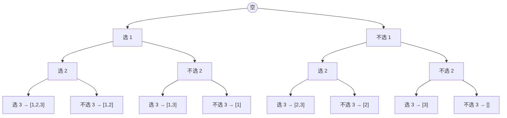

# 第 14 章 回溯算法
> 覆盖题号：17, 22, 37, 39, 40, 46, 47, 51, 52, 77, 78, 79, 90, 93, 131, 216, 282, 301, 306, 386

## 14.1 引子：走迷宫的人

想象你在一个岔路极多的迷宫里找出口：每到一个岔路口，选一条路往前走；走了一段发现是死胡同，就**原路退回**岔路口（退回时还要把沿路做的记号擦掉），换另一条路再试。如此反复，直到把所有岔路都试遍。

这个"走进去 → 走不通 → 退回来 → 换一条"的过程，就是**回溯（Backtracking）**。计算机不认识路，但它有一个人类没有的优点——**系统**：它会按固定顺序把每条路都试一遍，**不重不漏**。程序里的"岔路口"叫**决策点**，每一层递归对应决策树的一层；"原路退回"就是把刚做的选择**撤销（undo）**。

先用一个最简单的例子体会：生成所有 n 位二进制串。第 1 位可以填 0 或 1，第 2 位又可以填 0 或 1……把所有选择展开，就是一棵**决策树**，每个叶子是一个答案：

```text
           根
         /   \
        0     1
       / \   / \
     00  01 10  11      (n = 2 时 4 个叶子)
```

用回溯写出来只有十几行，注意看代码里的"三步"：

```python
def binary_strings(n):
    """回溯生成 n 位二进制串: 每个位置是决策树的一层, 每层两个分支 0/1"""
    res = []

    def backtrack(depth, path):
        if depth == n:                  # 已经选满 n 位: 到达叶子, 记录答案
            res.append("".join(path))
            return
        for ch in ("0", "1"):           # 选择列表: 这一位填 0 还是 1
            path.append(ch)             # ① 做选择
            backtrack(depth + 1, path)  # ② 递归(进入决策树下一层)
            path.pop()                  # ③ 撤销选择(回到岔路口, 试另一个分支)

    backtrack(0, [])
    return res


if __name__ == "__main__":
    assert binary_strings(1) == ["0", "1"]
    assert binary_strings(2) == ["00", "01", "10", "11"]
    assert binary_strings(3) == ["000", "001", "010", "011", "100", "101", "110", "111"]
    assert binary_strings(0) == [""]    # 边界: 0 位只有空串
    print("n=3 的决策树有 2^3=8 个叶子, 全部断言通过!")
```

从决策树看，回溯就是**深度优先遍历（DFS）**这棵树：一条路走到底（到叶子），再退回上一层换分支。`path.pop()` 这一行就是"退回岔路口时擦掉标记"。

回溯能解决什么题？凡是要**枚举所有可行方案**、又带一堆约束的题，基本都是它：子集、组合、排列、括号、IP 地址、N 皇后、数独……本章 20 道真题全部围绕这一个思想展开。

## 14.2 核心思想：选择、递归、撤销

### 14.2.1 回溯 = DFS + 剪枝

把回溯拆开看，是两个词的组合：

- **DFS**：深度优先地遍历"决策树"。每条"根 → 叶子"的路径，对应一组完整的选择序列（一个候选答案）。
- **剪枝（pruning）**：走了一半发现这条路**注定**不对（比如已经超过 target、已经用了重复元素），就提前回头，不再往深处走。剪枝决定回溯的快慢——不剪枝就是指数级硬枚举，剪得好能少走 90% 的节点。

回溯区别于普通递归的地方在于**撤销**这一步。普通递归把子问题的答案"向上返回"；回溯则是**一路共享同一条路径**（`path`），每深入一层就往 path 里塞一个选择，返回时再把它拿出来。如果不撤销，上一次分支留下的元素就会"残留"到下一次分支里，结果全乱。所以**"做选择 → 递归 → 撤销"三步必须成对出现**，这是回溯唯一需要死记的模板。

### 14.2.2 手推小例子：从 [1,2,3] 中选 2 个数

以"组合"为例手工走一遍。选择规则：**只能往后选**（选了 2 之后只能从 3 里选，不能回头选 1，否则 [1,2] 和 [2,1] 会重复）。决策树如下，剪掉的分支用点线标出：

```text
             []
        /     |     \
      [1]   [2]    [3]
     /   \    |      ┊
 [1,2] [1,3] [2,3]  (死路: 3 后面没得选, 凑不满 2 个)
```

换成"子集"问题（每个元素选或不选）时，决策树是一棵二叉树，叶子就是全部 8 个子集：



回溯就是在这棵树上做 DFS：走到叶子记录答案，走不下去就回头（撤销刚才的选择）。

按 DFS 顺序逐步推演：

| 步骤 | 当前 path | 可选项 | 动作 |
| --- | --- | --- | --- |
| 1 | [] | 1, 2, 3 | 选 1 → 递归 |
| 2 | [1] | 2, 3 | 选 2 → 递归 |
| 3 | [1,2] | — | 满 2 个，记录 [1,2]，返回 |
| 4 | [1] | 3 | 撤销 2，再选 3 → 递归 |
| 5 | [1,3] | — | 记录 [1,3]，返回 |
| 6 | [] | 2, 3 | 撤销 1，改选 2 → 递归 |
| 7 | [2] | 3 | 选 3 → [2,3]，返回后撤销 |
| 8 | [] | 3 | 选 3，发现后面没元素，死路剪掉 |

最终得到 [[1,2], [1,3], [2,3]]，不重不漏。注意步骤 4、6、8：每次返回都要"撤销"，否则 path 会越攒越多。

### 14.2.3 子集 / 组合 / 排列：回溯三兄弟

刷题时 90% 的回溯题都是这三兄弟的变体，它们的区别只有两个：**每个位置能选什么**、**什么时候算结束**：

| | 子集 | 组合 | 排列 |
| --- | --- | --- | --- |
| 要什么 | 所有子集 | 恰好 k 个元素的组合 | 所有排列（顺序敏感） |
| 顺序敏感吗 | 否 | 否 | 是 |
| 每个位置能选什么 | start 及之后的元素 | start 及之后的元素 | 所有没用过的元素 |
| 防重复手段 | start 下标只增不减 | start 下标只增不减 | used 数组 |
| 结束条件 | 每个节点都收集 | path 长度 == k | path 长度 == n |
| 典型题 | 78 / 90 | 77 / 39 / 40 / 216 | 46 / 47 |

- **子集**：每个节点都是答案（空集、单元素、双元素……全要），所以递归一进来就先收集。
- **组合**：只收集"长度恰好为 k"的叶子，其余与子集几乎一样（子集就是"所有长度的组合"）。
- **排列**：顺序敏感，[1,2] 和 [2,1] 是两个答案，所以每层都要从**所有没用过的元素**里选，用 `used` 数组标记。

### 14.2.4 去重三套路：start 下标 / used 数组 / 排序后跳过同层

"去重"是回溯最常见的坑。三种手段各管一件事：

| 套路 | 写法要点 | 原理 | 例题 |
| --- | --- | --- | --- |
| start 下标 | 递归传 `i + 1`（或 `i`） | 强制"只能往后选"，天然是组合序，不会出现 [2,1] 与 [1,2] 重复 | 78 / 77 / 39 |
| used 数组 | 用过打标记，递归后撤销 | 排列中同一元素不会在同一分支里被用两次 | 46 |
| 排序 + 同层跳过 | 先 `sort()`，再 `if i > start and nums[i] == nums[i-1]: continue` | 相同元素排序后相邻；在同一层只尝试第一个，其余跳过 | 90 / 40 / 47 |

第三种为什么叫"同层跳过"？以 90 题 `[1, 2, 2]` 为例：排序后两个 2 相邻。如果两个 2 都允许在**同一层**被选，就会产生 `[1, 2a]` 和 `[1, 2b]` 两个一模一样的子集。而 `i > start` 这个条件很关键：它只在**同一层**生效——上一层选过 2a 之后，下一层再选 2b 是合法的（这就是 `[2, 2]` 这个子集）。写成 `i > 0` 会误伤不同层的合法分支（详见 90 题易错点）。

47 题全排列的 used 数组有两种等价写法（讲在 47 题小节）：`not used[i-1]` 与 `used[i-1]` 分别保留"前一个相同元素"与"后一个"，结果集合相同、顺序不同，两种都 Accepted。

### 14.2.5 剪枝技巧：可行性剪枝与排序预处理

回溯的"剪枝"本质是**提前判断这条路没戏**。本章用到两类最重要的剪枝：

1. **可行性剪枝**：边做边算，一旦发现已经不可能满足约束就回头。比如 39 题组合总和：把候选**排序**后，`candidates[i] > remaining` 时直接 `break`——因为后面的候选更大，更不可能凑进剩余值。剩下不够凑满 k 个（77 题）、右括号数超过左括号（22 题）、空格无候选数字（37 题）都是同一思想。
2. **排序预处理**：排序不只服务于剪枝，还是"同层跳过"的前提——只有相同元素相邻，才能用"和上一个比"来识别重复（90 / 40 / 47）。所以**有重复元素的题，第一步永远是排序**。

## 14.3 算法流程

写任何回溯题，都按下面四步走：

1. **设计递归函数** `backtrack(路径, 选择列表)`：参数里既要有"当前走到哪了"（如 start、深度、剩余值），也要有"还能选什么"。
2. **写结束条件**：路径满足题目要求时记录答案（务必 `path[:]` 拷贝），然后返回。
3. **遍历选择列表**：对每个选择先做剪枝判断（不合法就 `continue`），然后执行"做选择 → 递归 → 撤销选择"三步。
4. **想清楚选择列表怎么收缩**：是 `start` 只增不减（子集/组合），还是 `used` 数组（排列），还是别的约束（如括号数、剩余值）。

统一模板（先记框架，再填三个可替换点）：

```text
def backtrack(路径, 选择列表):
    if 满足结束条件:
        记录答案(拷贝路径)
        return
    for 选择 in 选择列表:
        if 剪枝条件成立:          # 这条支路注定不行
            continue             # (有时是 break, 见 39 题)
        做选择: 把选择加入路径
        backtrack(新路径, 收缩后的选择列表)   # 递归进入决策树下一层
        撤销选择: 把选择从路径移除            # 回到岔路口, 试下一条路
```

## 14.4 复杂度分析

回溯的复杂度 = **决策树的节点数 × 每个节点的开销**。剪枝会大幅减少实际访问的节点，但**最坏情况下的复杂度不会变**，分析时按"不剪枝"来算：

- **子集**：每个元素"选/不选"两种可能，共 $2^n$ 个节点；每个节点收集答案要拷贝 path（最长 n 个元素）。时间 $O(n \cdot 2^n)$，答案本身占空间 $O(n \cdot 2^n)$，递归栈 $O(n)$。
- **组合** $C(n,k)$：叶子数为 $C(n,k)$，每片叶子拷贝 k 个元素，时间 $O(k \cdot C(n,k))$，空间 $O(k)$（不含答案）。
- **排列**：叶子数 $n!$，每片叶子拷贝 n 个元素，时间 $O(n \cdot n!)$，空间 $O(n)$。
- **棋盘类**（N 皇后、数独）：N 皇后逐行放置，第 i 行有 n 个选择，节点数约 $O(n!)$ 量级；数独每个空格最多 9 个候选，最坏 $O(9^{81})$，但现实中靠剪枝（MRV，见 37 题）几乎瞬间解出。

**一句话记忆**：子集看 $2^n$，排列看 $n!$，组合看 $C(n,k)$；空间主要是递归深度 + 答案存储。剪枝的好坏决定常数，复杂的剪枝（如 37 题的 MRV）能把指数级问题"砍"到可解。

## 14.5 Python 实现：统一模板实例化

把 14.3 的骨架实例化成两个典型：一个"无剪枝"（子集），一个"带可行性剪枝"（组合总和）。对比着看，三个可替换点分别填了什么：

```python
# 通用回溯骨架(先记框架, 再填三个可替换点):
#   def backtrack(路径, 选择列表):
#       if 结束条件: 记录答案; return
#       for 选择 in 选择列表:
#           if 剪枝条件: continue / break
#           做选择; backtrack(新路径, 新选择列表); 撤销选择

def subsets(nums):
    """实例一: 子集。结束条件=每个节点都收集; 选择列表=start 及之后; 剪枝=无"""
    res = []
    n = len(nums)

    def backtrack(start, path):
        res.append(path[:])                # 结束条件: 每个节点都是合法子集
        for i in range(start, n):          # 选择列表: 只能往后选(组合序)
            path.append(nums[i])           # ① 做选择
            backtrack(i + 1, path)         # ② 递归
            path.pop()                     # ③ 撤销

    backtrack(0, [])
    return res


def combination_sum(candidates, target):
    """实例二: 组合总和。剪枝=可行性剪枝(候选超过剩余值直接停)"""
    candidates = sorted(candidates)        # 排序: 剪枝的前提
    res = []
    n = len(candidates)

    def backtrack(start, path, remaining):
        if remaining == 0:                 # 结束条件: 正好凑够 target
            res.append(path[:])
            return
        for i in range(start, n):
            if candidates[i] > remaining:  # 剪枝: 最小的候选都超了, 后面更大, 全剪掉
                break
            path.append(candidates[i])     # 做选择(数字可重复用, 递归仍从 i 开始)
            backtrack(i, path, remaining - candidates[i])
            path.pop()                     # 撤销

    backtrack(0, [], target)
    return res


if __name__ == "__main__":
    assert subsets([1, 2, 3]) == [[], [1], [1, 2], [1, 2, 3], [1, 3], [2], [2, 3], [3]]
    assert subsets([]) == [[]]                          # 边界: 空集
    assert combination_sum([2, 3, 6, 7], 7) == [[2, 2, 3], [7]]
    assert combination_sum([2, 3, 5], 8) == [[2, 2, 2, 2], [2, 3, 3], [3, 5]]
    assert combination_sum([2], 1) == []                # 边界: 无解
    print("通用骨架两个实例验证通过!")
```

## 14.6 LeetCode 真题精讲

下面 20 道题按"子集与组合 → 排列 → 字符串生成 → 网格搜索 → 棋盘类 → 难题攻坚"六个梯度展开。前两组是模板的直接套用，务必先吃透；后面是在模板上叠加剪枝和技巧。

### 第一组：子集与组合（78 / 90 / 77 / 39 / 40 / 216）

### 78. 子集（中等）

**题意**：给一个无重复元素的数组 `nums`，返回所有可能的子集（幂集），顺序不限。

**思路**：三兄弟里的"子集"——**每个节点都收集**。从空集出发，每次只能选 `start` 及之后的元素，保证不会产生 `[1,2]` 和 `[2,1]` 这样的重复。手工推演 `[1,2,3]`：先收集 `[]`，然后依次收集 `[1]`、`[1,2]`、`[1,2,3]`、`[1,3]`、`[2]`、`[2,3]`、`[3]`——正好 8 个。

```python
def subsets(nums):
    """78. 子集: 每个节点都是一个答案, start 保证组合序"""
    res = []
    n = len(nums)

    def backtrack(start, path):
        res.append(path[:])                 # 关键: 拷贝, 不能直接 append(path)
        for i in range(start, n):
            path.append(nums[i])
            backtrack(i + 1, path)
            path.pop()

    backtrack(0, [])
    return res


if __name__ == "__main__":
    assert subsets([1, 2, 3]) == [[], [1], [1, 2], [1, 2, 3], [1, 3], [2], [2, 3], [3]]
    assert subsets([]) == [[]]              # 边界: 空集只有空子集
    assert subsets([1]) == [[], [1]]        # 边界: 单元素
    print("78. 子集 全部断言通过!")
```

**复杂度分析**：时间 $O(n \cdot 2^n)$（$2^n$ 个节点，每个拷贝 path 最多 n 个元素），空间 $O(n \cdot 2^n)$ 存答案 + $O(n)$ 递归栈。

**易错点**：
- `res.append(path[:])` 必须拷贝：`path` 是全程共享的同一个列表，直接 `append(path)` 存的是引用，最后所有结果都会变成同一个最终状态。
- 忘记 `start` 限制会重复：不传 start 或传 0，就会同时出现 [1,2] 和 [2,1]。

### 90. 子集 II（中等）

**题意**：同 78 题，但数组**含重复元素**，返回的子集不能重复。

**思路**：有重复元素 → **先排序**，再在"同一层"跳过相同元素。以 `[1,2,2]` 为例，排序后两个 2 相邻：同一层里第二个 2 和第一个 2 产生的结果完全一样（`[1,2]` vs `[1,2]`），所以跳过；但上一层选过第一个 2 后，下一层再选第二个 2 得到 `[2,2]` 是合法的——这正是 `i > start` 存在的意义。

```python
def subsets_with_dup(nums):
    """90. 子集 II: 先排序, 再"同层跳过相同元素"去重"""
    nums.sort()
    res = []
    n = len(nums)

    def backtrack(start, path):
        res.append(path[:])
        for i in range(start, n):
            if i > start and nums[i] == nums[i - 1]:
                continue                  # 同层跳过: 相同元素只取第一个
            path.append(nums[i])
            backtrack(i + 1, path)
            path.pop()

    backtrack(0, [])
    return res


if __name__ == "__main__":
    assert subsets_with_dup([1, 2, 2]) == [[], [1], [1, 2], [1, 2, 2], [2], [2, 2]]
    assert subsets_with_dup([2, 2, 2]) == [[], [2], [2, 2], [2, 2, 2]]  # 边界: 全相同
    assert subsets_with_dup([]) == [[]]                                  # 边界: 空集
    print("90. 子集 II 全部断言通过!")
```

**复杂度分析**：同 78 题，最坏 $O(n \cdot 2^n)$；去重只是减少实际枚举，不改变量级。

**易错点**：
- 跳过条件必须是 `i > start`，不能写成 `i > 0`：`i > 0` 会把不同层的合法分支也剪掉，例如 `[2, 2]` 这个子集（第二层的 2 和第一层的 2 相等但不同层）会被误删。
- 必须先 `sort()` 再跳过：不排序，相同元素不相邻，"和上一个比"就识别不出重复。

### 77. 组合（中等）

**题意**：给定 n 和 k，返回 1 到 n 中所有 k 个数的组合。

**思路**：子集的"定量版"——只收集长度恰好为 k 的节点。除了结束条件从"每个节点"变成"满 k 个"，其余完全一样。可以加一条**可行性剪枝**：如果当前 path 长度加上剩余可选元素都不足 k 个，这条路再走也凑不满，直接 `break`。

```python
def combine(n, k):
    """77. 组合: 从 1..n 选 k 个, start 只增不减 + 凑不满就剪枝"""
    res = []

    def backtrack(start, path):
        if len(path) == k:                # 结束条件: 选满 k 个
            res.append(path[:])
            return
        for i in range(start, n + 1):
            if len(path) + (n - i + 1) < k:
                break                     # 剪枝: 剩下的元素凑不满 k 个
            path.append(i)
            backtrack(i + 1, path)
            path.pop()

    backtrack(1, [])
    return res


if __name__ == "__main__":
    assert combine(4, 2) == [[1, 2], [1, 3], [1, 4], [2, 3], [2, 4], [3, 4]]
    assert combine(1, 1) == [[1]]                          # 边界: 单元素
    assert combine(4, 0) == [[]]                           # 边界: k=0 只有空组合
    assert combine(2, 3) == []                             # 边界: k > n 无解
    print("77. 组合 全部断言通过!")
```

**复杂度分析**：叶子数 $C(n,k)$，时间 $O(k \cdot C(n,k))$，空间 $O(k)$（不含答案）。

**易错点**：
- 数字范围是 `range(start, n + 1)`，`n` 要加一。
- 剪枝条件 `len(path) + (n - i + 1) < k`：`n - i + 1` 是"从 i 到 n 还有几个数"，加上已选的不够 k 就直接停；写错成 `<=` 会丢掉刚好凑满的答案。

### 39. 组合总和（中等）

**题意**：给一个无重复元素的候选数组 `candidates` 和 target，找出所有和为 target 的组合；**每个数字可以无限次使用**。

**思路**：和 77 的区别只有一个——**数字可重复用**，所以递归时传 `i` 而不是 `i + 1`（这一层选了 `candidates[i]`，下一层还能再选它）。再叠加**排序 + 可行性剪枝**：先排序，一旦 `candidates[i] > remaining` 就 `break`，因为后面的更大更不可能。手工推演 `[2,3,6,7]` target=7：选 2 → 剩 5 → 再选 2 → 剩 3 → 再选 2 会超过，改选 3 恰好凑满，得到 `[2,2,3]`；跳过 6 后选 7 得到 `[7]`。

```python
def combination_sum(candidates, target):
    """39. 组合总和: 数字可重复使用(递归传 i) + 排序后可行性剪枝"""
    candidates = sorted(candidates)
    res = []
    n = len(candidates)

    def backtrack(start, path, remaining):
        if remaining == 0:                 # 结束条件: 正好凑满
            res.append(path[:])
            return
        for i in range(start, n):
            if candidates[i] > remaining:  # 可行性剪枝: 候选超过剩余值, 后面更大, 全剪
                break
            path.append(candidates[i])
            backtrack(i, path, remaining - candidates[i])   # 传 i: 允许重复使用
            path.pop()

    backtrack(0, [], target)
    return res


if __name__ == "__main__":
    assert combination_sum([2, 3, 6, 7], 7) == [[2, 2, 3], [7]]
    assert combination_sum([2, 3, 5], 8) == [[2, 2, 2, 2], [2, 3, 3], [3, 5]]
    assert combination_sum([2], 1) == []                     # 边界: 无解
    assert combination_sum([2], 0) == [[]]                   # 边界: target=0 只有空组合
    print("39. 组合总和 全部断言通过!")
```

**复杂度分析**：每个节点分支数为 n、深度约为 target / min(candidates)，最坏 $O(n^{target/m})$（m 为最小候选）；剪枝后实际远小于此。空间 $O(target/m)$ 递归深度 + 答案。

**易错点**：
- 递归传 `i` 不是 `i + 1`：这是"可重复使用"的开关，写错就变成 40 题（每个用一次）。
- 剪枝必须建立在排序之上：不排序，`break` 就漏答案（后面可能还有更小的数）。

### 40. 组合总和 II（中等）

**题意**：同 39 题，但候选数组**含重复元素**，且**每个数字只能用一次**，组合不能重复。

**思路**：39 + 90 的结合体：每个数字只能用一次 → 递归传 `i + 1`；有重复 → 排序 + 同层跳过。三步走：排序 → 剪枝（超剩余值 break）→ 同层去重（`i > start and nums[i] == nums[i-1]`）。手工推演 `[10,1,2,7,6,1,5]` target=8：排序成 `[1,1,2,5,6,7,10]`，第一个 1 正常用，第二个 1 在同一层被跳过（避免 `[1,2,5]` 出现两次），但 `[1,1,6]` 里的两个 1 是不同层的，合法。

```python
def combination_sum2(candidates, target):
    """40. 组合总和 II: 每个数字用一次(i+1) + 排序 + 同层去重"""
    candidates = sorted(candidates)
    res = []
    n = len(candidates)

    def backtrack(start, path, remaining):
        if remaining == 0:
            res.append(path[:])
            return
        for i in range(start, n):
            if candidates[i] > remaining:
                break                     # 可行性剪枝
            if i > start and candidates[i] == candidates[i - 1]:
                continue                  # 同层去重
            path.append(candidates[i])
            backtrack(i + 1, path, remaining - candidates[i])   # i+1: 每个只能用一次
            path.pop()

    backtrack(0, [], target)
    return res


if __name__ == "__main__":
    assert combination_sum2([10, 1, 2, 7, 6, 1, 5], 8) == [[1, 1, 6], [1, 2, 5], [1, 7], [2, 6]]
    assert combination_sum2([1, 1, 1], 2) == [[1, 1]]          # 边界: 全相同
    assert combination_sum2([2], 1) == []                      # 边界: 无解
    assert combination_sum2([1], 1) == [[1]]                   # 边界: 单元素
    print("40. 组合总和 II 全部断言通过!")
```

**复杂度分析**：最坏仍是 $O(2^n)$ 量级（每个元素选/不选），但剪枝 + 去重后实际快得多。空间 $O(n)$ 递归深度 + 答案。

**易错点**：
- 两个判断的顺序：先 `break`（可行性）再 `continue`（去重）——超了直接停，去重与否无所谓。
- 同层去重的 `i > start` 别忘了：写成 `i > 0` 会把 `[1,1,6]` 这种"两个相同数在不同层"的合法组合剪掉。

### 216. 组合总和 III（中等）

**题意**：找出所有由 k 个数字组成、和为 n 的组合，数字只能取 1~9 且每个最多用一次。

**思路**：40 题的简化版：数字池固定为 1..9、无重复，所以只需"从 start 往后选 + 剪枝"。剪枝点：`i > remaining` 直接 break（可行性）。结束条件先判数量，满 k 再看和。

```python
def combination_sum3(k, n):
    """216. 组合总和 III: 从 1..9 选 k 个和为 n, 每个用一次"""
    res = []

    def backtrack(start, path, remaining):
        if len(path) == k:                # 结束条件: 先判数量
            if remaining == 0:
                res.append(path[:])
            return
        for i in range(start, 10):
            if i > remaining:             # 剪枝: 数字超过剩余和, 后面更大, 停
                break
            path.append(i)
            backtrack(i + 1, path, remaining - i)
            path.pop()

    backtrack(1, [], n)
    return res


if __name__ == "__main__":
    assert combination_sum3(3, 7) == [[1, 2, 4]]
    assert combination_sum3(3, 9) == [[1, 2, 6], [1, 3, 5], [2, 3, 4]]
    assert combination_sum3(4, 1) == []                     # 边界: 凑不够
    assert combination_sum3(1, 9) == [[9]]                  # 边界: 单数字
    assert combination_sum3(9, 45) == [[1, 2, 3, 4, 5, 6, 7, 8, 9]]  # 边界: 全取
    print("216. 组合总和 III 全部断言通过!")
```

**复杂度分析**：数字池只有 9 个，最多 $C(9,k)$ 种组合，时间 $O(C(9,k))$，可视为常数级。

**易错点**：
- 结束条件**先判 `len(path) == k` 再判 `remaining == 0`**：k 没满但和已超 0 的情况交给剪枝处理，别把两个条件写反。
- 数字范围 1~9，`range(start, 10)` 别写成 `range(start, n)`——n 是目标和，不是数字池上限。

### 第二组：排列（46 / 47）

### 46. 全排列（中等）

**题意**：给一个无重复元素的数组，返回所有排列。

**思路**：三兄弟里唯一"顺序敏感"的：`[1,2]` 和 `[2,1]` 是两个答案，所以每层都要从**所有还没用过的元素**里选——用 `used` 数组标记。结束条件是 path 满 n。手工推演 `[1,2,3]`：第一层选 1，第二层在 {2,3} 里选 2 得 `[1,2,3]`，退回再选 3 得 `[1,3,2]`；然后第一层改选 2、3……共 6 个。

```python
def permute(nums):
    """46. 全排列: 选择列表=所有没用过的元素, used 数组标记"""
    res = []
    n = len(nums)
    used = [False] * n

    def backtrack(path):
        if len(path) == n:                # 结束条件: 排满 n 个
            res.append(path[:])
            return
        for i in range(n):                # 每层都能选任意位置
            if used[i]:
                continue                  # 用过的不能再选
            used[i] = True                # 做选择: 打标记
            path.append(nums[i])
            backtrack(path)               # 递归
            path.pop()                    # 撤销
            used[i] = False               # 撤销标记(与 path 同步!)

    backtrack([])
    return res


if __name__ == "__main__":
    assert permute([1, 2, 3]) == [[1, 2, 3], [1, 3, 2], [2, 1, 3], [2, 3, 1], [3, 1, 2], [3, 2, 1]]
    assert permute([1]) == [[1]]          # 边界: 单元素
    assert permute([]) == [[]]            # 边界: 空数组
    print("46. 全排列 全部断言通过!")
```

**复杂度分析**：叶子数 $n!$，时间 $O(n \cdot n!)$，空间 $O(n)$ 递归 + used + 答案。

**易错点**：
- `used` 标记必须和 `path` **同步撤销**：`path.pop()` 后忘了 `used[i] = False`，下一次递归会以为该元素还在用，导致漏解。
- 每层循环都从 0 开始（不是 start）：排列和组合的根本区别就在这。

### 47. 全排列 II（中等）

**题意**：同 46 题，但数组**含重复元素**，返回不重复的排列。

**思路**：46 + 排序 + 同层去重。排序后，在同一层遇到和前一个相同的元素就跳过。判断"同层"的经典写法是看**前一个相同元素是否还在 used 状态**——如果 `used[i-1]` 为 False，说明前一个相同元素在这一层刚被撤销过（即这一层已经试过它），再试当前这个就是重复；如果 `used[i-1]` 为 True，说明前一个相同元素在更上层，当前这个可以正常使用。两种等价写法：

- 写法 A：`if i > 0 and nums[i] == nums[i-1] and not used[i-1]: continue`
- 写法 B：`if i > 0 and nums[i] == nums[i-1] and used[i-1]: continue`

写法 A 保留"同值元素中第一个"，写法 B 保留"最后一个"，结果集合完全一样、只是输出顺序不同，两种都 Accepted。下面用写法 A。

```python
def permute_unique(nums):
    """47. 全排列 II: 排序 + used 数组 + 同层去重"""
    nums.sort()
    res = []
    n = len(nums)
    used = [False] * n

    def backtrack(path):
        if len(path) == n:
            res.append(path[:])
            return
        for i in range(n):
            if used[i]:
                continue
            if i > 0 and nums[i] == nums[i - 1] and not used[i - 1]:
                continue                  # 同层去重: 前一个相同元素不在使用中
            used[i] = True
            path.append(nums[i])
            backtrack(path)
            path.pop()
            used[i] = False

    backtrack([])
    return res


if __name__ == "__main__":
    assert permute_unique([1, 1, 2]) == [[1, 1, 2], [1, 2, 1], [2, 1, 1]]
    assert permute_unique([2, 2, 2]) == [[2, 2, 2]]      # 边界: 全相同只有一种
    assert permute_unique([]) == [[]]                    # 边界: 空数组
    print("47. 全排列 II 全部断言通过!")
```

**复杂度分析**：最坏 $O(n \cdot n!)$（无重复时退化为 46 题），空间 $O(n)$ + 答案。

**易错点**：
- 必须先排序：`nums[i] == nums[i-1]` 依赖相同元素相邻。
- 写法 A 里是 `not used[i-1]` 才跳过，写法 B 里是 `used[i-1]` 才跳过——**两者取反，别记混**；想不清楚时用手推 `[1,1,2]` 验证一遍。

### 第三组：字符串生成（17 / 22 / 93 / 131 / 306 / 386）

### 17. 电话号码的字母组合（中等）

**题意**：给一个只含 2~9 的字符串，每个数字对应一组字母（电话键盘），返回所有可能的字母组合。

**思路**：这就是"每层选一个字母"的决策树：第 i 层的选择列表是 `digits[i]` 对应的字母串。结束条件是 i 走到末尾。手工推演 `"23"`：第一层从 {a,b,c} 选一个，第二层从 {d,e,f} 选一个，共 $3 \times 3 = 9$ 种。

```python
def letter_combinations(digits):
    """17. 电话号码的字母组合: 第 i 层从 digits[i] 对应字母里选一个"""
    if not digits:
        return []
    mapping = {"2": "abc", "3": "def", "4": "ghi", "5": "jkl",
               "6": "mno", "7": "pqrs", "8": "tuv", "9": "wxyz"}
    res = []

    def backtrack(i, path):
        if i == len(digits):              # 结束条件: 每一位都选好了
            res.append("".join(path))
            return
        for ch in mapping[digits[i]]:     # 选择列表: 当前数字的字母
            path.append(ch)
            backtrack(i + 1, path)
            path.pop()

    backtrack(0, [])
    return res


if __name__ == "__main__":
    assert letter_combinations("23") == ["ad", "ae", "af", "bd", "be", "bf", "cd", "ce", "cf"]
    assert letter_combinations("") == []                    # 边界: 空串
    assert letter_combinations("2") == ["a", "b", "c"]      # 边界: 单个数字
    assert len(letter_combinations("79")) == 16             # 4 * 4 = 16
    print("17. 电话号码的字母组合 全部断言通过!")
```

**复杂度分析**：设每个数字平均 3~4 个字母、共 n 位，时间 $O(4^n \cdot n)$（结果拼接），空间 $O(n)$ + 答案。

**易错点**：
- 空串返回 `[]` 而不是 `[""]`：一个字母都没得选时答案应是空列表（题目的坑）。
- 用 `path` 列表收集字符、最后 `"".join(path)`，比每次字符串拼接 `path + ch` 高效（后者每次 O(n) 拷贝）。

### 22. 括号生成（中等）

**题意**：给 n，生成所有由 n 对括号组成的合法括号串（如 n=3 有 5 个）。

**思路**：不枚举所有 $2^{2n}$ 个括号串再筛（太慢），而是把"合法性"变成**约束直接剪枝**：任意前缀里，左括号数 ≥ 右括号数，且左括号总数不超过 n。于是递归时只要两个计数：还可以放几个左括号（left < n 才能放 `"("`）、右括号不能超过已放的左括号（right < left 才能放 `")"`）。手工推演 n=2：`(()), ()()`。

```python
def generate_parenthesis(n):
    """22. 括号生成: 用"左括号数 >= 右括号数"约束剪枝"""
    res = []

    def backtrack(path, left, right):
        if len(path) == 2 * n:            # 结束条件: 放满 2n 个
            res.append("".join(path))
            return
        if left < n:                      # 还能放左括号
            path.append("(")
            backtrack(path, left + 1, right)
            path.pop()
        if right < left:                  # 右括号不能超过已放的左括号
            path.append(")")
            backtrack(path, left, right + 1)
            path.pop()

    backtrack([], 0, 0)
    return res


if __name__ == "__main__":
    assert generate_parenthesis(3) == ["((()))", "(()())", "(())()", "()(())", "()()()"]
    assert generate_parenthesis(1) == ["()"]              # 边界: 一对括号
    assert generate_parenthesis(0) == [""]                # 边界: 0 对括号只有空串
    print("22. 括号生成 全部断言通过!")
```

**复杂度分析**：合法括号串个数是卡特兰数 $C_n = \frac{1}{n+1}\binom{2n}{n}$，时间 $O(C_n \cdot n)$，空间 $O(n)$ + 答案。

**易错点**：
- 右括号的放行条件 `right < left`，不是 `right < n`：后者会生成 `"())("` 这类非法串。
- 结束条件用 `len(path) == 2 * n`，别漏掉最后一步的右括号。

### 93. 复原 IP 地址（中等）

**题意**：给一个只含数字的字符串，还原成所有合法的 IP 地址（4 段，每段 0~255，不能有前导零）。

**思路**：把字符串切成 4 段——`start` 表示当前切到哪，`path` 存已切出的段。每段长度 1~3，两个剪枝：段长 >1 且以 "0" 开头（前导零）→ **break**（更长的段也还是前导零）；`int(seg) > 255` → `continue`。结束条件是切满 4 段且刚好用完整个串。手工推演 `"25525511135"`：`255.255.11.135`、`255.255.111.35` 两个答案。

```python
def restore_ip_addresses(s):
    """93. 复原 IP 地址: 切成 4 段, 每段 1~3 位, 无前导零, 值 <= 255"""
    res = []
    n = len(s)

    def backtrack(start, path):
        if len(path) == 4:                # 结束条件: 切满 4 段
            if start == n:
                res.append(".".join(path))
            return
        for end in range(start + 1, min(start + 3, n) + 1):
            seg = s[start:end]
            if len(seg) > 1 and seg[0] == "0":
                break                     # 前导零: 再长的段也还是前导零, 直接停
            if int(seg) > 255:
                continue
            path.append(seg)
            backtrack(end, path)
            path.pop()

    backtrack(0, [])
    return res


if __name__ == "__main__":
    assert set(restore_ip_addresses("25525511135")) == {"255.255.11.135", "255.255.111.35"}
    assert restore_ip_addresses("0000") == ["0.0.0.0"]        # 边界: 全零
    assert set(restore_ip_addresses("101023")) == {
        "1.0.10.23", "1.0.102.3", "10.1.0.23", "10.10.2.3", "101.0.2.3"}
    assert restore_ip_addresses("") == []                     # 边界: 空串
    print("93. 复原 IP 地址 全部断言通过!")
```

**复杂度分析**：每段最多 3 种切法、共 4 段，状态数常数级（$3^4$），时间可视为 $O(1)$ 量级；空间 $O(4)$ + 答案。

**易错点**：
- 前导零必须 `break` 而不是 `continue`：段长 2 以 "0" 开头，段长 3 也必然以 "0" 开头，后面没得试。
- `end` 的上界是 `min(start + 3, n)`：别让切片越界，也别让单段超过 3 位。

### 131. 分割回文串（中等）

**题意**：给一个字符串，把它分割成若干子串，使每个子串都是回文串，返回所有分割方案。

**思路**：又是"切段"问题，只是合法性从"IP 段规则"变成"是回文"。`start` 表示当前起点，枚举终点 end，若 `s[start:end]` 是回文就切一刀递归。结束条件是 start 走到末尾。手工推演 `"aab"`：先切 "a"，剩 "ab" 再切 "a","b" 得 `["a","a","b"]`；回到开头切 "aa"，剩 "b" 得 `["aa","b"]`。

```python
def partition(s):
    """131. 分割回文串: 切出的每段都必须是回文"""
    res = []
    n = len(s)

    def backtrack(start, path):
        if start == n:                    # 结束条件: 整串切完
            res.append(path[:])
            return
        for end in range(start + 1, n + 1):
            seg = s[start:end]
            if seg != seg[::-1]:          # 不是回文就换更长的段
                continue
            path.append(seg)              # 是回文, 切这一刀
            backtrack(end, path)
            path.pop()

    backtrack(0, [])
    return res


if __name__ == "__main__":
    assert partition("aab") == [["a", "a", "b"], ["aa", "b"]]
    assert partition("a") == [["a"]]                      # 边界: 单字符
    assert partition("") == [[]]                          # 边界: 空串
    assert partition("aa") == [["a", "a"], ["aa"]]        # 边界: 全相同
    print("131. 分割回文串 全部断言通过!")
```

**复杂度分析**：n 个字符有 $2^{n-1}$ 种切法，最坏 $O(n \cdot 2^n)$（每段判断回文 O(n)），空间 $O(n)$ + 答案。可优化：预处理回文表（DP）把判断降到 O(1)，但 n 很小时没必要。

**易错点**：
- 回文判断 `seg != seg[::-1]` 注意边界：`end` 要取到 `n + 1`（含末尾），否则漏掉最后一段。
- 收集答案时 `path[:]` 拷贝，理由同 78 题。

### 306. 累加数（中等）

**题意**：判断一个数字字符串是否"累加序列"：除前两个数外，每个数都等于前两个数之和，且整个串恰好被这些数完整覆盖（至少 3 个数，不能有前导零）。

**思路**：先随便拆前两个数，之后每段必须严格等于前两段之和。关键技巧：**手写字符串加法** `add(a, b)` 模拟竖式进位——Python 的 `int` 本来不会溢出，这里演示的是"大数场景下不转整数"的通用写法（面试加分）。两个剪枝：前导零（段长 >1 以 "0" 开头）→ break；当前段比"应有的和"还长 → break（数值必然更大，不可能相等）。手工推演 `"112358"`：1, 1, 2, 3, 5, 8——每一步都满足"前两数之和"，返回 True。

```python
def is_additive_number(num):
    """306. 累加数: 手写字符串加法避免大数问题 + 前导零/长度剪枝"""
    n = len(num)

    def add(a, b):
        """字符串加法(竖式进位), 避免转成超大整数"""
        i, j = len(a) - 1, len(b) - 1
        carry = 0
        out = []
        while i >= 0 or j >= 0 or carry:
            d = carry
            if i >= 0:
                d += ord(a[i]) - 48
                i -= 1
            if j >= 0:
                d += ord(b[j]) - 48
                j -= 1
            carry, d = divmod(d, 10)
            out.append(chr(d + 48))
        return "".join(reversed(out))

    def dfs(start, prev1, prev2, cnt):
        if start == n:
            return cnt >= 3               # 至少三个数
        for end in range(start + 1, n + 1):
            part = num[start:end]
            if len(part) > 1 and part[0] == "0":
                break                     # 前导零剪枝
            if cnt < 2:                   # 前两个数随意定
                if dfs(end, prev2, part, cnt + 1):
                    return True
            else:
                expect = add(prev1, prev2)
                if part == expect:
                    if dfs(end, prev2, part, cnt + 1):
                        return True
                elif len(part) > len(expect):
                    break                 # 段更长, 数值必然更大, 不可能相等
        return False                      # 所有切法都不满足

    return dfs(0, "", "", 0)


if __name__ == "__main__":
    assert is_additive_number("112358") is True
    assert is_additive_number("199100199") is True
    assert is_additive_number("1023") is False            # 1+0=1!=2, 10+2=12!=3, "02" 前导零非法
    assert is_additive_number("0") is False               # 边界: 单个数不够三个
    assert is_additive_number("12") is False              # 边界: 只有两个数
    assert is_additive_number("111") is False             # 1+1=2 != 1, 切不出三个数
    assert is_additive_number("11235813") is True         # 更长序列: 5+8=13
    print("306. 累加数 全部断言通过!")
```

**复杂度分析**：前两个数的切法共 $O(n^2)$ 种，每种向后验证 O(n) 段、每段加法 O(n)，总时间 $O(n^3)$（n ≤ 35，完全够用）；空间 $O(n)$ 递归深度。

**易错点**：
- 前导零判断要在切段循环里用 `break`（更长的段同样前导零）。
- "至少三个数"的条件 `cnt >= 3` 别漏：`"12"` 这种只有两个数的串不是累加数。
- 字符串加法里 `reversed(out)` 别忘——竖式从低位加到高位，结果是反的。

### 386. 字典序排数（中等）

**题意**：给整数 n，按字典序返回 1 到 n 的所有整数（如 n=13：`[1,10,11,12,13,2,...,9]`）。

**思路**：字典序的本质是"数字树"的 DFS：1 的孩子是 10~19（不超过 n），10 的孩子是 100~109……也就是 **cur 的孩子是 `cur*10 .. cur*10+9`**。从 1~9 出发深搜，先走到"叶子"（超过 n 为止）再回溯换兄弟，天然就是字典序。手工推演 n=13：1 → 10, 11, 12, 13 → 回到 2 → ... → 9。

```python
def lexical_order(n):
    """386. 字典序排数: 数字树 DFS, cur 的孩子是 cur*10 .. cur*10+9"""
    res = []

    def dfs(cur):
        res.append(cur)
        for nxt in range(cur * 10, min(cur * 10 + 9, n) + 1):
            dfs(nxt)                      # 孩子: cur 后面接 0~9

    for start in range(1, 10):
        if start > n:
            break
        dfs(start)
    return res


if __name__ == "__main__":
    assert lexical_order(13) == [1, 10, 11, 12, 13, 2, 3, 4, 5, 6, 7, 8, 9]
    assert lexical_order(1) == [1]                        # 边界: 只有 1
    r25 = lexical_order(25)
    assert r25[:12] == [1, 10, 11, 12, 13, 14, 15, 16, 17, 18, 19, 2]
    assert len(r25) == 25 and sorted(r25) == list(range(1, 26))
    print("386. 字典序排数 全部断言通过!")
```

**复杂度分析**：每个数恰好访问一次，时间 $O(n)$，空间 $O(n)$（答案）+ $O(\log n)$ 递归深度（数字树高度约 $\log_{10} n$）。

**易错点**：
- 孩子范围上限 `min(cur * 10 + 9, n)`：超过 n 的孩子不能生成，别写成裸上限 `cur * 10 + 9`（会访问超范围数字）。
- 起点是 1~9，从 0 开始没有意义（字典序里没有前导零）。

### 第四组：网格搜索（79）

### 79. 单词搜索（中等）

**题意**：在 `m x n` 的字母矩阵中，找是否存在一条路径能拼出单词 `word`（相邻格上下左右移动，同一格不能用两次）。

**思路**：每个格子作为起点做 DFS，向四个方向延伸，匹配 word 的第 k 个字符。用**原地标记**代替 visited 数组：进入格子时把 `board[i][j]` 临时改成 `"#"`，返回时恢复——省一个二维数组。剪枝：越界、字符不匹配、k 已到末尾。手工推演标准样例：`ABCCED` 从 (0,0) 的 A 出发，A→B→C→C→E→D 一路走通。

```python
def exist(board, word):
    """79. 单词搜索: 每个格子作起点, 四方向 DFS + 原地标记访问"""
    if not board or not board[0]:
        return False
    m, n = len(board), len(board[0])

    def dfs(i, j, k):
        if k == len(word):                # 结束条件: 单词全部匹配
            return True
        if not (0 <= i < m and 0 <= j < n) or board[i][j] != word[k]:
            return False                  # 剪枝: 越界或字符不匹配
        tmp = board[i][j]
        board[i][j] = "#"                 # 原地标记: 防止同一条路径绕圈
        found = (dfs(i + 1, j, k + 1) or dfs(i - 1, j, k + 1)
                 or dfs(i, j + 1, k + 1) or dfs(i, j - 1, k + 1))
        board[i][j] = tmp                 # 撤销标记
        return found

    for i in range(m):
        for j in range(n):
            if dfs(i, j, 0):
                return True
    return False


if __name__ == "__main__":
    board = [["A", "B", "C", "E"],
             ["S", "F", "C", "S"],
             ["A", "D", "E", "E"]]
    assert exist(board, "ABCCED") is True
    assert exist(board, "SEE") is True
    assert exist(board, "ABCB") is False
    assert exist([["a"]], "a") is True                    # 边界: 单格单字符
    assert exist([["a"]], "b") is False                   # 边界: 单格不匹配
    print("79. 单词搜索 全部断言通过!")
```

**复杂度分析**：每个起点最多 4 个方向、路径最长 len(word)，时间 $O(m \times n \times 4^{L})$（L 为单词长度），空间 $O(L)$ 递归栈。

**易错点**：
- 标记必须**撤销**：`board[i][j] = tmp` 在四个方向的 DFS 之后执行，漏掉会让不同路径互相"看不见"格子。
- 边界检查放在字符比较之前：先判越界再取 `board[i][j]`，顺序反了会 IndexError。
- 空矩阵/空行要判空（`not board[0]`）。

### 第五组：棋盘类（51 / 52 / 37）

### 51. N 皇后（困难）

**题意**：n×n 棋盘上放 n 个皇后，任意两个不能在同一行、同一列或同一对角线上，返回所有摆法（棋盘用 `"Q"`/`"."` 表示）。

**思路**：逐行放皇后（天然解决"同行"约束），需要 O(1) 判断"同列"和"两条对角线"。用三个集合：

- `cols`：已占用的列；
- `diag1`：主对角线（左上↘右下），这条线上的格子满足 **row - col 恒定**；
- `diag2`：副对角线（右上↙左下），满足 **row + col 恒定**。

放皇后时若 `col`、`row-col`、`row+col` 任一已在集合中则剪枝。手工推演 n=4 的第一行放 (0,1)：第二行只能试 (1,3)，第三行 (2,0)，第四行 (3,2)——形成唯一解，另一个解由对称得到。

```python
def solve_n_queens(n):
    """51. N 皇后: 逐行放置, cols/diag1/diag2 三个集合 O(1) 判冲突"""
    res = []
    cols = set()        # 已占用的列
    diag1 = set()       # 主对角线: row - col 恒定
    diag2 = set()       # 副对角线: row + col 恒定

    def backtrack(row, board):
        if row == n:                      # 结束条件: 放满 n 行
            res.append(["".join(r) for r in board])
            return
        for col in range(n):
            if col in cols or (row - col) in diag1 or (row + col) in diag2:
                continue                  # 剪枝: 列/两条对角线冲突
            cols.add(col)
            diag1.add(row - col)
            diag2.add(row + col)
            board[row][col] = "Q"
            backtrack(row + 1, board)
            board[row][col] = "."         # 撤销
            cols.remove(col)
            diag1.remove(row - col)
            diag2.remove(row + col)

    board = [["."] * n for _ in range(n)]
    backtrack(0, board)
    return res


if __name__ == "__main__":
    assert len(solve_n_queens(4)) == 2
    assert solve_n_queens(1) == [["Q"]]               # 边界: 1x1
    assert len(solve_n_queens(8)) == 92               # 已知: 8 皇后共 92 种
    print("51. N 皇后 全部断言通过!")
```

**复杂度分析**：第 i 行有 n 个选择，剪枝后实际有效分支远少，节点数约为 $O(n!)$ 量级；时间 $O(n!)$，空间 $O(n)$（三个集合 + 递归栈）+ 答案。

**易错点**：
- 对角线判定用 `row - col` / `row + col`：主对角线上两点满足 `row1 - col1 == row2 - col2`。
- `row - col` 可能是负数，没关系，集合存的是"差值"本身，不是下标。
- 撤销时要**三个集合都 remove**，漏一个就会误伤后面的分支。

### 52. N 皇后 II（困难）

**题意**：同 51 题，但只返回**方案数**，不需要棋盘。

**思路**：51 题的"计数版"：去掉棋盘数组，只保留三个集合和一个计数器，递归逻辑一模一样。用 `nonlocal count` 在嵌套函数里修改外层计数。n=4 答案是 2，n=8 是 92（n=1 是 1）。

```python
def total_n_queens(n):
    """52. N 皇后 II: 只计数, 不存棋盘"""
    count = 0
    cols, diag1, diag2 = set(), set(), set()

    def backtrack(row):
        nonlocal count
        if row == n:                      # 放满一行: 一种摆法
            count += 1
            return
        for col in range(n):
            if col in cols or (row - col) in diag1 or (row + col) in diag2:
                continue
            cols.add(col)
            diag1.add(row - col)
            diag2.add(row + col)
            backtrack(row + 1)
            cols.remove(col)
            diag1.remove(row - col)
            diag2.remove(row + col)

    backtrack(0)
    return count


if __name__ == "__main__":
    assert total_n_queens(1) == 1
    assert total_n_queens(4) == 2
    assert total_n_queens(8) == 92
    assert total_n_queens(9) == 352               # 边界: 大一点的 n
    print("52. N 皇后 II 全部断言通过!")
```

**复杂度分析**：同 51 题，$O(n!)$ 时间、$O(n)$ 空间（且省去了存棋盘的答案空间）。

**易错点**：
- `nonlocal count` 必不可少：不声明，`count += 1` 会当成新建局部变量。
- 只计数时不存棋盘，撤销逻辑仍然要完整（三个集合 remove），否则计数会错。

### 37. 解数独（困难）

**题意**：给一个 9×9 数独（`"."` 表示空格），原地填充，使每行、每列、每个 3×3 宫都含 1~9 且不重复。

**思路**：**行/列/宫三组集合标记**是基础：`rows[i]`、`cols[j]`、`boxes[i//3*3 + j//3]` 分别记录已出现的数字，填数时 O(1) 查冲突。关键优化是 **MRV（最少候选优先）**：每次递归先扫描所有空格，挑"候选数字最少"的那个先填——分支最少，剪枝最狠，难题也能秒解。若某个空格候选为空，直接返回 False（死路）。找到解后要**层层返回 True**，避免继续回溯覆盖答案。

```python
def solve_sudoku(board):
    """37. 解数独: 行/列/宫三组集合 + MRV(空格最少候选优先)剪枝"""
    rows = [set() for _ in range(9)]
    cols = [set() for _ in range(9)]
    boxes = [set() for _ in range(9)]

    for i in range(9):
        for j in range(9):
            ch = board[i][j]
            if ch != ".":
                rows[i].add(ch)
                cols[j].add(ch)
                boxes[i // 3 * 3 + j // 3].add(ch)

    def candidates(i, j):
        b = i // 3 * 3 + j // 3
        return [ch for ch in "123456789"
                if ch not in rows[i] and ch not in cols[j] and ch not in boxes[b]]

    def backtrack():
        # 找候选数字最少的空格, 优先填它: 分支最少, 剪枝最狠
        best_i = best_j = -1
        best_cands = None
        for i in range(9):
            for j in range(9):
                if board[i][j] == ".":
                    cands = candidates(i, j)
                    if not cands:
                        return False          # 有空格却无候选: 死路, 剪掉
                    if best_cands is None or len(cands) < len(best_cands):
                        best_i, best_j, best_cands = i, j, cands
        if best_i == -1:
            return True                       # 没有空格了: 全部填完
        b = best_i // 3 * 3 + best_j // 3
        for ch in best_cands:
            board[best_i][best_j] = ch
            rows[best_i].add(ch)
            cols[best_j].add(ch)
            boxes[b].add(ch)
            if backtrack():
                return True                   # 找到解, 层层返回, 不再撤销
            board[best_i][best_j] = "."       # 撤销
            rows[best_i].remove(ch)
            cols[best_j].remove(ch)
            boxes[b].remove(ch)
        return False

    backtrack()
    return board


if __name__ == "__main__":
    board = [
        ["5", "3", ".", ".", "7", ".", ".", ".", "."],
        ["6", ".", ".", "1", "9", "5", ".", ".", "."],
        [".", "9", "8", ".", ".", ".", ".", "6", "."],
        ["8", ".", ".", ".", "6", ".", ".", ".", "3"],
        ["4", ".", ".", "8", ".", "3", ".", ".", "1"],
        ["7", ".", ".", ".", "2", ".", ".", ".", "6"],
        [".", "6", ".", ".", ".", ".", "2", "8", "."],
        [".", ".", ".", "4", "1", "9", ".", ".", "5"],
        [".", ".", ".", ".", "8", ".", ".", "7", "9"],
    ]
    solved = solve_sudoku(board)
    full = set("123456789")
    for i in range(9):                        # 每行、每列都是 1..9
        assert set(solved[i]) == full
        assert set(solved[j][i] for j in range(9)) == full
    for r in range(3):                        # 每个 3x3 宫都是 1..9
        for c in range(3):
            box = {solved[r * 3 + i][c * 3 + j] for i in range(3) for j in range(3)}
            assert box == full
    print("37. 解数独 全部断言通过!")
```

**复杂度分析**：朴素回溯最坏 $O(9^{81})$（天文数字），但 MRV 剪枝后实际只需访问少量节点，LeetCode 的困难样例毫秒级解出；空间 $O(81)$（三组集合 + 递归栈）。

**易错点**：
- 宫编号是 `i // 3 * 3 + j // 3`，不是 `i // 3 + j // 3`（后者会算错宫）。
- 找到解后 `return True` 要一路传回最顶层，否则上层继续尝试别的数字会把答案覆盖掉。
- 撤销时三组集合都要 remove，且只能 remove 自己刚 add 的数字。

### 第六组：难题攻坚（282 / 301）

### 282. 给表达式添加运算符（困难）

**题意**：给一个数字串 `num` 和整数 `target`，在数字之间插入 `+`、`-`、`*`（也可以不插，让相邻数字合成更大的数），使表达式结果等于 target，返回所有表达式。**不能有前导零**（如 `"05"` 不允许）。

**思路**：难点全在**乘法的优先级**：`2+3*2` 中，`3*2` 要先算。所以 DFS 要额外记录**上一次的操作数** `last`（带符号）：加/减时新 last 就是 `±x`；乘法时要把"上一步加进来的 last"换成 `last * x`，即

```text
新值   = 当前值 - last + last * x     (把 last 替换成 last * x)
新last = last * x
```

手工推演 `"232"` target=8：`2+3*2`：值 5 时 last=3，乘 2 → 5 - 3 + 3*2 = 8 ✓；`2*3+2`：值 6 时 last=6，加 2 → 8 ✓。前导零剪枝：段长 >1 且以 "0" 开头直接 break。

```python
def add_operators(num, target):
    """282. 给表达式添加运算符: 记录上一次操作数解决乘法优先级 + 前导零剪枝"""
    res = []
    n = len(num)

    def dfs(pos, value, last, expr):
        if pos == n:                      # 结束条件: 用完所有数字
            if value == target:
                res.append(expr)
            return
        for end in range(pos + 1, n + 1):
            part = num[pos:end]
            if len(part) > 1 and part[0] == "0":
                break                     # 前导零剪枝
            x = int(part)
            if pos == 0:                  # 第一个数字直接放, 不加运算符
                dfs(end, x, x, part)
            else:
                dfs(end, value + x, x, expr + "+" + part)
                dfs(end, value - x, -x, expr + "-" + part)
                dfs(end, value - last + last * x, last * x, expr + "*" + part)

    dfs(0, 0, 0, "")
    return res


if __name__ == "__main__":
    assert set(add_operators("123", 6)) == {"1+2+3", "1*2*3"}
    assert set(add_operators("232", 8)) == {"2*3+2", "2+3*2"}
    assert set(add_operators("105", 5)) == {"1*0+5", "10-5"}
    assert set(add_operators("00", 0)) == {"0+0", "0-0", "0*0"}   # 边界: 全零
    assert add_operators("", 5) == []                              # 边界: 空串
    print("282. 给表达式添加运算符 全部断言通过!")
```

**复杂度分析**：每两个数字之间 4 种选择（+ - * 或合并），最坏 $O(4^{n-1} \cdot n)$（拼接 expr 的拷贝），n ≤ 10 可接受；空间 $O(n)$ + 答案。

**易错点**：
- 乘法公式 `value - last + last * x` 是**核心**，写错成 `value * x` 或 `value + last * x` 都不对——想想"上一步加进来的 last 现在要被替换成乘积"。
- 前导零要 `break` 不要 `continue`（更长段也前导零）。
- 第一个数字是直接放置的（`pos == 0` 分支），不要在它前面加运算符。

### 301. 删除无效的括号（困难）

**题意**：给一个可能含字母的括号串，删除最少数量的括号使其合法，返回所有结果。

**思路**：求"最少删除数"→ **BFS 按层搜索**最自然：先删 1 个括号试试，所有结果都不合法就删 2 个……**第一次出现合法串的那一层就是最优解**（删得最少），收集完这一层直接返回。合法性检查用计数器：左括号 +1、右括号 -1，过程中计数为负即非法，最终为 0 才合法。`visited` 集合去重（同一个串可能由不同删法得到）。手工推演 `"()())()"`：删 1 个得到 `"(())()"` 和 `"()()()"`，这一层就出答案。

```python
from collections import deque


def remove_invalid_parentheses(s):
    """301. 删除无效的括号: BFS 逐层删, 第一层出现合法串即最优"""
    def is_valid(t):
        bal = 0
        for ch in t:
            if ch == "(":
                bal += 1
            elif ch == ")":
                bal -= 1
                if bal < 0:
                    return False          # 右括号先多了, 必非法
        return bal == 0

    res = []
    visited = {s}
    queue = deque([s])
    found = False
    while queue:
        cur = queue.popleft()
        if is_valid(cur):
            res.append(cur)
            found = True                  # 这一层已找到答案
        if found:
            continue                      # 不再往下一层删(要最少的删除数)
        for i, ch in enumerate(cur):
            if ch not in "()":
                continue                  # 字母不删
            nxt = cur[:i] + cur[i + 1:]
            if nxt not in visited:
                visited.add(nxt)
                queue.append(nxt)
    return res


if __name__ == "__main__":
    assert set(remove_invalid_parentheses("()())()")) == {"(())()", "()()()"}
    assert set(remove_invalid_parentheses("(a)())()")) == {"(a())()", "(a)()()"}
    assert remove_invalid_parentheses(")(") == [""]     # 边界: 全删
    assert remove_invalid_parentheses("") == [""]       # 边界: 空串
    print("301. 删除无效的括号 全部断言通过!")
```

**复杂度分析**：最坏要删掉一半括号，每层状态数 $O(2^n)$（visited 去重后少很多），总时间 $O(n \cdot 2^n)$ 量级（n 是串长）；空间 $O(2^n)$（visited + 队列）。

**易错点**：
- 找到合法串后 `found = True`，但**这一层的其他串仍要检查**（可能有多个最优解）；同时**不再生成下一层**（保证最少删除）。
- 跳过字母：只有 `(` 和 `)` 参与删除，删字母会让答案变少。
- 另一种思路（先算最少删除数再 DFS）也常见，但 BFS 天然保证"层数 = 删除数"，实现更直观。

## 14.7 本章小结

**要点回顾**：

1. **回溯 = DFS + 剪枝**：深度优先遍历决策树，走不通就提前回头（剪枝），走到底就记录答案。
2. **三步模板**：做选择 → 递归 → 撤销选择。撤销是灵魂，`path.pop()` 与 `used[i] = False` 必须成对出现。
3. **三兄弟**：子集每个节点都收集、组合满 k 收集、排列满 n 收集；子集/组合用 start 下标、排列用 used 数组。
4. **去重三套路**：start 下标（组合序）、used 数组（排列）、排序 + 同层跳过（有重复元素）。有重复先排序。
5. **剪枝技巧**：可行性剪枝（超了直接 break）、排序预处理、MRV（候选最少优先）。
6. **棋盘类**：N 皇后用 `cols / row-col / row+col` 三集合 O(1) 判冲突；数独用行/列/宫三组集合 + MRV。
7. **字符串难题**：282 用"上一次操作数"处理乘法优先级；301 用 BFS 逐层删除；306 手写字符串加法。

**常见错误清单**：

- 收集答案不拷贝：`res.append(path)` 而不是 `path[:]`，所有结果变成同一个列表。
- 忘记撤销：`path.pop()` 和 `used`/集合标记不同步，分支间互相污染。
- 去重条件写错：`i > 0` 误伤不同层（应为 `i > start`）；47 题 `not used[i-1]` 与 `used[i-1]` 搞反。
- 有重复元素不排序就跳过：相同元素不相邻，去重失效。
- 递归传参错误：39 题可重复用传 `i`、40 题每个一次传 `i + 1`，写反即错。
- 剪枝过度：`break` 与 `continue` 用错（前导零用 break；超范围视是否排序决定用哪个）。

**面试提示**：先和面试官确认"结果顺序是否要求"（很多题顺序不限，可简化去重）；再口头描述决策树的层数与分支（这是复杂度分析的依据）；最后强调剪枝点——这往往是区分"背模板"和"真懂"的地方。

## 14.8 扩展阅读：更多回溯题

以下 10 题是 LeetCode 付费题（锁题），不在免费范围内，但同样是回溯思想的上好练习。每题给思路 + 精简可运行的代码与断言（合并为三个代码块）。

### 246. 中心对称数（简单，付费）

**题意**：判断一个数字串旋转 180° 后是否还是它自己。可旋转的数字对：0↔0、1↔1、6↔9、8↔8、9↔6。

**思路**：双指针从两端向中间夹：左边必须是可映射数字，且映射结果等于右边。如 `"69"` 旋转后还是 `"69"`（6→9 在最右、9→6 在最左，整体倒过来看还是 69）。

### 247. 中心对称数 II（中等，付费）

**题意**：生成长度恰好为 n 的所有中心对称数。

**思路**：从里向外**逐层包壳**：`build(m)` 由 `build(m-2)` 的外面再包一对数字得到。最外层不能以 0 开头（否则产生前导零），其余层可以。n=2 的答案是 `["11","69","88","96"]`。

### 248. 中心对称数 III（困难，付费）

**题意**：统计 `[low, high]` 闭区间内中心对称数的个数。

**思路**：枚举**所有长度在 `len(low)` 到 `len(high)` 之间**的中心对称数（用 247 题的生成器），再按长度与区间端点比较计数，排除前导零。

```python
def is_strobogrammatic(num):
    """246. 中心对称数: 旋转 180 度后还是自己"""
    mapping = {"0": "0", "1": "1", "6": "9", "8": "8", "9": "6"}
    left, right = 0, len(num) - 1
    while left <= right:
        if num[left] not in mapping or mapping[num[left]] != num[right]:
            return False
        left += 1
        right -= 1
    return True


def find_strobogrammatic(n):
    """247. 中心对称数 II: 从里向外包壳, 最外层不能以 0 开头"""
    def build(m):
        if m == 0:
            return [""]
        if m == 1:
            return ["0", "1", "8"]
        inner = build(m - 2)
        res = []
        for s in inner:
            if m != n:                    # 只有最外层禁止前导零
                res.append("0" + s + "0")
            res.append("1" + s + "1")
            res.append("6" + s + "9")
            res.append("8" + s + "8")
            res.append("9" + s + "6")
        return res
    return build(n)


def count_strobogrammatic_in_range(low, high):
    """248. 中心对称数 III: 枚举各长度中心对称数, 按区间计数"""
    def gen(m):
        if m == 0:
            return [""]
        if m == 1:
            return ["0", "1", "8"]
        inner = gen(m - 2)
        res = []
        for s in inner:
            res.append("0" + s + "0")
            res.append("1" + s + "1")
            res.append("6" + s + "9")
            res.append("8" + s + "8")
            res.append("9" + s + "6")
        return res

    lo_len, hi_len = len(low), len(high)
    total = 0
    for L in range(lo_len, hi_len + 1):
        for s in gen(L):
            if L > 1 and s[0] == "0":
                continue                  # 排除前导零
            if lo_len == hi_len:
                if low <= s <= high:
                    total += 1
            elif L == lo_len:
                if s >= low:
                    total += 1
            elif L == hi_len:
                if s <= high:
                    total += 1
            else:
                total += 1
    return total


if __name__ == "__main__":
    assert is_strobogrammatic("69") is True
    assert is_strobogrammatic("88") is True
    assert is_strobogrammatic("962") is False
    assert is_strobogrammatic("101") is True          # 边界: 奇数长度
    assert is_strobogrammatic("6") is False
    assert find_strobogrammatic(1) == ["0", "1", "8"]
    assert find_strobogrammatic(2) == ["11", "69", "88", "96"]
    assert len(find_strobogrammatic(3)) == 12
    assert all(s[0] != "0" for s in find_strobogrammatic(3))
    assert count_strobogrammatic_in_range("50", "100") == 3
    assert count_strobogrammatic_in_range("0", "100") == 7
    print("246/247/248 中心对称数三连 全部断言通过!")
```

### 254. 因子的组合（中等，付费）

**题意**：给整数 n，返回所有因子组合（因子 ≥ 2，按非降序排列，不含 `[n]` 本身）。

**思路**：DFS 从 start=2 开始试除：`i * i <= remaining` 时才递归（保证除完剩下的因子 ≥ i，结果天然非降序）；递归结束后把"路径 + 剩余值"作为一组完整答案（path 非空时）。n=12 → `[[2,2,3],[2,6],[3,4]]`。

### 267. 回文排列 II（中等，付费）

**题意**：给字符串 s，返回所有由 s 的字符组成的回文串（去重）。超过一个字符出现奇数次则无解。

**思路**：回文 = 左半 + 中位 + 左半的逆序。先统计频次：奇数频次的字符最多一个（作中位）；把每个字符的一半收集成 `half`，用"排序 + 同层跳过"对 half 做去重排列，每个排列拼成回文。如 `"aabb"` → `["abba","baab"]`。

```python
def get_factors(n):
    """254. 因子的组合: 试除 + 递归, i*i <= remaining 保证因子非降序"""
    res = []

    def dfs(start, remaining, path):
        i = start
        while i * i <= remaining:
            if remaining % i == 0:
                path.append(i)
                dfs(i, remaining // i, path)
                path.pop()
            i += 1
        if path:
            res.append(path + [remaining])    # 剩余值作为最后一个因子

    dfs(2, n, [])
    return res


def generate_palindromes(s):
    """267. 回文排列 II: 一半字符做去重排列, 镜像拼成回文"""
    from collections import Counter
    cnt = Counter(s)
    odd = [ch for ch, c in cnt.items() if c % 2 == 1]
    if len(odd) > 1:
        return []                             # 超过一个奇数频次字符, 无回文
    mid = odd[0] if odd else ""
    half = []
    for ch, c in cnt.items():
        half.extend([ch] * (c // 2))
    half.sort()
    n = len(half)
    used = [False] * n
    res = []

    def backtrack(path):
        if len(path) == n:
            left = "".join(path)
            res.append(left + mid + left[::-1])
            return
        for i in range(n):
            if used[i]:
                continue
            if i > 0 and half[i] == half[i - 1] and not used[i - 1]:
                continue                      # 同层去重
            used[i] = True
            path.append(half[i])
            backtrack(path)
            path.pop()
            used[i] = False

    backtrack([])
    return res


if __name__ == "__main__":
    assert get_factors(12) == [[2, 2, 3], [2, 6], [3, 4]]
    assert get_factors(8) == [[2, 2, 2], [2, 4]]
    assert get_factors(1) == []               # 边界: 1 没有因子组合
    assert get_factors(37) == []              # 边界: 素数
    assert set(generate_palindromes("aabb")) == {"abba", "baab"}
    assert generate_palindromes("abc") == []  # 边界: 无法构成回文
    assert generate_palindromes("a") == ["a"] # 边界: 单字符
    print("254/267 因子组合与回文排列 全部断言通过!")
```

### 291. 单词规律 II（困难，付费）

**题意**：模式串 pattern（如 `"abab"`）与字符串 s（如 `"redblueredblue"`），判断能否建立**双射**：每个模式字符对应一个单词、每个单词只对应一个模式字符，拼接后等于 s。

**思路**：DFS 同时推进模式下标 pi 和字符串下标 si。若 pattern[pi] 已绑定单词，检查 s 的当前位置是否以该单词开头；否则枚举切分点绑定新单词（反向映射 `w2p` 保证单词不重复绑定）。`"abab"` → `"red"`/`"blue"` 一一对应，True。

### 293. 翻转游戏（简单，付费）

**题意**：一次操作把连续的两个 `"+"` 翻成 `"--"`，返回所有可能的结果。

**思路**：这甚至不需要回溯——扫描所有相邻的 `"++"`，各自翻一次即可。`"++++"` → `["--++","+--+","++--"]`。

### 294. 翻转游戏 II（中等，付费）

**题意**：两人轮流翻转，无法翻转者输，判断先手能否必胜。

**思路**：DFS + 记忆化：当前局面存在**一个**翻转，使得翻转后的局面是"对手必输"（`not dfs(nxt)`），则当前必胜。用 `@lru_cache` 缓存局面结果（状态数有限）。`"++++"` 先手必胜。

```python
def word_pattern_match(pattern, s):
    """291. 单词规律 II: 双射(模式字符<->单词), 回溯切分"""
    p2w = {}
    w2p = {}

    def dfs(pi, si):
        if pi == len(pattern):
            return si == len(s)           # 模式用完时字符串也必须用完
        ch = pattern[pi]
        if ch in p2w:                     # 已绑定的字符: 检查是否匹配
            word = p2w[ch]
            if s.startswith(word, si):
                return dfs(pi + 1, si + len(word))
            return False
        for end in range(si + 1, len(s) + 1):
            word = s[si:end]
            if word in w2p:               # 一个单词不能绑给两个字符
                continue
            p2w[ch] = word
            w2p[word] = ch
            if dfs(pi + 1, end):
                return True
            del p2w[ch]                   # 撤销
            del w2p[word]
        return False

    return dfs(0, 0)


def generate_possible_next_moves(s):
    """293. 翻转游戏: 列出所有把连续 '++' 翻成 '--' 的结果"""
    res = []
    for i in range(len(s) - 1):
        if s[i] == s[i + 1] == "+":
            res.append(s[:i] + "--" + s[i + 2:])
    return res


def can_win(s):
    """294. 翻转游戏 II: 记忆化 DFS, 存在一步让对手必输即必胜"""
    from functools import lru_cache

    @lru_cache(maxsize=None)
    def dfs(state):
        for i in range(len(state) - 1):
            if state[i] == state[i + 1] == "+":
                nxt = state[:i] + "--" + state[i + 2:]
                if not dfs(nxt):          # 对手在这一步必输
                    return True
        return False

    return dfs(s)


if __name__ == "__main__":
    assert word_pattern_match("abab", "redblueredblue") is True
    assert word_pattern_match("aaaa", "asdasdasdasd") is True
    assert word_pattern_match("ab", "xy") is True
    assert word_pattern_match("ab", "a") is False         # 边界: 字符串太短
    assert word_pattern_match("a", "") is False           # 边界: 空串
    assert generate_possible_next_moves("++++") == ["--++", "+--+", "++--"]
    assert generate_possible_next_moves("+-") == []       # 边界: 无连续加号
    assert generate_possible_next_moves("") == []         # 边界: 空串
    assert can_win("++++") is True
    assert can_win("++") is True
    assert can_win("+") is False
    assert can_win("") is False
    print("291/293/294 单词规律与翻转游戏 全部断言通过!")
```

### 320. 列举单词的全部缩写（中等，付费）

**题意**：返回单词的所有缩写：任意连续若干字符可以被其长度数字替换（如 `"word"` → `"w2d"`、`"3d"`、`"4"`）。

**思路**：每个位置两个分支：**缩写掉它**（计数 +1）或**保留它**（把累计计数写进结果再写该字符）。递归到底时把剩余计数收尾。`"word"` 共 $2^4=16$ 个缩写。

### 351. 安卓系统手势解锁（困难，付费）

**题意**：3×3 九宫格，统计长度在 `[m, n]` 之间的合法手势数。规则：每个点最多经过一次；若两点连线中间隔着一个未访问的点，则不能直接跳（如 1→9 必须先经过 5）。

**思路**：预计算 `skip[i][j]` 表示从 i 跳到 j 必须经过的中间点（直线穿过格点的对：1-3、1-7、3-9、7-9、1-9、3-7、2-8、4-6 等）。DFS 枚举起点与后续点：若 `skip[last][nxt]` 非 0 且该中间点未访问，则剪枝。已知 `number_of_patterns(1,1)=9`、`(1,2)=65`、`(1,3)=385`。

```python
def generate_abbreviations(word):
    """320. 列举单词的全部缩写: 每个位置 缩写掉(计数+1) 或 保留"""
    res = []

    def dfs(i, cnt, path):
        if i == len(word):
            res.append(path + (str(cnt) if cnt else ""))
            return
        dfs(i + 1, cnt + 1, path)                     # 缩写掉 word[i]
        dfs(i + 1, 0, path + (str(cnt) if cnt else "") + word[i])  # 保留 word[i]

    dfs(0, 0, "")
    return res


def number_of_patterns(m, n):
    """351. 安卓系统手势解锁: skip 表记录必须经过的中间点, DFS 计数"""
    skip = [[0] * 10 for _ in range(10)]
    skip[1][3] = skip[3][1] = 2
    skip[1][7] = skip[7][1] = 4
    skip[3][9] = skip[9][3] = 6
    skip[7][9] = skip[9][7] = 8
    skip[1][9] = skip[9][1] = 5
    skip[3][7] = skip[7][3] = 5
    skip[2][8] = skip[8][2] = 5
    skip[4][6] = skip[6][4] = 5

    def dfs(visited, last, remaining):
        if remaining == 0:
            return 1
        total = 0
        for nxt in range(1, 10):
            if nxt in visited:
                continue
            mid = skip[last][nxt]
            if mid != 0 and mid not in visited:
                continue                  # 必须经过的中间点还没访问, 不能跳
            visited.add(nxt)
            total += dfs(visited, nxt, remaining - 1)
            visited.remove(nxt)
        return total

    ans = 0
    for length in range(m, n + 1):
        for start in range(1, 10):
            ans += dfs({start}, start, length - 1)
    return ans


if __name__ == "__main__":
    abbr = generate_abbreviations("word")
    assert len(abbr) == 16 and "word" in abbr and "4" in abbr and "w2d" in abbr
    assert generate_abbreviations("") == [""]         # 边界: 空串
    assert len(generate_abbreviations("ab")) == 4
    assert number_of_patterns(1, 1) == 9
    assert number_of_patterns(1, 2) == 65
    assert number_of_patterns(1, 3) == 385
    print("320/351 缩写与手势解锁 全部断言通过!")
```

