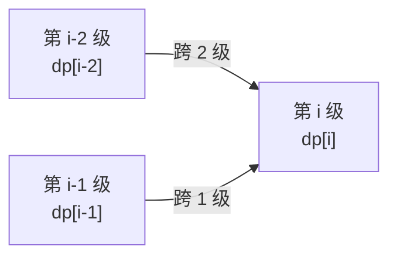

# 第 16 章 动态规划入门

> 覆盖题号：53, 62, 63, 64, 70, 91, 120, 152, 198, 213, 279, 338, 343, 357, 368

## 16.1 引子：同一个问题，为什么要算三遍？

想象你在爬一栋楼的楼梯：每次可以跨 1 级或 2 级台阶。你想知道：上到第 10 级，一共有多少种走法？

如果你直接用递归去数：上到第 10 级的走法 = 上到第 9 级的走法 + 上到第 8 级的走法；
上到第 9 级又 = 上到第 8 级 + 上到第 7 级……一路拆下去，你会发现**同一个子问题被反复计算**：
比如"上到第 3 级有几种走法"会被问几十次，每次都从头数一遍。第 01 章 1.5 节已经算过这笔账：
这样写斐波那契，复杂度是恐怖的 $O(2^n)$，$n$ 稍微大一点就跑不完。

这时候一个朴素的想法浮现出来：**既然"上到第 3 级有 3 种走法"算一遍就够了，
为什么不算完就把它记下来，下次直接查？** 就像家里记账：同一笔账记一次，下次翻账本就行。

这就是**动态规划（Dynamic Programming，DP）**的灵魂：**把算过的子问题答案记下来，避免重复计算**。
再进一步，我们甚至可以不从第 10 级"往下拆"，而是从第 0 级"往上填"：把每一级的答案依次算出来，
像**填一张表**一样一路填到第 10 级。前者叫**自顶向下（记忆化递归）**，后者叫**自底向上（填表）**——
它们是动态规划的两种面孔，也是本章的两条主线。

动态规划是算法面试的"半壁江山"：本书覆盖的前 400 题里有几十道是它的直接应用。
学完本章，你会形成一套固定的解题套路——**定义状态 → 写转移方程 → 初始化 → 确定遍历顺序 → 举例验证**，
这就是著名的"DP 五步法"。

## 16.2 核心思想

### 16.2.1 什么是动态规划：最优子结构 + 重叠子问题

动态规划不是一种"数据结构"，而是一种**解题思路**。判断一道题能不能用 DP，看两个性质：

1. **最优子结构（optimal substructure）**：大问题的最优解，可以由子问题的最优解"拼"出来。
   以爬楼梯为例：上到第 $n$ 级的走法数 = 上到第 $n-1$ 级的走法数（最后一步跨 1 级）
   + 上到第 $n-2$ 级的走法数（最后一步跨 2 级）。大问题的答案完全由两个小问题的答案决定。
2. **重叠子问题（overlapping subproblems）**：递归展开时，同一个子问题会被反复遇到——
   爬楼梯里"上到第 3 级"在计算第 5、第 6、第 7 级……时都会被问到，**有重叠才值得记账**。

把这两点放在一起，动态规划可以浓缩成一个公式：

> **动态规划 = 暴力递归（枚举所有可能）+ 记账本（去掉重复计算）**
> 一句话理解：暴力递归把所有可能性都算一遍，DP 只是让每个子问题只算一遍。

有了这个视角，DP 和其他算法的关系就清楚了：

| 算法 | 特点 | 和 DP 的区别 |
| --- | --- | --- |
| 暴力递归 | 枚举所有方案，正确但慢 | 子问题重复计算，指数级 |
| 分治 | 把问题切成互不相交的子问题（如归并排序） | 子问题**不重叠**，不需要记账 |
| 贪心 | 每一步选当前最优，不回头 | 依赖"贪心选择性质"，一旦决策不可撤销 |
| 动态规划 | 记录子问题答案，由小到大拼出大问题 | 需要最优子结构 + 重叠子问题 |

> **一句话判断**：能用贪心的问题往往也能用 DP 解（更慢但更稳）；能用 DP 的问题
> 往往不能贪心（如 198 题，每一步贪心偷最有钱的邻居会漏掉更优解）。

### 16.2.2 DP 五步法：把"灵光一现"变成流水线

初学者最怕的是"看到题不知道状态怎么定义"。五步法就是把这一步"玄学"变成固定流程。
仍以爬楼梯为例，走一遍完整流程：

**第①步：定义状态。** 用一个数组/下标描述子问题：对爬楼梯，`dp[i]` = 上到第 i 级台阶的走法数。
**状态定义是整个 DP 的地基，定义错了，后面全错。**

**第②步：写转移方程。** `dp[i]` 怎么由更小的状态算出来？最后一步要么从第 i-1 级跨 1 级上来，
要么从第 i-2 级跨 2 级上来：

$$dp[i] = dp[i-1] + dp[i-2]$$

把"最后一步"画出来，转移方程就一目了然：



**第③步：初始化。** 最小的状态（地基）是什么？`dp[0] = 1`（0 级台阶算 1 种空走法，
为方便递推的人为约定）、`dp[1] = 1`。

**第④步：确定遍历顺序。** `dp[i]` 依赖更小的下标，所以 i 必须**从小到大**遍历，
保证算 dp[i] 时它依赖的值已经算好。

**第⑤步：举例验证。** 拿一个小输入手推一遍 dp 表，确认和直觉一致。下表是 n=6 时的手推结果：

| i | 0 | 1 | 2 | 3 | 4 | 5 | 6 |
| --- | --- | --- | --- | --- | --- | --- | --- |
| dp[i] | 1 | 1 | 2 | 3 | 5 | 8 | 13 |

第 6 级有 13 种走法——和第 01 章斐波那契数列对上了（只是初值略有不同）。

> **五步法口诀**：先定状态、再写转移、然后初始化、想清顺序、最后手推验证。
> 第①、③步最容易错，第⑤步是防错神器——写代码前先手推一张小表，能拦住 80% 的笔误。

### 16.2.3 自顶向下 vs 自底向上：记账本与填表

同一套五步法，落地有两种写法：

**写法一：自顶向下（记忆化递归）= 暴力递归 + 记账本。**
从最大的问题（第 n 级）出发，递归往下拆；每算出一个子问题的答案，就记进"账本"
（Python 里通常是一个 dict）；下次再遇到同一个子问题，直接翻账本，不再重算。

**写法二：自底向上（填表）= 从地基开始循环填满整张表。**
先填好 dp[0]、dp[1]，再用转移方程算出 dp[2]、dp[3]……一路填到 dp[n]。

两者如何互相转换？记住三句话：

- **递归函数的参数，就是表的下标**：`f(i)` 对应 `dp[i]`；
- **递归函数的返回值，就是表的格子值**：`memo[i]` 对应 `dp[i]`；
- **递归的出口，就是初始化**：`if i <= 1: return ...` 对应 `dp[0]、dp[1]` 的初值。

所以"把记忆化递归改成填表"是机械操作：把"递归调用 + 记账"换成"循环 + 数组赋值"，
16.5 节会用代码完整演示。两种写法怎么选？一般刷题用自底向上（无递归栈开销、方便滚动优化）；
状态维度多或循环顺序难写时用自顶向下（顺着"大问题怎么拆"的思路写，不容易错）。

### 16.2.4 空间优化：滚动数组与"只保留上一行"

dp 表往往很大（一维 O(n)、二维 O(mn)），但很多转移方程里**新状态只依赖少数几个旧状态**。
这时可以丢掉用不到的旧值，这就是**滚动数组**。

**一维滚动数组**：如果 `dp[i]` 只依赖 `dp[i-1]` 和 `dp[i-2]`，整张表根本不用开——
两个变量 `a, b` 轮流保存"上两个值"，像滚轮一样往前滚。类比：你算流水账，
只要记得"上个月的余额"和"上上个月的余额"就够算这个月了，不需要把十年账本都摊在桌上。
爬楼梯、打家劫舍、Kadane 都能这样优化，空间从 $O(n)$ 降到 $O(1)$。

**二维"只保留上一行"**：如果 `dp[i][j]` 只依赖 `dp[i-1][j]`（上一行）和 `dp[i][j-1]`（本行左侧），
整个二维表可以压缩成一维数组：`dp[j]` 被覆盖前存"上一行第 j 列"，覆盖后存"本行第 j 列"。
路径类题目（62/63/64 题）全是这个形态，空间从 $O(mn)$ 降到 $O(n)$。

> **滚动数组的灵魂是"依赖方向"**：新值依赖"本行左侧"，内层循环必须**从左往右**扫；
> 依赖"本行右侧"就得**从右往左**扫。方向反了，你会把"刚算出的新值"当"旧值"用，答案全错。

### 16.2.5 一维 DP 与二维 DP 的经典形态

本书前 400 题里的 DP 题，九成是下面两种形态：

**形态一：一维线性 DP。** 输入是一个序列，状态只有一个下标，`dp[i]` 表示"处理到第 i 个元素时
的某个最优值/方案数"。爬楼梯、53 题、198/213 题、91 题都是这种。
共同套路：**站在位置 i 上做"取/不取、接/不接、单独/合并"的二选一或三选一决策。**

**形态二：二维网格路径 DP。** 输入是一个 m×n 网格，状态是坐标，`dp[i][j]` 表示"到达 (i, j) 的
方案数/最小代价"。由于只能向下、向右走，到达 (i, j) 只有两个来源：上方和左方：

$$dp[i][j] = dp[i-1][j] + dp[i][j-1] \quad(\text{方案数，62 题})$$

$$dp[i][j] = \min(dp[i-1][j],\, dp[i][j-1]) + \text{代价} \quad(\text{最小代价，64 题})$$

62、63、64、120 题会把四种变体（无障/有障/带权/三角形）逐个讲透；
**把这两种形态练熟，再难的 DP 题也只是"换了个状态定义"。**

## 16.3 算法流程

拿到一道 DP 题，按下面的流水线走，一步都不要跳：

1. **定义状态**：`dp[i]`（或 `dp[i][j]`）代表什么？下标 i 的物理含义是什么？
2. **写转移方程**：`dp[i]` 能由哪些更小的状态算出来？把"最后一步怎么走"翻译成数学式。
3. **初始化**：最小的几个状态（边界）分别是什么？常被坑的地方：`dp[0]`、`dp[1]`、第一行、第一列。
4. **确定遍历顺序**：`dp[i]` 依赖谁，谁就先算；通常是从小到大、从左到右，个别题从大到小。
5. **举例验证**：拿一个小输入手推一遍表，核对每个格子的值和直觉一致，再写代码。

伪代码（以自底向上填表为例）：

```text
① 定义状态:   dp[i] = 关于"前 i 个/第 i 个元素"的答案
② 写转移方程: dp[i] = f(dp[i-1], dp[i-2], ..., 输入数据)
③ 初始化:     dp[0] = 边界值; dp[1] = 边界值
④ 确定遍历顺序:
   for i in range(2, n + 1):      # 依赖更小的下标 -> 从小到大
       dp[i] = f(dp[i-1], dp[i-2], ...)
⑤ 举例验证:   手推 n = 3~5 的小表, 核对无误后返回 dp[n]
```

> 自查要点：状态定义是否说清、转移方程是否覆盖所有"最后一步"、边界初始化
> （`dp[0]`/`dp[1]`/第一行/第一列）、遍历顺序与依赖方向是否一致、有没有手推小表验证。

## 16.4 复杂度分析

DP 的复杂度分析有一套统一的公式：

> **时间复杂度 = 状态个数 × 每个状态转移的代价**
> **空间复杂度 = dp 表的大小**（滚动数组优化后可大幅降低）

以爬楼梯为例，四种写法的复杂度对比：

| 写法 | 时间复杂度 | 空间复杂度 | 说明 |
| --- | --- | --- | --- |
| 暴力递归 | $O(2^n)$ | $O(n)$（递归栈） | n=45 直接跑不动 |
| 记忆化递归 | $O(n)$ | $O(n)$（账本 + 栈） | 每个 n 只算一次 |
| 自底向上填表 | $O(n)$ | $O(n)$（dp 数组） | 最直观 |
| 滚动数组 | $O(n)$ | $O(1)$ | 面试标准答案 |

二维网格 DP（62/63/64 题）：状态 $m \times n$ 个、每个 $O(1)$ 转移，时间 $O(mn)$；
空间 $O(mn)$，滚动到"只保留上一行"后 $O(n)$。

> 面试技巧：报复杂度先说"状态多少个、每状态花多少"，再给总量；其余题目复杂度在 16.6 节逐题给出。

## 16.5 Python 实现

下面用爬楼梯演示**"记忆化 ↔ 填表"的互相转换**——这是自顶向下与自底向上的核心对应。
对照 16.2.3 节的"转换三句话"阅读：递归参数 ↔ 表下标，返回值 ↔ 格子值，递归出口 ↔ 初始化。
（滚动数组只是写法二的纯空间优化，思路相同，放到 70 题里演示。）

```python
def climb_stairs_memo(n, memo=None):
    """写法一: 记忆化递归(自顶向下) = 暴力递归 + 记账本, 每个 n 只算一次, O(n)"""
    if memo is None:
        memo = {}
    if n in memo:
        return memo[n]
    if n <= 1:
        return 1                # 约定: f(0)=f(1)=1 (0 级台阶算 1 种空走法)
    memo[n] = climb_stairs_memo(n - 1, memo) + climb_stairs_memo(n - 2, memo)
    return memo[n]


def climb_stairs_table(n):
    """写法二: 自底向上填表, 从地基 dp[0]、dp[1] 一格一格填满"""
    if n <= 1:
        return 1
    dp = [0] * (n + 1)
    dp[0], dp[1] = 1, 1         # 初始化(递归出口 -> 初值)
    for i in range(2, n + 1):   # 遍历顺序: 从小到大, 保证依赖的值已算好
        dp[i] = dp[i - 1] + dp[i - 2]   # 转移方程(递归调用 -> 数组赋值)
    return dp[n]


if __name__ == "__main__":
    for n in range(0, 20):
        assert climb_stairs_memo(n) == climb_stairs_table(n)
    assert climb_stairs_table(0) == 1               # 边界: 0 级台阶
    assert climb_stairs_table(1) == 1               # 边界: 1 级台阶
    assert climb_stairs_table(45) == 1836311903     # 边界: LeetCode 的 n 上限是 45
    print("爬楼梯记忆化与填表结果一致, 两种写法全部验证通过!")
```

注意写法一和写法二的对应关系：`if n <= 1: return 1` 就是初始化；
`memo[n] = f(n-1) + f(n-2)` 就是转移方程；递归里"n 从大到小拆"，填表里"i 从小到大填"，
**只是方向相反，答案完全一致**。这就是自顶向下与自底向上的本质联系。
（暴力递归版 $O(2^n)$ 见第 01 章 1.5 节，不再重复。）

16.6 节的每一道题，本质上都是"换一个状态定义、换一条转移方程"的五步法练习。

## 16.6 LeetCode 真题精讲

我们把 15 道题按"一维 DP → 二维路径 DP → 一维进阶 → 计数与集合"四个梯度组织，
每道题按"题意 → 思路（含手推小表）→ 代码 → 复杂度 → 易错点"展开。

### 第一组：一维 DP 入门（70 / 53 / 198 / 213 / 91）

### 70. 爬楼梯（简单）

**题意**：一次可以上 1 级或 2 级台阶，问上到第 n 级台阶共有多少种走法（$1 \le n \le 45$）。

**思路**：这是 16.2 节反复用到的例子，和第 01 章的斐波那契是同一道题换了个马甲。
最后一步只有两种可能：从第 n-1 级跨 1 级，或从第 n-2 级跨 2 级，所以
$dp[i] = dp[i-1] + dp[i-2]$（手推表见 16.2.2 节：dp = 1, 1, 2, 3, 5, 8, 13）。

注意 `dp[0]=1` 是为了递推方便的人为约定（"0 级台阶"这一种空走法），真正答案从
`dp[1]=1`、`dp[2]=2` 开始。下面给出记忆化、填表、滚动数组三种标准写法。

```python
def climb_stairs_memo(n):
    """写法一: 记忆化递归(自顶向下)"""
    memo = {0: 1, 1: 1}

    def f(i):
        if i not in memo:
            memo[i] = f(i - 1) + f(i - 2)
        return memo[i]

    return f(n)


def climb_stairs_table(n):
    """写法二: 自底向上填表"""
    if n <= 1:
        return 1
    dp = [0] * (n + 1)
    dp[0] = dp[1] = 1
    for i in range(2, n + 1):
        dp[i] = dp[i - 1] + dp[i - 2]
    return dp[n]


def climb_stairs_roll(n):
    """写法三: 滚动数组, 空间 O(1)"""
    a = b = 1
    for _ in range(2, n + 1):
        a, b = b, a + b
    return b


if __name__ == "__main__":
    for n in range(0, 30):
        assert climb_stairs_memo(n) == climb_stairs_table(n) == climb_stairs_roll(n)
    assert climb_stairs_table(2) == 2                    # 边界: 2 级
    assert climb_stairs_table(3) == 3                    # 边界: 3 级
    assert climb_stairs_table(1) == 1                    # 边界: 1 级
    assert climb_stairs_table(45) == 1836311903          # 边界: LeetCode 上限 45
    print("70. 爬楼梯 三种写法全部验证通过!")
```

**复杂度分析**：三种写法时间都是 $O(n)$；空间上记忆化 $O(n)$、填表 $O(n)$、滚动 $O(1)$。

**易错点**：

- 初值约定别混：用 `dp[0]=dp[1]=1` 递推，就别再写 `dp[2]=2` 的特判（会重复计算）。
- 滚动数组 `a, b = b, a + b` 是**同时**更新，写成两行 `a = b; b = a + b` 就错了；
  暴力递归 $O(2^n)$ 在 n=45 时永远跑不完，面试里要主动讲出"为什么必须用 DP"。

### 53. 最大子数组和（中等）

**题意**：给一个整数数组 `nums`，找出和最大的连续子数组，返回最大和（子数组至少含一个元素）。

**思路**：这是动态规划里最经典的"决策"题，即第 01 章 1.8 节见过的 **Kadane 算法**。
关键洞察：**以 i 结尾**的最大子数组和，只有两种可能——把 `nums[i]` 接到前面的子数组后面
（延续），或者从 `nums[i]` 重新开始（弃前）。于是：

$$dp[i] = \max(nums[i],\; dp[i-1] + nums[i])$$

手推 `[-2, 1, -3, 4, -1, 2, 1, -5, 4]`：

| i | 0 | 1 | 2 | 3 | 4 | 5 | 6 | 7 | 8 |
| --- | --- | --- | --- | --- | --- | --- | --- | --- | --- |
| nums[i] | -2 | 1 | -3 | 4 | -1 | 2 | 1 | -5 | 4 |
| dp[i] | -2 | 1 | -2 | 4 | 3 | 5 | 6 | 1 | 5 |

答案取所有 `dp[i]` 的最大值 6（对应子数组 `[4, -1, 2, 1]`）。
注意 `dp[i]` 是"以 i 结尾"的值，答案不是 `dp[n-1]` 而是 `max(dp)`。
由于 `dp[i]` 只依赖 `dp[i-1]`，滚动成一个变量 `cur` 就是 Kadane——
这是 16.2.4 节一维滚动数组的又一次应用。（分治解法：跨中点的子数组
= 左半最大后缀 + 右半最大前缀，时间 $O(n\log n)$，不如 DP，思路了解即可。）

```python
def max_subarray(nums):
    """Kadane 算法: 滚动数组版, 空间 O(1)"""
    best = cur = nums[0]            # cur = 以当前元素结尾的最大子数组和
    for x in nums[1:]:
        cur = max(x, cur + x)       # 从 x 重新开始, 还是把 x 接上去?
        best = max(best, cur)
    return best


if __name__ == "__main__":
    assert max_subarray([-2, 1, -3, 4, -1, 2, 1, -5, 4]) == 6
    assert max_subarray([1]) == 1                        # 边界: 单元素
    assert max_subarray([-1, -2, -3]) == -1              # 边界: 全负数
    assert max_subarray([5, 5, 5]) == 15                 # 边界: 全正数
    assert max_subarray([0, 0, 0]) == 0                  # 边界: 全 0
    assert max_subarray([-5]) == -5                      # 边界: 单负数
    print("53. 最大子数组和 全部验证通过!")
```

**复杂度分析**：时间 $O(n)$（一遍遍历），空间 $O(1)$。

**易错点**：

- `best = cur = nums[0]` 而不是 0：全负数时从 0 初始化会把答案错算成 0。
- `dp[i]` 是"以 i 结尾"的子数组和，答案要取所有 `dp[i]` 的最大值（代码里即 `best`），
  而不是最后一个位置的 dp 值——最优子数组未必包含最后一个元素。

### 198. 打家劫舍（中等）

**题意**：一排房子，每间有现金 `nums[i]`，相邻两间不能同时偷，求能偷到的最大金额。

**思路**：站在第 i 间房前，只有两个选择：**偷**它（则 i-1 不能偷，收益 = `dp[i-2] + nums[i]`）
或**不偷**它（收益 = `dp[i-1]`）。两者取大：

$$dp[i] = \max(dp[i-1],\; dp[i-2] + nums[i])$$

手推 `[2, 7, 9, 3, 1]`：

| i | 0 | 1 | 2 | 3 | 4 |
| --- | --- | --- | --- | --- | --- |
| nums[i] | 2 | 7 | 9 | 3 | 1 |
| dp[i] | 2 | 7 | 11 | 11 | 12 |

答案 12（偷第 0、2、4 间：2+9+1=12，没有相邻）。初始化：`dp[0]=nums[0]`，
`dp[1]=max(nums[0], nums[1])`。

```python
def rob(nums):
    """自底向上填表版"""
    n = len(nums)
    if n == 0:
        return 0
    if n == 1:
        return nums[0]
    dp = [0] * n
    dp[0] = nums[0]
    dp[1] = max(nums[0], nums[1])
    for i in range(2, n):
        dp[i] = max(dp[i - 1], dp[i - 2] + nums[i])
    return dp[n - 1]


if __name__ == "__main__":
    assert rob([1, 2, 3, 1]) == 4
    assert rob([2, 7, 9, 3, 1]) == 12
    assert rob([1]) == 1                     # 边界: 单元素
    assert rob([1, 2]) == 2                  # 边界: 两元素
    assert rob([0, 0, 0]) == 0               # 边界: 全 0
    assert rob([]) == 0                      # 边界: 空数组
    print("198. 打家劫舍 全部验证通过!")
```

**复杂度分析**：时间 $O(n)$，空间 $O(n)$（`dp[i]` 只依赖前两个状态，按 70 题的做法
滚动成两个变量即可降到 $O(1)$，此处略）。

**易错点**：

- `dp[1] = max(nums[0], nums[1])`，不是 `nums[1]`：两间房相邻只能偷更富的一间。
- 本题不能贪心：`[2, 1, 1, 2]` 贪心偷 2 就错过 2+2=4 的更优解。

### 213. 打家劫舍 II（中等）

**题意**：房子围成一圈（首尾相邻），其余规则同 198 题，求最大偷窃金额。

**思路**：环形的唯一麻烦是**第一间和最后一间不能同时偷**。破解方法非常漂亮——
把环形问题拆成两个线性问题：

- **不偷第一间**：问题退化为在 `nums[1:]` 上做 198 题；
- **不偷最后一间**：问题退化为在 `nums[:-1]` 上做 198 题；

最优解要么没偷第一间，要么没偷最后一间（否则首尾都偷了，非法），
所以答案 = 两个线性结果的最大值。手推 `[2, 3, 2]`：两个子问题都得 3——
环形下最多只能偷一间（三间两两相邻）。

```python
def rob_range(nums, left, right):
    """线性打家劫舍(198题)的滚动版, 只偷 nums[left..right]"""
    prev2 = prev1 = 0
    for i in range(left, right + 1):
        prev2, prev1 = prev1, max(prev1, prev2 + nums[i])
    return prev1


def rob(nums):
    """环形打家劫舍: 拆成"不含首"与"不含尾"两个线性问题"""
    n = len(nums)
    if n == 1:
        return nums[0]
    if n == 2:
        return max(nums[0], nums[1])
    return max(rob_range(nums, 0, n - 2),   # 不偷最后一间
               rob_range(nums, 1, n - 1))   # 不偷第一间


if __name__ == "__main__":
    assert rob([2, 3, 2]) == 3
    assert rob([1, 2, 3, 1]) == 4
    assert rob([1, 2, 3]) == 3               # 边界: 三间环形, 只能偷一间
    assert rob([1]) == 1                     # 边界: 单元素
    assert rob([1, 2]) == 2                  # 边界: 两元素
    assert rob([0, 0, 0]) == 0               # 边界: 全 0
    assert rob([2, 7, 9, 3, 1]) == 11        # 环形首尾相邻, 与线性答案 12 不同
    print("213. 打家劫舍 II 全部验证通过!")
```

**复杂度分析**：两次线性 DP，时间 $O(n)$，空间 $O(1)$。

**易错点**：

- `n == 1` 必须单独返回：切片 `nums[:-1]` 在 n=1 时是空数组，两个子问题都会得 0。
- 复用同一个 `rob_range`，别把两个子问题各写一遍（容易在边界上写岔）；
  环形答案 ≤ 线性答案（多了"首尾不能同时偷"的限制），`[2,7,9,3,1]` 从 12 降到 11，可用于自查。

### 91. 解码方法（中等）

**题意**：'A'~'Z' 分别对应 1~26，给一个只含数字的字符串 `s`，求共有多少种解码方式。

**思路**：处理到第 i 个字符时，"最后一段"只有两种切法：**单独解码** `s[i-1]`（须是 1~9）
或**两位解码** `s[i-2:i]`（须是 10~26）。所以：

$$dp[i] = (s[i-1]\in[1,9])\cdot dp[i-1] + (s[i-2:i]\in[10,26])\cdot dp[i-2]$$

其中 `dp[i]` 表示"前 i 个字符的解码方式数"。手推 `"226"`：

| i | 0 | 1 | 2 | 3 |
| --- | --- | --- | --- | --- |
| dp[i] | 1 | 1 | 2 | 3 |

`dp[2]`：'2' 可单独解（+dp[1]），"22" 可两位解（+dp[0]）→ 2；
`dp[3]`：'6' 可单独解（+dp[2]），"26" 可两位解（+dp[1]）→ 3。
三种解码：BEE、BZ、YE（2/2/6、2/26、22/6）。

```python
def num_decodings(s):
    """数字串的解码方式数 (91. 解码方法)"""
    if not s or s[0] == "0":
        return 0
    n = len(s)
    dp = [0] * (n + 1)
    dp[0] = 1                # 空串算 1 种, 作为递推的种子
    dp[1] = 1                # 第一个字符非 '0', 只有 1 种
    for i in range(2, n + 1):
        one = int(s[i - 1])          # 最后一位单独解码
        two = int(s[i - 2:i])        # 最后两位一起解码
        if 1 <= one <= 9:
            dp[i] += dp[i - 1]
        if 10 <= two <= 26:
            dp[i] += dp[i - 2]
    return dp[n]


if __name__ == "__main__":
    assert num_decodings("12") == 2
    assert num_decodings("226") == 3
    assert num_decodings("06") == 0              # 边界: 前导 0
    assert num_decodings("0") == 0               # 边界: 单个 0
    assert num_decodings("10") == 1              # 边界: 只能整体解
    assert num_decodings("210") == 1             # 边界: "2"+"10"
    assert num_decodings("1") == 1               # 边界: 单字符
    assert num_decodings("1111111111") == 89     # 边界: 全 1, 斐波那契式增长
    print("91. 解码方法 全部验证通过!")
```

**复杂度分析**：时间 $O(n)$（一遍扫描，每步 O(1)），空间 $O(n)$（可滚动到 $O(1)$）。

**易错点**：

- '0' 永远不能单独解码：`"0"`、`"06"` 都是 0 种；'0' 只能作为 "10"、"20" 的一部分。
- `dp[0] = 1` 是递推种子，不是 0——否则 `"10"` 会算成 0；两位判断是 `10 <= two <= 26`，
  `"01"` 不算（'0' 开头不算两位数字）。

### 第二组：二维路径 DP（62 / 63 / 64 / 120）

### 62. 不同路径（中等）

**题意**：m×n 网格，从左上角到右下角，每次只能向下或向右走，求不同路径数。

**思路**：到达 `(i, j)` 只有两个来源：从上方 `(i-1, j)` 下来，或从左方 `(i, j-1)` 过来，所以

$$dp[i][j] = dp[i-1][j] + dp[i][j-1]$$

第一行、第一列都只有一条路可走（一路向右/一路向下），初始化全为 1。
手推 3×3 的表：

```text
1  1  1
1  2  3
1  3  6      ← dp[2][2] = 6, 3×3 网格共 6 条路径
```

```python
def unique_paths(m, n):
    """二维填表版"""
    dp = [[1] * n for _ in range(m)]      # 第一行第一列天然是 1
    for i in range(1, m):
        for j in range(1, n):
            dp[i][j] = dp[i - 1][j] + dp[i][j - 1]
    return dp[m - 1][n - 1]


def unique_paths_roll(m, n):
    """滚动数组版: 只保留上一行, 空间 O(n)"""
    row = [1] * n
    for _ in range(1, m):
        for j in range(1, n):
            row[j] += row[j - 1]          # 旧 row[j] = 上方, row[j-1] = 左方
    return row[n - 1]


if __name__ == "__main__":
    assert unique_paths(3, 7) == 28
    assert unique_paths(3, 2) == 3
    assert unique_paths(1, 1) == 1         # 边界: 1x1
    assert unique_paths(1, 10) == 1        # 边界: 只有一行
    assert unique_paths(10, 1) == 1        # 边界: 只有一列
    assert unique_paths_roll(3, 7) == 28
    assert unique_paths_roll(7, 3) == 28   # m、n 对称
    print("62. 不同路径 全部验证通过!")
```

**复杂度分析**：时间 $O(mn)$，空间 $O(mn)$（填表）或 $O(n)$（滚动）。

**易错点**：

- 第一行、第一列全是 1，别忘了它们的"只能沿边走"特性。
- 滚动数组内层必须**从左往右**扫：`row[j]` 更新依赖本行左侧 `row[j-1]`（已更新）
  和旧 `row[j]`（上一行，还没被覆盖）——方向反了结果全错。

### 63. 不同路径 II（中等）

**题意**：62 题的网格里加了障碍物（1 表示障碍、0 表示空地），求绕开障碍的路径数。

**思路**：障碍格永远不可达，`dp` 保持 0；只有空地才做转移。**最大的坑在第一行和第一列**：
它们只能沿边走，一旦遇到障碍，**后面的格子全部不可达**（被堵死了），必须"断"。
手推 `[[0,0,0],[0,1,0],[0,0,0]]`：

```text
1  1  1
1  0  1      ← 中间是障碍, 保持 0
1  1  2      ← dp[2][2] = 2
```

```python
def unique_paths_with_obstacles(obstacle_grid):
    """带障碍网格的路径数 (63. 不同路径 II)"""
    m, n = len(obstacle_grid), len(obstacle_grid[0])
    dp = [[0] * n for _ in range(m)]
    # 第一列: 沿边走, 遇到障碍即断
    for i in range(m):
        if obstacle_grid[i][0] == 1:
            break
        dp[i][0] = 1
    # 第一行: 同理
    for j in range(n):
        if obstacle_grid[0][j] == 1:
            break
        dp[0][j] = 1
    # 中间区域: 只有空地才转移
    for i in range(1, m):
        for j in range(1, n):
            if obstacle_grid[i][j] == 0:
                dp[i][j] = dp[i - 1][j] + dp[i][j - 1]
    return dp[m - 1][n - 1]


if __name__ == "__main__":
    grid = [[0, 0, 0], [0, 1, 0], [0, 0, 0]]
    assert unique_paths_with_obstacles(grid) == 2
    assert unique_paths_with_obstacles([[0, 1], [0, 0]]) == 1
    assert unique_paths_with_obstacles([[1]]) == 0             # 边界: 起点就是障碍
    assert unique_paths_with_obstacles([[0]]) == 1             # 边界: 1x1 无障碍
    assert unique_paths_with_obstacles([[0, 0, 0]]) == 1       # 边界: 单行无障碍
    assert unique_paths_with_obstacles([[0], [1], [0]]) == 0   # 边界: 障碍堵死单列
    print("63. 不同路径 II 全部验证通过!")
```

**复杂度分析**：时间 $O(mn)$，空间 $O(mn)$（可滚动到 $O(n)$，但第一行的"断点"处理要更小心）。

**易错点**：

- 第一行/第一列必须用 `break`（遇到障碍就断），用 `continue` 会把障碍后面的格子也设成 1。
- 起点 `(0,0)` 是障碍时答案为 0（两个初始化循环都会在第一格 break）；
  中间区域障碍格跳过转移（保持 0），别让障碍参与累加。

### 64. 最小路径和（中等）

**题意**：m×n 网格每格有权值，从左上到右下（只能下/右），求路径上权值之和的最小值。

**思路**：把 62 的"方案数相加"换成"代价取最小"：

$$dp[i][j] = \min(dp[i-1][j],\; dp[i][j-1]) + grid[i][j]$$

第一行只能从左方来（累加前缀和），第一列只能从上方来（同理）。
手推 `[[1,3,1],[1,5,1],[4,2,1]]`：

```text
1   4   5
2   7   6
6   8   7      ← dp[2][2] = 7
```

最小路径是 1→3→1→1→1，和为 7。

```python
def min_path_sum(grid):
    """二维填表版"""
    m, n = len(grid), len(grid[0])
    dp = [[0] * n for _ in range(m)]
    dp[0][0] = grid[0][0]
    for j in range(1, n):                 # 第一行: 只能从左来
        dp[0][j] = dp[0][j - 1] + grid[0][j]
    for i in range(1, m):                 # 第一列: 只能从上来
        dp[i][0] = dp[i - 1][0] + grid[i][0]
    for i in range(1, m):
        for j in range(1, n):
            dp[i][j] = min(dp[i - 1][j], dp[i][j - 1]) + grid[i][j]
    return dp[m - 1][n - 1]


if __name__ == "__main__":
    g = [[1, 3, 1], [1, 5, 1], [4, 2, 1]]
    assert min_path_sum(g) == 7
    assert min_path_sum([[1]]) == 1                 # 边界: 1x1
    assert min_path_sum([[1, 2]]) == 3              # 边界: 单行
    assert min_path_sum([[1], [2]]) == 3            # 边界: 单列
    assert min_path_sum([[0, 0], [0, 0]]) == 0      # 边界: 全 0
    print("64. 最小路径和 全部验证通过!")
```

**复杂度分析**：时间 $O(mn)$，空间 $O(mn)$（按 16.2.4 节滚动到"只保留上一行"可降到 $O(n)$；
若要 $O(1)$ 额外空间，可原地修改 `grid`，但会破坏输入，面试时先问一句能否修改）。

**易错点**：

- 第一行/第一列要单独累加，别在通用转移里访问 `dp[i-1][j]`（越界）。
- 求"最小"要初始化合理：好在第一行第一列都显式填了，中间格不会用到未初始化的 0。

### 120. 三角形最小路径和（中等）

**题意**：给一个三角形（第 i 行有 i+1 个数），从顶部出发，每步走到下一行**相邻**的格子，
求到底部的最小路径和。

**思路**：三角形和矩形不一样，直接自顶向下要处理"边界格子只有一个邻居"的麻烦。
**自底向上**更优雅：从倒数第二行开始，每个格子的最小代价 =
本身 + min(正下方, 右下方)：

$$triangle[i][j] += \min(triangle[i+1][j],\; triangle[i+1][j+1])$$

最后 `triangle[0][0]` 就是答案。手推 `[[2],[3,4],[6,5,7],[4,1,8,3]]`：
倒数第二行 `[6,5,7]` 变成 `[7,6,10]`；再上一行 `[3,4]` 变成 `[9,10]`；顶部 `2` 变成 `11`。

```python
def minimum_total(triangle):
    """自底向上, 原地修改 triangle, 额外空间 O(1)"""
    n = len(triangle)
    for i in range(n - 2, -1, -1):        # 从倒数第二行往上
        for j in range(i + 1):            # 第 i 行有 i+1 个数
            triangle[i][j] += min(triangle[i + 1][j], triangle[i + 1][j + 1])
    return triangle[0][0]


if __name__ == "__main__":
    tri = [[2], [3, 4], [6, 5, 7], [4, 1, 8, 3]]
    assert minimum_total([row[:] for row in tri]) == 11   # 原地版会改输入, 传副本
    assert minimum_total([[1]]) == 1                       # 边界: 单元素
    assert minimum_total([[-1], [-2, -3]]) == -4           # 边界: 负数
    print("120. 三角形最小路径和 全部验证通过!")
```

**复杂度分析**：n 行三角形共 $n(n+1)/2$ 个格子，时间 $O(n^2)$；空间 $O(1)$（原地修改，
不想破坏输入则用滚动数组保留一行累计结果，空间 $O(n)$）。

**易错点**：

- 自底向上时行下标要**倒着**走（`range(n-2, -1, -1)`），因为当前行依赖下一行；
  每行的 j 范围是 `0..i`（第 i 行有 i+1 个数），别写成 `0..n-1`。

### 第三组：一维 DP 进阶（152 / 279 / 338 / 343）

### 152. 乘积最大子数组（中等）

**题意**：给整数数组 `nums`（可含负数、0），找出乘积最大的连续子数组，返回最大乘积。

**思路**：和 53 题只差一个字，但难度上升一个台阶——**乘法里"负负得正"**：
一个很小的负数，乘上另一个负数可能变成很大的正数。所以只维护"以 i 结尾的最大乘积"
不够，还必须同时维护**最小值**：

- `cur_max = max(x, cur_max * x)`：要么从 x 重新开始，要么接上去；
- `cur_min = min(x, cur_min * x)`：记录"最负"的乘积，为负负得正做准备；
- 遇到负数 x 时，先交换 `cur_max` 和 `cur_min`（乘以负数会让大变小、小变大），再更新。

手推 `[2, 3, -2, 4]`：

| i | 0 | 1 | 2 | 3 |
| --- | --- | --- | --- | --- |
| nums[i] | 2 | 3 | -2 | 4 |
| cur_max | 2 | 6 | -2 | 4 |
| cur_min | 2 | 3 | -12 | -48 |

答案取 max = 6（子数组 `[2, 3]`）。乘 0 时 `max(x, ...)` 会自动"重置"为从 x 重新开始。

```python
def max_product(nums):
    """乘积最大子数组: 同时维护最大值与最小值 (152. 乘积最大子数组)"""
    best = cur_max = cur_min = nums[0]
    for x in nums[1:]:
        if x < 0:                     # 负数让大小反转, 先交换
            cur_max, cur_min = cur_min, cur_max
        cur_max = max(x, cur_max * x)
        cur_min = min(x, cur_min * x)
        best = max(best, cur_max)
    return best


if __name__ == "__main__":
    assert max_product([2, 3, -2, 4]) == 6
    assert max_product([-2, 0, -1]) == 0        # 边界: 含 0
    assert max_product([-2]) == -2              # 边界: 单负数
    assert max_product([0, 0, 0]) == 0          # 边界: 全 0
    assert max_product([-1, -2, -3]) == 6       # 边界: 负负得正 (-1*-2*-3 = 6)
    assert max_product([1, 2, 3]) == 6          # 边界: 全正数
    print("152. 乘积最大子数组 全部验证通过!")
```

**复杂度分析**：时间 $O(n)$（一遍遍历），空间 $O(1)$。

**易错点**：

- 只维护最大值会漏掉"负负得正"：在 `[-1, -2, -3]` 里最优子数组是 `[-2, -3] = 6`，
  但只维护最大值时，i=2 的 cur 只会是 max(-3, 2×(-3)) = -3，永远到不了 6——
  因为"最负的潜力 -2"被 max 丢掉了。同时维护 cur_min 才能把它保留下来，乘上 -3 翻成 6。
- 交换 `cur_max, cur_min` 必须**同时**进行：先改一个再用改过的值算另一个就错了。
- 初始值都是 `nums[0]`，别用 0 或 1：全负数时答案应为负数。

### 279. 完全平方数（中等）

**题意**：给正整数 n，求最少能用几个完全平方数（1、4、9、16…）相加得到 n。

**思路**：这是"完全背包"思想的雏形：把每个完全平方数 $j^2$ 看作一件"无限使用的物品"，
问凑出总额 n 最少要几件。设 `dp[i]` = 凑出 i 的最少个数，最后一个平方数若是 $j^2$，则：

$$dp[i] = \min_{j^2 \le i}(dp[i - j^2] + 1)$$

初始化 `dp[i] = i`（最坏情况全部用 1 拼）。手推 n=12：12 = 4+4+4 → 3 个；
n=13 = 4+9 → 2 个。（本题也可用 BFS 求"最少步数"：把每个数看成节点，
减去一个平方数得到下一层，最先到达 0 的层数就是答案；这里只给出 DP 版。）

```python
def num_squares(n):
    """完全背包思想: dp[i] = min(dp[i - j*j] + 1)"""
    dp = [0] * (n + 1)
    for i in range(1, n + 1):
        dp[i] = i                       # 最坏: 全部用 1 拼
        k = 1
        while k * k <= i:
            dp[i] = min(dp[i], dp[i - k * k] + 1)
            k += 1
    return dp[n]


if __name__ == "__main__":
    assert num_squares(12) == 3         # 4+4+4
    assert num_squares(13) == 2         # 4+9
    assert num_squares(1) == 1          # 边界: 1
    assert num_squares(2) == 2          # 边界: 2
    assert num_squares(4) == 1          # 边界: 完全平方数本身
    assert num_squares(16) == 1         # 边界: 大完全平方数
    print("279. 完全平方数 全部验证通过!")
```

**复杂度分析**：时间 $O(n\sqrt{n})$（每个 i 内层循环 $\sqrt{i}$ 次），空间 $O(n)$。

**易错点**：

- 内层要把 $j^2 \le i$ 的每个平方数都试一遍，别漏 $j^2 = i$（此时答案是 1）；
  `dp[i]` 初始化成 `i`（保证有解），别初始化成一个大数再担心"有没有解"。

### 338. 比特位计数（简单）

**题意**：给非负整数 n，返回一个数组，第 i 个元素是 0~n 中数字 i 的二进制表示里 1 的个数。

**思路**：最朴素的做法是对每个数单独数 1，复杂度 $O(n \log n)$。DP 更快，关键观察：

> 把 i 右移一位得到 `i >> 1`，它和 i 的二进制**只差最低位**。所以
> `i` 的 1 的个数 = `i >> 1` 的 1 的个数 + 最低位是否为 1：

$$dp[i] = dp[i >> 1] + (i \& 1)$$

手推 0~7：

| i | 0 | 1 | 2 | 3 | 4 | 5 | 6 | 7 |
| --- | --- | --- | --- | --- | --- | --- | --- | --- |
| dp[i] | 0 | 1 | 1 | 2 | 1 | 2 | 2 | 3 |

例如 dp[6] = dp[3] + 0 = 2（6=110 有 2 个 1，3=11 有 2 个 1，最低位 0）。

```python
def count_bits(n):
    """0..n 每个数的二进制中 1 的个数 (338. 比特位计数)"""
    dp = [0] * (n + 1)
    for i in range(1, n + 1):
        dp[i] = dp[i >> 1] + (i & 1)    # 去掉最低位后的个数 + 最低位本身
    return dp


if __name__ == "__main__":
    assert count_bits(2) == [0, 1, 1]
    assert count_bits(5) == [0, 1, 1, 2, 1, 2]
    assert count_bits(0) == [0]                          # 边界: n=0
    assert count_bits(1) == [0, 1]                       # 边界: n=1
    assert count_bits(7) == [0, 1, 1, 2, 1, 2, 2, 3]     # 边界: 全 1 的二进制
    print("338. 比特位计数 全部验证通过!")
```

**复杂度分析**：时间 $O(n)$（每个数 O(1)），空间 $O(n)$（答案数组本身）。

**易错点**：

- 最低位是 `i & 1`（0 或 1），别写反成 `i >> 1` 当最低位；`dp[0]=0` 是地基，循环从 1 开始。
- 返回值是长度为 n+1 的数组，n=0 时返回 `[0]`。

### 343. 整数拆分（中等）

**题意**：把正整数 n 拆成**至少两个**正整数的和，求这些整数乘积的最大值。

**思路**：DP 很直接：`dp[i]` = 拆 i 能得到的最大乘积。枚举第一块 j（1 ≤ j < i），
剩下部分要么**不再拆**（`j * (i-j)`），要么**继续拆**（`j * dp[i-j]`）：

$$dp[i] = \max_{1 \le j < i}\big(j \cdot (i-j),\; j \cdot dp[i-j]\big)$$

还有一个漂亮的**数学结论**（用均值不等式可证）：想乘积最大，尽量拆成 3；
余数为 1 时留一个 4（3+1 不如 2+2）。所以贪心版：不断减 3 乘 3，最后乘剩余部分。
两种方法都给出并对比。手推：n=10 → 3+3+4 → 36；n=7 → 3+2+2 → 12。

```python
def integer_break(n):
    """DP 版: dp[i] = max(j*(i-j), j*dp[i-j])"""
    dp = [0] * (n + 1)
    for i in range(2, n + 1):
        for j in range(1, i):
            dp[i] = max(dp[i], j * (i - j), j * dp[i - j])
    return dp[n]


def integer_break_greedy(n):
    """贪心版: 尽量拆成 3 (数学结论), 余 1 时留一个 4"""
    if n == 2:
        return 1                    # 只能拆成 1+1
    if n == 3:
        return 2                    # 只能拆成 1+2
    result = 1
    while n > 4:
        result *= 3                 # 拆出一个 3
        n -= 3
    return result * n               # 剩下的 2、3 或 4 直接乘


if __name__ == "__main__":
    assert integer_break(2) == 1            # 边界: 2
    assert integer_break(3) == 2            # 边界: 3
    assert integer_break(4) == 4            # 边界: 2+2
    assert integer_break(10) == 36          # 3+3+4
    assert integer_break(7) == 12           # 3+2+2
    assert integer_break_greedy(10) == 36
    assert integer_break_greedy(2) == 1
    assert integer_break_greedy(4) == 4
    # 两种方法在 2..60 内结果一致
    for n in range(2, 61):
        assert integer_break(n) == integer_break_greedy(n)
    print("343. 整数拆分 全部验证通过!")
```

**复杂度分析**：DP 时间 $O(n^2)$、空间 $O(n)$；贪心时间 $O(n)$、空间 $O(1)$。

**易错点**：

- n=2、3 必须特判：题目要求"至少拆成两个数"，而 2、3 拆开反而变小（1×1=1、1×2=2）。
- DP 转移里 `j*(i-j)`（不拆）和 `j*dp[i-j]`（拆）都要考虑，漏一个就不完整。
- 贪心版循环条件是 `while n > 4`：n=4 时直接返回 `1*4 = 4`（2+2 的乘积）；写成 `while n > 3` 会把 4 拆成 3+1（乘积 3，错了）。

### 第四组：计数与集合（357 / 368）

### 357. 统计各位数字都不同的数字个数（中等）

**题意**：统计 $0 \le x < 10^n$ 中，各位数字互不相同的 x 的个数（包括 0 本身）。

**思路**：按"位数"分类计数。k 位数各位互不相同有多少个？首位不能是 0，有 9 种选择；
第二位不能和首位相同，剩 9 种；第三位剩 8 种……第 k 位剩 $10-k+1$ 种。

所以 k 位数的个数是 $9 \times 9 \times 8 \times \dots \times (10-k+1)$。
用 DP 累加：`dp[i]` = 位数 ≤ i 的互异数字总个数 = `dp[i-1]` + 第 i 位数的个数。
手推：n=2 → 1 位数 10 个 + 2 位数 9×9=81 个 = 91；n=3 → 91 + 9×9×8=648 = 739。

```python
def count_numbers_with_unique_digits(n):
    """DP 版: 逐位累加互异数字的个数 (357. 统计各位数字都不同的数字个数)"""
    if n == 0:
        return 1                        # 0 <= x < 1, 只有 0
    dp = [0] * (n + 1)
    dp[0] = 1                           # 0 位数(占位)
    dp[1] = 10                          # 1 位数: 0..9
    for i in range(2, n + 1):
        cnt = 9                         # i 位数的个数: 首位 9 种
        for k in range(1, i):           # 之后第 2..i 位分别有 9, 8, ... 种
            cnt *= (10 - k)
        dp[i] = dp[i - 1] + cnt
    return dp[n]


if __name__ == "__main__":
    assert count_numbers_with_unique_digits(0) == 1
    assert count_numbers_with_unique_digits(1) == 10
    assert count_numbers_with_unique_digits(2) == 91
    assert count_numbers_with_unique_digits(3) == 739
    # 边界: 超过 10 位数字必然重复, 个数不再增加
    assert count_numbers_with_unique_digits(10) == count_numbers_with_unique_digits(11)
    print("357. 统计各位数字都不同的数字个数 全部验证通过!")
```

**复杂度分析**：时间 $O(n^2)$（每层内层连乘），空间 $O(n)$（可改滚动变量降到 $O(1)$，留作练习）。

**易错点**：

- n=0 返回 1（只有 0 这个数），n=1 返回 10（0~9）。
- 首位是 9 种选择（不能是 0），别按 10 算；次位 9 种、第三位 8 种……逐位递减。
- 位数超过 10 后必有重复，个数不再增长——第 11 位的连乘因子是 0，自动停止增长，可作为自查点。

### 368. 最大整除子集（中等）

**题意**：给互不相同的整数数组（可能有重复，见下），找出最大的子集，其中任意两个数 a、b
满足 a 能整除 b 或 b 能整除 a。返回这个子集本身（不是长度）。

**思路**：如果 a < b 且 a 能整除 b，那么 b 可以接到"以 a 结尾的整除链"后面。
这和有序列上求最长递增子序列（LIS）如出一辙，只是"递增"换成"整除"：

1. **先排序**：整除关系有方向（小的整除大的），排序后只需检查 `nums[i] % nums[j] == 0`（j < i）；
2. **LIS 式 DP**：`dp[i]` = 以 `nums[i]` 结尾的最长整除链长度，
   `dp[i] = max(dp[j] + 1)` 对所有满足 `nums[i] % nums[j] == 0` 的 j；
3. **记录前驱**：`prev[i]` = 最优前驱的下标，最后从最长链的末尾沿 prev 回溯还原整个集合。

手推 `[1, 2, 4, 8]`：1→2→4→8 全链可整除，dp = [1, 2, 3, 4]，答案就是整个数组。

```python
def largest_divisible_subset(nums):
    """最大整除子集: 排序 + LIS 式 DP + 前驱回溯 (368. 最大整除子集)"""
    if not nums:
        return []
    nums.sort()                     # 排序让整除关系有方向
    n = len(nums)
    dp = [1] * n                    # 以 nums[i] 结尾的最长整除链长度
    prev = [-1] * n                 # 前驱下标, 用于还原集合
    max_len, end = 1, 0
    for i in range(n):
        for j in range(i):
            if nums[i] % nums[j] == 0 and dp[j] + 1 > dp[i]:
                dp[i] = dp[j] + 1
                prev[i] = j
        if dp[i] > max_len:
            max_len = dp[i]
            end = i
    result = []
    while end != -1:                # 沿前驱回溯
        result.append(nums[end])
        end = prev[end]
    return result[::-1]


if __name__ == "__main__":
    assert largest_divisible_subset([1, 2, 3]) == [1, 2]
    assert largest_divisible_subset([1, 2, 4, 8]) == [1, 2, 4, 8]
    assert largest_divisible_subset([2, 3, 4, 9, 8]) == [2, 4, 8]
    assert largest_divisible_subset([1]) == [1]              # 边界: 单元素
    assert largest_divisible_subset([]) == []                # 边界: 空数组
    assert largest_divisible_subset([3, 3, 3]) == [3, 3, 3]  # 边界: 全相同(整除成立)
    print("368. 最大整除子集 全部验证通过!")
```

**复杂度分析**：排序 $O(n\log n)$，双层 DP $O(n^2)$，总时间 $O(n^2)$，空间 $O(n)$。

**易错点**：

- 必须先排序：不排序时"整除"关系没有方向，DP 转移会漏。
- 题目要返回**集合本身**而不是长度：必须用 `prev` 记录前驱再回溯，只算 `max(dp)` 白做一半。
- 相同元素也互相整除（如 `[3, 3, 3]`），转移条件对相等元素成立，不要额外限制。

## 16.7 本章小结

### 要点回顾

1. **动态规划 = 暴力递归 + 记账本**。能用 DP 的题满足两个性质：
   **最优子结构**（大问题由子问题拼出）和**重叠子问题**（子问题被反复计算）。
2. **五步法**：①定义状态 → ②写转移方程 → ③初始化 → ④确定遍历顺序 → ⑤举例验证。
   前两步是灵魂，第⑤步是防错神器——写代码前先手推一张小表。
3. **两种写法**：自顶向下（记忆化递归）与自底向上（填表）可以互相转换——
   递归参数 ↔ 表下标、递归返回值 ↔ 格子值、递归出口 ↔ 初始化。
4. **空间优化**：一维滚动数组（两个变量）和二维"只保留上一行"（一个一维数组），
   依赖方向决定内层循环的扫描方向。
5. **经典形态**：一维线性 DP（决策类：70/53/198/91/152）与二维网格路径 DP
   （62/63/64/120），转移方程高度雷同，换的是"状态定义"和"决策内容"。
6. **进阶套路**：环形拆线性（213）、正负双值（152）、完全背包（279）、位运算递推（338）、
   贪心对比（343）、组合计数（357）、LIS + 前驱回溯（368）。

### 常见错误

- **状态定义含糊**：写不出转移方程时，回退到第①步把 `dp[i]` 的物理含义说清楚。
- **初始化错误**：`dp[0]`/`dp[1]`/第一行/第一列是最容易错的地方
  （比如 53 题从 0 初始化导致全负数出错、91 题 `dp[0]=0` 导致 "10" 算成 0）。
- **遍历顺序错误**：依赖"本行左侧"就必须从左往右扫，依赖"上一行"的滚动数组也同理；
  方向反了会把新值当旧值用。
- **只算长度不算方案**：要返回集合/方案本身的题（368），必须记录前驱再回溯。
- **忘记验证**：写完不手推小例子，边界笔误（`+1`/`-1`、`<=`/`<`）很难靠肉眼发现。

> 新题自检顺序：先问"能不能枚举所有方案？重叠吗？"——重叠才值得 DP；
> 再问"状态怎么定义？最后一步有几种走法？"——答案就是转移方程。

## 16.8 扩展阅读：241. 为运算表达式设计优先级（中等）

**题意**：给一个由数字和 `+ - *` 组成的表达式，以不同方式加括号会得到不同结果，
返回所有可能的结果（顺序不限）。

**思路**：这是"区间 DP / 分治"思想的入门题。关键观察：**每个运算符都是最后一步**。
表达式在某个运算符处被切开：左边所有结果 × 右边所有结果，按该运算符组合。
例如 `"2-1-1"`：第一个减号当最后一步 → `2 - (1-1) = 2`；第二个减号 → `(2-1) - 1 = 0`。

所以递归地对每个运算符把表达式劈成左右两半，各自算出所有结果，再两两组合；
用记忆化（账本）避免同一子表达式重复计算——这就是"自顶向下"的区间 DP。
状态是**子串**，比一维 DP 多了一个维度（起点 + 终点），是二维区间的雏形。

```python
def diff_ways_to_compute(expression):
    """所有可能的加括号结果 (241. 为运算表达式设计优先级)"""
    memo = {}

    def helper(expr):
        if expr in memo:                    # 记账本: 同一子串只算一次
            return memo[expr]
        results = []
        for i, ch in enumerate(expr):
            if ch in "+-*":
                left = helper(expr[:i])     # 运算符左边所有结果
                right = helper(expr[i + 1:])  # 运算符右边所有结果
                for a in left:
                    for b in right:
                        if ch == "+":
                            results.append(a + b)
                        elif ch == "-":
                            results.append(a - b)
                        else:
                            results.append(a * b)
        if not results:                     # 纯数字子串: 只有一个结果
            results.append(int(expr))
        memo[expr] = results
        return results

    return helper(expression)


if __name__ == "__main__":
    assert sorted(diff_ways_to_compute("2-1-1")) == [0, 2]
    assert sorted(diff_ways_to_compute("2*3-4*5")) == [-34, -14, -10, -10, 10]
    assert diff_ways_to_compute("1") == [1]             # 边界: 单个数字
    assert diff_ways_to_compute("0") == [0]             # 边界: 0
    assert diff_ways_to_compute("1+1") == [2]           # 边界: 单个运算符
    print("241. 为运算表达式设计优先级 全部验证通过!")
```

**复杂度分析**：不同加括号方式的数量是卡特兰数（第 n 个约为 $4^n/n^{3/2}$），
结果个数本身是指数级，最坏 $O(2^n)$ 级别；记忆化保证每个子串只算一次，实际运行远快于朴素递归。

**易错点**：

- 纯数字子串要返回 `[int(expr)]`，否则递归到叶子时 results 为空，丢结果。
- 左右两个结果列表要**两两组合**（笛卡尔积），别漏组合；结果顺序无所谓（题目说 "in any order"），
  断言时用 `sorted` 比较更稳。

> 提示：第 17 章会系统讲解区间 DP，本题是提前种下的一颗种子——状态从"一维下标"
> 升级为"区间 [i, j]"，但"枚举最后一步"的思想完全一致。


