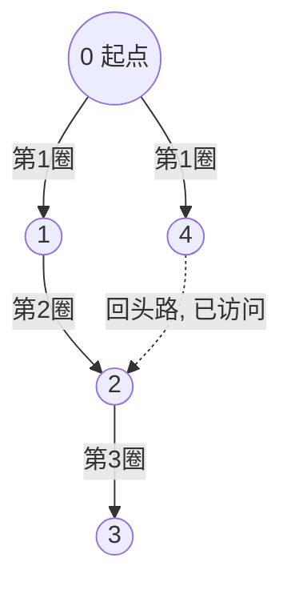

# 第 19 章 图：遍历与连通性

> 覆盖题号：126, 127, 130, 133, 200, 286, 317, 329, 339, 364

## 19.1 引子：社交网络与地图航线

你有没有想过，"六度分隔"理论为什么成立？你和世界上任何一个陌生人之间，最多隔着 5 个人。这句话的意思是：把所有人看成"点"，把"互相认识"看成"点与点之间的线"，那么从你出发，沿着"认识"这条线最多走 6 步就能到任何人。

再看导航软件：从北京到上海，地图上有许多城市和航线，导航要回答"哪条路线最短"。把城市看成点、航线看成线，这又是一个"找最短路线"的问题。

像"点 + 点之间的连线"这样的结构，就叫**图（graph）**。社交网络是图、地铁线路是图、网页之间的超链接是图、迷宫是图，甚至二维数组里的每个格子也可以看成图。而处理图的第一步，几乎永远是**遍历（traversal）**——把图里的点一个个走一遍。本章就讲遍历的两大主角：

- **BFS（广度优先搜索）**：像往池塘里扔石头，波纹一圈圈往外扩散——天然适合找"最短路径"；
- **DFS（深度优先搜索）**：像走迷宫一样一条路走到黑、撞了南墙才回头——天然适合"连通性"判断。

从 LeetCode 前 400 题看，图相关的题目里，十道有八道是"BFS/DFS + 一点小技巧"。学会本章，你就掌握了刷图题的半壁江山。先看一道开胃菜：**200. 岛屿数量**——一张 `'1'/'0'` 二维网格，数一数有几个"1 连成的岛"。数岛屿的本质就是"数图里有几个连通的块"，这正是 DFS/BFS 最拿手的活。本章会把这道题和另外 9 道题（含 4 道付费锁题）逐一讲透，每道都给出经过验证的完整代码。

## 19.2 核心思想

### 19.2.1 图是什么：点、边与"关系"

图由两部分组成：

- **顶点（vertex）**：图中的"点"，比如社交网络里的一个人、地图上的一个城市；
- **边（edge）**：点与点之间的"关系"，比如 A 认识 B、北京到上海有航线。

根据边的性质，图又分成几类：

| 类型 | 含义 | 生活类比 |
| --- | --- | --- |
| 无向图 | 边没有方向，A-B 和 B-A 是一回事 | 微信好友（你加我、我加你，对称） |
| 有向图 | 边有方向，只能 A→B | 微博关注（我关注你，你不一定关注我） |
| 带权图 | 边上带一个数值（距离、花费） | 航线的里程、高速的过路费 |
| 无权图 | 边上没有数值，只关心"通不通" | 好友关系、单词接龙（改一个字母算一步） |

如果从某个点出发，能沿着边走到另一个点，就说这两个点**连通**；无向图里"互相能走到"的一整团点，叫一个**连通分量**。数"有几个岛"、判断"朋友圈里 A 和 B 认不认识"，本质都是在做连通性分析。

### 19.2.2 三种表示法：邻接表、邻接矩阵、边列表

要在代码里存图，主流有 3 种方式。设顶点数为 $V$、边数为 $E$：

**① 邻接表（adjacency list）**：每个顶点挂一个"邻居名单"。Python 里最常用两种写法：

- `list` 的 `list`：顶点编号是 0~V-1 时用，`adj[u]` 就是 u 的所有邻居；
- `dict`：顶点是字符串或编号不连续时用，`adj = {"北京": ["上海", "广州"], ...}`。

**② 邻接矩阵（adjacency matrix）**：开一个 $V \times V$ 的二维数组，`mat[u][v] = 1` 表示 u 到 v 有边。判断"u 和 v 是不是邻居"是 $O(1)$，但空间是 $O(V^2)$，适合稠密图（边很多的图）或顶点数很少的图。

**③ 边列表（edge list）**：把所有边存成一个列表 `[(u, v), ...]`。它最"省心"，但想查"u 的邻居"要全表扫描；它的用武之地是按边处理的算法（比如第 20 章最小生成树的 Kruskal 算法要先给边按权值排序）。

**怎么选？** 看这张表：

| 操作 | 邻接表 | 邻接矩阵 | 边列表 |
| --- | --- | --- | --- |
| 遍历 u 的所有邻居 | $O(\deg(u))$，快 | $O(V)$，要扫一整行 | $O(E)$，全表扫描 |
| 判断 u、v 是否相邻 | $O(\deg(u))$ | $O(1)$ | $O(E)$ |
| 空间 | $O(V+E)$，稀疏图省 | $O(V^2)$，稠密图可接受 | $O(E)$ |
| 典型用途 | 刷题默认首选 | 小图/稠密图/快速判邻 | 按边排序的算法 |

刷 LeetCode 时，**邻接表是绝对主力**：遍历邻居快、空间省，BFS/DFS 模板直接套。下面这段代码演示三种表示法及它们之间的转换：

```python
def edges_to_adj_list(edges, n, directed=False):
    """边列表 -> 邻接表: 下标即顶点编号, 每个顶点挂一个邻居列表"""
    adj = [[] for _ in range(n)]
    for u, v in edges:
        adj[u].append(v)
        if not directed:
            adj[v].append(u)
    return adj


def edges_to_adj_matrix(edges, n, directed=False):
    """边列表 -> 邻接矩阵: mat[u][v] = 1 表示 u 到 v 有边"""
    mat = [[0] * n for _ in range(n)]
    for u, v in edges:
        mat[u][v] = 1
        if not directed:
            mat[v][u] = 1
    return mat


def adj_list_to_edges(adj, directed=False):
    """邻接表 -> 边列表(去重: 无向图只取 u < v 的一条)"""
    edges = []
    for u in range(len(adj)):
        for v in adj[u]:
            if directed or u < v:
                edges.append((u, v))
    return edges


def dict_adj_from_edges(edges, directed=False):
    """边列表 -> 字典式邻接表: 适合顶点是字符串/编号不连续的场景"""
    adj = {}
    for u, v in edges:
        adj.setdefault(u, []).append(v)
        if not directed:
            adj.setdefault(v, []).append(u)
    return adj


if __name__ == "__main__":
    edges = [(0, 1), (1, 2), (2, 0), (2, 3)]
    adj = edges_to_adj_list(edges, 4)
    assert adj == [[1, 2], [0, 2], [1, 0, 3], [2]]
    assert edges_to_adj_list(edges, 4, directed=True) == [[1], [2], [0, 3], []]
    mat = edges_to_adj_matrix(edges, 4)
    assert mat[0][1] == mat[1][0] == 1 and mat[0][0] == 0
    assert mat[2][3] == mat[3][2] == 1
    # 邻接表 <-> 边列表 互转要能还原(无向边归一化后比较)
    assert {tuple(sorted(e)) for e in adj_list_to_edges(adj)} == \
        {tuple(sorted(e)) for e in edges}
    # 字符串顶点的字典式邻接表
    d = dict_adj_from_edges([("北京", "上海"), ("上海", "广州")], directed=True)
    assert d == {"北京": ["上海"], "上海": ["广州"]}
    print("三种图的表示互相转换验证通过!")
```

手工推演一遍转换：边列表 `[(0,1),(1,2),(2,0),(2,3)]`（无向图）。邻接表里 `adj[0]` 先收到 1，再收到 2（因为 (2,0) 这条边），所以 `adj[0] = [1, 2]`；`adj[2]` 依次收到 1、0、3，所以 `adj[2] = [1, 0, 3]`。邻接矩阵则在 `(0,1)、(1,0)、(1,2)、(2,1)、(2,0)、(0,2)、(2,3)、(3,2)` 这 8 个位置写 1，其余写 0。注意无向图的矩阵一定**沿主对角线对称**——这是无向图的特征，可以用来快速自查。

### 19.2.3 BFS：波纹扩散

把一块石头扔进池塘，水面会荡起一圈圈波纹，第一圈、第二圈……依次向外。**BFS（Breadth-First Search，广度优先搜索）就是这个波纹**：从起点出发，先把"一步能到的点"全部访问（第 1 圈），再访问"两步能到的点"（第 2 圈），以此类推。

它靠**队列（queue）**实现——先进先出，像排队买奶茶：先到的人先处理，处理完的人把"他的邻居"排到队尾。

> **为什么 BFS 能找到无权图的最短路径？** 因为波纹是一圈圈往外扩的：第 k 圈里的点，从起点到它**至少**要走 k 步（不然它会更早被访问到）；同时 BFS 又**确实**在第 k 步走到了它。两头一夹，第一次访问到目标时走的步数就是最短的。而 DFS 一条路走到黑，可能先沿着一条远路走到天边，绕了一大圈才碰到目标——所以"最短路径"这件事，交给 BFS。

手推一个例子：社交网络里，你是起点 0，好友是 1、4；1 的好友是 2；2 的好友是 3。BFS 从 0 出发的波纹是：第 1 圈 {1, 4}，第 2 圈 {2}，第 3 圈 {3}。所以"0 到 3 要几步？"答案是 3——这正是从 0 走到 3 的最短步数（0→1→2→3）。



每一圈对应队列中的"一层"：处理完第 k 圈的所有点，才轮到第 k+1 圈——这就是"波纹"的代码形态。

### 19.2.4 DFS：一条路走到黑

**DFS（Depth-First Search，深度优先搜索）**像在迷宫里走路：从入口进去，见路就走、一条道走到黑；撞了墙（走到尽头），退回上一个岔路口，再换一条路继续走。这种"走到底再回头"的路线，正好可以用**递归**自然表达：进入一个点，就递归进入它的第一个邻居，邻居的邻居……直到没有新邻居，再一层层返回。

> **为什么 DFS 适合连通性/染色？** 一次 DFS 会"贪心"地把当前点所在连通分量**整个走完**才回头——所以"从一个点出发 DFS 能到达哪些点"就是"它和谁连通"。染色（判断二分图）也靠这个性质：DFS 一路走下来，给相邻的点染上不同颜色，一旦发现"相邻两点颜色相同"就说明图里有奇环，不是二分图。

如果不想用递归（怕爆栈），可以用**显式栈**模拟：把"待访问的点"压进栈，每次弹出栈顶访问。栈是后进先出，所以会先钻进刚发现的新点——效果和递归一致。

### 19.2.5 网格图：把二维数组当成图

LeetCode 里一大类"图题"长得根本不像图——它们是一张二维网格，比如 200 题的 `'1'/'0'` 矩阵。把网格当成图的诀窍是：

- **每个格子是一个顶点**；
- **上下左右四个格子是它的邻居**（四方向）；如果题目允许斜着走，再加两条对角线（八方向）。

这样，"从 (i, j) 能走到哪些格子"就变成了标准的图遍历。唯一要注意的是**边界检查**：邻居坐标不能越出网格。

遍历网格图时，`visited` 有一个省钱妙招——**原地修改**：把访问过的 `'1'` 直接改成 `'0'`，既不重复访问，又省掉一个和网格一样大的 visited 数组，额外空间从 $O(mn)$ 降到 $O(1)$。200 题的"沉没技巧"就是它（详见 19.6 节）。

### 19.2.6 记忆化搜索：给 DFS 装"缓存"

有时候 DFS 会反复计算同一个子问题：比如从 (i, j) 出发能走多远，可能被多个邻居各问一遍。解决办法是**记忆化（memoization）**——准备一张表，第一次算出答案就存起来，下次直接查表（第 01 章的 `fib_memo` 已经见过这个套路）。

记忆化能把指数级的暴力 DFS 变成多项式级。但它有一个**大坑**：如果图里有环，DFS 可能绕回自己，此时"答案还没算完就查缓存"会出错。所以记忆化 DFS 只适合**天然无环**的问题，例如"只能走向更大的数"（329 题严格递增，环根本走不回来）。如果题目允许绕圈，就得换**拓扑排序**的思路（第 20 章会系统讲），本章不展开。

## 19.3 算法流程

### 19.3.1 BFS 模板

```text
# 无权图 BFS: 求 start 到每个点的最短距离(邻接表)
visited = [False] * V
dist[start] = 0, visited[start] = True
queue = [start]
while queue 非空:
    u = queue 出队
    for v in adj[u]:            # 遍历 u 的所有邻居
        if not visited[v]:
            visited[v] = True   # 入队前先标记, 防止重复入队
            dist[v] = dist[u] + 1
            queue 入队 v
```

两个细节必须记住：

1. **入队前就标记 visited**，而不是出队时再标记——否则同一个点可能被多个邻居重复入队，队列膨胀，还可能算错层数；
2. 想"逐层处理"（数圈数、记录层号）时，先取 `size = len(queue)`，只处理这一层的 size 个节点——这就是 127、126 题的"层"。

### 19.3.2 DFS 模板（递归版）

```text
visited = [False] * V
def dfs(u):
    visited[u] = True           # 先标记再递归, 防环/防重复
    for v in adj[u]:
        if not visited[v]:
            dfs(v)

# 全图遍历: 每个未访问点启动一次 dfs
for u in range(V):
    if not visited[u]:
        dfs(u)
```

"每个未访问点启动一次 dfs"这个外层循环，就是"数连通分量"的标准写法：启动几次，就有几个连通分量。

### 19.3.3 DFS 模板（显式栈版）

```text
visited = [False] * V
stack = [start]; visited[start] = True
while stack 非空:
    u = stack.pop()
    for v in adj[u]:
        if not visited[v]:
            visited[v] = True
            stack.push(v)
```

### 19.3.4 网格图：邻居怎么生成

```text
dirs = [(1, 0), (-1, 0), (0, 1), (0, -1)]   # 四方向
# 八方向: [(-1,-1),(-1,0),(-1,1),(0,-1),(0,1),(1,-1),(1,0),(1,1)]
for di, dj in dirs:
    ni, nj = i + di, j + dj
    if 0 <= ni < m and 0 <= nj < n and grid[ni][nj] 满足条件:
        处理(ni, nj)
```

四方向还是八方向，看题意（"只能上下左右走"=四方向；"可以走对角线"=八方向），**不要默认**。

### 19.3.5 记忆化 DFS 模板

```text
memo = 和输入同尺寸的缓存表(初始为"未计算"标记)
def dfs(i, j):
    if memo[i][j] 已算过:
        return memo[i][j]
    按题意从邻居递归计算答案
    memo[i][j] = 答案
    return 答案
```

### 19.3.6 什么时候用 BFS，什么时候用 DFS？

| 题目特征 | 首选 | 原因 |
| --- | --- | --- |
| 求最短步数/最短路径/逐层扩散 | BFS | 波纹逐层扩散，首次到达即最短 |
| 数连通块/判断可达/染色/遍历全图 | DFS | 一次 DFS 覆盖整个连通分量，代码短 |
| 网格题 | 两者皆可 | 递归顺手的 DFS，或防爆栈用 BFS |
| 求最长路径/路径计数（无环） | 记忆化 DFS | 缓存子问题答案，避免指数爆炸 |

## 19.4 复杂度分析

先说遍历的"行情价"：

- **邻接表上的 BFS/DFS**：时间 $O(V+E)$。为什么？每个顶点至多入队（入栈）一次，每条边至多被检查一次（从它的两个端点各看一次）。空间 $O(V)$：visited 数组 + 队列/栈 + 递归栈。
- **邻接矩阵上的 BFS/DFS**：时间 $O(V^2)$——即使图很稀疏，每访问一个点也要扫一整行（V 个位置）找邻居。空间 $O(V^2)$（矩阵本身）。
- **网格图遍历**：$m \times n$ 个格子就是 $V = mn$ 个顶点，$E \approx 4mn$ 条"边"，所以时间 $O(mn)$；visited 用原地修改时额外空间 $O(1)$，否则 $O(mn)$。
- **记忆化 DFS**：每个状态只算一次，时间 $O(\text{状态数} \times \text{每个状态的转移代价})$。329 题状态数 $mn$、每个状态看 4 个邻居，总时间 $O(mn)$。

| 场景 | 时间 | 空间 | 说明 |
| --- | --- | --- | --- |
| BFS（邻接表） | $O(V+E)$ | $O(V)$ | 无权图最短路径的标准答案 |
| DFS（邻接表） | $O(V+E)$ | $O(V)$ | 含递归栈 |
| 网格 BFS/DFS | $O(mn)$ | $O(mn)$ 或 $O(1)$ | 原地标记可省 visited |
| 记忆化 DFS | $O(\text{状态数}\times\text{转移})$ | $O(\text{状态数})$ | 缓存表 |

一个常见误区：**图很大时别用邻接矩阵**。$V = 10^5$ 的稀疏图，邻接表只要存 $10^5 + E$ 个数，邻接矩阵却要开 $10^{10}$ 个格子——直接内存爆炸。刷题默认邻接表，准没错。

## 19.5 Python 实现：三大模板

### 19.5.1 BFS 与 DFS 遍历模板

下面把 19.3 的伪代码落地成可直接运行的函数：BFS 求访问顺序和最短距离，DFS 给递归版和显式栈版，并顺手实现两个最常用的应用——数连通分量、二分图染色判定：

```python
from collections import deque


def bfs_order(adj, start):
    """BFS 访问顺序: 队列 + visited, 一层一层扩散"""
    n = len(adj)
    visited = [False] * n
    visited[start] = True
    queue = deque([start])
    order = []
    while queue:
        u = queue.popleft()
        order.append(u)
        for v in adj[u]:
            if not visited[v]:
                visited[v] = True
                queue.append(v)
    return order


def bfs_distances(adj, start):
    """BFS 求 start 到每个点的最短距离(无权图), 不可达记 -1。
    关键: 距离数组同时充当 visited, 首次赋值即最短距离。"""
    n = len(adj)
    dist = [-1] * n
    dist[start] = 0
    queue = deque([start])
    while queue:
        u = queue.popleft()
        for v in adj[u]:
            if dist[v] == -1:
                dist[v] = dist[u] + 1
                queue.append(v)
    return dist


def dfs_order_recursive(adj, start):
    """DFS 访问顺序(递归版): 一条路走到黑, 走不动才回头"""
    n = len(adj)
    visited = [False] * n
    order = []

    def dfs(u):
        visited[u] = True
        order.append(u)
        for v in adj[u]:
            if not visited[v]:
                dfs(v)

    dfs(start)
    return order


def dfs_order_iterative(adj, start):
    """DFS 访问顺序(显式栈版): 与递归版顺序可能不同, 但访问的顶点集相同"""
    n = len(adj)
    visited = [False] * n
    order = []
    stack = [start]
    while stack:
        u = stack.pop()
        if visited[u]:
            continue
        visited[u] = True
        order.append(u)
        for v in reversed(adj[u]):     # 反序入栈, 让访问顺序尽量贴近递归版
            if not visited[v]:
                stack.append(v)
    return order


def count_components(adj):
    """无向图连通分量个数: 每个未访问顶点启动一次 DFS, 一次 DFS 覆盖一个分量"""
    n = len(adj)
    visited = [False] * n

    def dfs(u):
        visited[u] = True
        for v in adj[u]:
            if not visited[v]:
                dfs(v)

    cnt = 0
    for u in range(n):
        if not visited[u]:
            cnt += 1
            dfs(u)
    return cnt


def is_bipartite(adj):
    """二分图判定: DFS 染色, 相邻顶点必须异色, 否则不是二分图"""
    n = len(adj)
    color = [-1] * n

    def dfs(u, c):
        color[u] = c
        for v in adj[u]:
            if color[v] == -1:
                if not dfs(v, 1 - c):
                    return False
            elif color[v] == c:
                return False
        return True

    for u in range(n):
        if color[u] == -1 and not dfs(u, 0):
            return False
    return True


if __name__ == "__main__":
    # 图: 0-1-2-3 是一条链, 0 还连着 4
    adj = [[1, 4], [0, 2], [1, 3], [2], [0]]
    assert bfs_order(adj, 0) == [0, 1, 4, 2, 3]
    assert bfs_distances(adj, 0) == [0, 1, 2, 3, 1]
    assert bfs_distances(adj, 3) == [3, 2, 1, 0, 4]
    assert dfs_order_recursive(adj, 0) == [0, 1, 2, 3, 4]
    it = dfs_order_iterative(adj, 0)
    assert len(it) == 5 and sorted(it) == [0, 1, 2, 3, 4]
    assert count_components(adj) == 1
    assert count_components([[1], [0], [3], [2]]) == 2   # 两个互不相连的边
    # 二分图: 四环是二分图, 三角形不是
    assert is_bipartite([[1, 3], [0, 2], [1, 3], [0, 2]]) is True
    assert is_bipartite([[1, 2], [0, 2], [0, 1]]) is False
    print("BFS / DFS 模板全部验证通过!")
```

### 19.5.2 网格图模板：flood fill

"网格即图"的完整示例：从一个格子出发，把四方向连通的整块区域标记掉并数出大小（这就是 200 题的"沉没"、130 题的"从边界标记"的共同骨架）：

```python
def flood_fill(grid, sr, sc):
    """把 (sr, sc) 所在的四方向连通块全部标记为 '#', 返回标记个数。
    演示"网格即图": 每个格子是一个顶点, 上下左右四条边;
    visited 用原地修改省掉额外空间。"""
    if not grid or not grid[0]:
        return 0
    if grid[sr][sc] != ".":
        return 0
    m, n = len(grid), len(grid[0])
    dirs = [(1, 0), (-1, 0), (0, 1), (0, -1)]
    count = 0

    def dfs(i, j):
        nonlocal count
        grid[i][j] = "#"          # 原地标记, 等价于 visited
        count += 1
        for di, dj in dirs:
            ni, nj = i + di, j + dj
            if 0 <= ni < m and 0 <= nj < n and grid[ni][nj] == ".":
                dfs(ni, nj)

    dfs(sr, sc)
    return count


if __name__ == "__main__":
    g = [
        ["#", "#", ".", "#"],
        ["#", ".", ".", "#"],
        [".", ".", "#", "#"],
    ]
    # 从 (1,1) 出发的连通块: (1,1)(1,2)(0,2)(2,1)(2,0) 共 5 格
    assert flood_fill(g, 1, 1) == 5
    # 已被标记成 #, 再数一次是 0
    assert flood_fill(g, 1, 1) == 0
    # 边界: 起点是墙 / 空网格
    assert flood_fill([["#", "."]], 0, 0) == 0
    assert flood_fill([], 0, 0) == 0
    print("网格图 DFS + 原地标记验证通过!")
```

### 19.5.3 记忆化 DFS 模板

用一道经典题演示记忆化：从 (0,0) 走到 (m-1,n-1)，只能向右或向下，求路径条数。朴素 DFS 会把同一格子反复计算（指数级），加一个 `lru_cache` 缓存后变成多项式级——这正是 329 题的骨架：

```python
from functools import lru_cache


def count_paths_memo(m, n):
    """从 (0,0) 走到 (m-1,n-1), 只能向右或向下, 求路径条数。
    演示"记忆化 DFS": 朴素 DFS 是指数级(重复计算), 缓存后变成多项式级。"""
    @lru_cache(maxsize=None)
    def dfs(i, j):
        if i == m - 1 and j == n - 1:
            return 1
        ways = 0
        if i + 1 < m:
            ways += dfs(i + 1, j)
        if j + 1 < n:
            ways += dfs(i, j + 1)
        return ways

    return dfs(0, 0)


if __name__ == "__main__":
    assert count_paths_memo(3, 3) == 6    # C(4,2) = 6
    assert count_paths_memo(2, 2) == 2
    assert count_paths_memo(1, 3) == 1    # 只有一条直线
    assert count_paths_memo(1, 1) == 1    # 边界: 单格
    print("记忆化 DFS 模板验证通过!")
```

## 19.6 LeetCode 真题精讲

本章 10 道题按主题分为四组：**连通性**（200、130）、**图的结构克隆**（133）、**最短路径**（127、126、286、317）、**记忆化与深度**（329、339、364）。

### 第一组：连通性（200 / 130）

### 200. 岛屿数量（中等）

**题意**：给一个 `'1'`（陆地）和 `'0'`（水）组成的二维网格，上下左右相邻的 `'1'` 属于同一座岛，返回岛的个数。

**思路**：把网格当图，每个 `'1'` 是一个顶点，四方向是边。"数岛"就是"数连通分量"。套路是：**扫到没见过的 `'1'` 就说明发现了一座新岛，计数 +1，然后用 DFS/BFS 把这座岛整个"沉没"（把它的 `'1'` 全改成 `'0'`）**，这样后面再扫到它就不会重复计数。原地改 `'0'` 同时充当 visited，一举两得。

手推一个小例子：

```text
1 1 0
1 0 1
```

扫到 (0,0) 是 `'1'`，计数 1，DFS 沉没 (0,0)、(0,1)、(1,0)（它们四方向连通）；继续扫到 (1,2) 又是 `'1'`，计数 2，沉没之。答案 2。注意 (0,2) 和 (1,1) 是水，不参与。

代码给 DFS 和 BFS 两种写法（面试常被要求换着写）。并查集（Union-Find）也能做这题：先把所有陆地节点并起来，再数"根"的个数——第 20 章会详细讲，这里先留个印象。

```python
import copy
import sys
from collections import deque

sys.setrecursionlimit(1000000)


def num_islands_dfs(grid):
    """200. 岛屿数量(DFS 版): 每遇到一个 '1' 就把它所在的岛整体沉没(改成 '0')"""
    if not grid:
        return 0
    m, n = len(grid), len(grid[0])
    dirs = [(1, 0), (-1, 0), (0, 1), (0, -1)]

    def sink(i, j):
        grid[i][j] = "0"               # 原地修改 = visited
        for di, dj in dirs:
            ni, nj = i + di, j + dj
            if 0 <= ni < m and 0 <= nj < n and grid[ni][nj] == "1":
                sink(ni, nj)

    count = 0
    for i in range(m):
        for j in range(n):
            if grid[i][j] == "1":
                count += 1
                sink(i, j)
    return count


def num_islands_bfs(grid):
    """200. 岛屿数量(BFS 版): 队列逐层扩散, 同样用原地修改标记"""
    if not grid:
        return 0
    m, n = len(grid), len(grid[0])
    dirs = [(1, 0), (-1, 0), (0, 1), (0, -1)]
    count = 0
    for i in range(m):
        for j in range(n):
            if grid[i][j] == "1":
                count += 1
                grid[i][j] = "0"
                queue = deque([(i, j)])
                while queue:
                    x, y = queue.popleft()
                    for dx, dy in dirs:
                        nx, ny = x + dx, y + dy
                        if 0 <= nx < m and 0 <= ny < n and grid[nx][ny] == "1":
                            grid[nx][ny] = "0"
                            queue.append((nx, ny))
    return count


if __name__ == "__main__":
    g1 = [["1", "1", "1", "1", "0"],
          ["1", "1", "0", "1", "0"],
          ["1", "1", "0", "0", "0"],
          ["0", "0", "0", "0", "0"]]
    g2 = [["1", "1", "0", "0", "0"],
          ["1", "1", "0", "0", "0"],
          ["0", "0", "1", "0", "0"],
          ["0", "0", "0", "1", "1"]]
    assert num_islands_dfs(copy.deepcopy(g1)) == 1
    assert num_islands_dfs(copy.deepcopy(g2)) == 3
    assert num_islands_bfs(copy.deepcopy(g1)) == 1
    assert num_islands_bfs(copy.deepcopy(g2)) == 3
    # 边界: 空网格 / 单格 / 全 1
    assert num_islands_dfs([]) == 0
    assert num_islands_dfs([["1"]]) == 1
    assert num_islands_dfs([["0"]]) == 0
    assert num_islands_bfs([["1", "1", "1"], ["1", "1", "1"], ["1", "1", "1"]]) == 1
    print("200. 岛屿数量 全部断言通过!")
```

**复杂度分析**：每个格子至多被访问一次（被沉没后不再进入），时间 $O(mn)$；递归/队列最多同时容纳 $O(mn)$ 个格子，空间 $O(mn)$（不计原地修改的 grid 本身）。

**易错点**：

- **忘了原地沉没**：不把 `'1'` 改 `'0'` 就会重复访问同一座岛，甚至无限递归。
- 本地测试时**先 copy 一份 grid** 再调用（两个版本都会改输入），否则同一个变量测第二次结果就变成 0。
- 大网格 DFS 可能爆递归栈：加 `sys.setrecursionlimit`，或干脆用 BFS/显式栈。

### 130. 被围绕的区域（中等）

**题意**：网格里 `'X'` 是墙、`'O'` 是空地。把所有**被 `'X'` 四面围住**的 `'O'` 翻成 `'X'`；贴着边界的 `'O'` 不算被围（它连通外界），保持不变。

**思路**：关键问题：**怎么知道哪些 `'O'` 被围？** 反过来想——被围的 `'O'` 一定**接触不到边界**；而贴着边界的 `'O'` 以及跟它连成一片的 `'O'`，都能"逃"到网格外面。所以：

1. 从**四条边界上所有的 `'O'`** 出发 DFS/BFS，把它们所在的连通块标记为 `'E'`（Escape，逃出去了）；
2. 再整体扫描：剩下的 `'O'` 全是被围的，翻成 `'X'`；`'E'` 还原成 `'O'`。

手推标准例子：

```text
X X X X      X X X X
X O O X      X O O X
X X O X  ->  X X X X
X O X X      X O X X
```

边界上唯一的 `'O'` 在 (3,1)，标记为 `'E'`；它四方向都被 `'X'` 围住，扩散不动。其余三个 `'O'`（(1,1)、(1,2)、(2,2)）都没被标记，全翻成 `'X'`。最后把 (3,1) 还原回 `'O'`。

**为什么必须从边界出发，而不是直接扫所有 `'O'`？** 因为"被围"是一个**整体**概念：一个 `'O'` 是不是被围，取决于它所在的连通块能否碰到边界。从边界出发一次标记一整块，天然把"能逃的"和"被围的"分开；如果从任意 `'O'` 出发，无法判断它所在的块能不能逃出去。

```python
import sys

sys.setrecursionlimit(1000000)


def solve(board):
    """130. 被围绕的区域: 从边界 'O' 出发的 DFS 标记为 'E'(逃出生天),
    剩下的 'O' 才是被 X 围住的, 整体翻成 'X', 最后把 'E' 还原成 'O'。"""
    if not board:
        return
    m, n = len(board), len(board[0])
    dirs = [(1, 0), (-1, 0), (0, 1), (0, -1)]

    def mark(i, j):
        board[i][j] = "E"
        for di, dj in dirs:
            ni, nj = i + di, j + dj
            if 0 <= ni < m and 0 <= nj < n and board[ni][nj] == "O":
                mark(ni, nj)

    for i in range(m):
        for j in range(n):
            if (i == 0 or i == m - 1 or j == 0 or j == n - 1) and board[i][j] == "O":
                mark(i, j)
    for i in range(m):
        for j in range(n):
            if board[i][j] == "O":
                board[i][j] = "X"
            elif board[i][j] == "E":
                board[i][j] = "O"


if __name__ == "__main__":
    board1 = [["X", "X", "X", "X"],
              ["X", "O", "O", "X"],
              ["X", "X", "O", "X"],
              ["X", "O", "X", "X"]]
    expected1 = [["X", "X", "X", "X"],
                 ["X", "X", "X", "X"],
                 ["X", "X", "X", "X"],
                 ["X", "O", "X", "X"]]
    solve(board1)
    assert board1 == expected1
    # 边界: 全部贴着边界的 O 不会被翻转
    board2 = [["O", "O"], ["O", "O"]]
    solve(board2)
    assert board2 == [["O", "O"], ["O", "O"]]
    # 边界: 单格 O / 空网格
    board3 = [["O"]]
    solve(board3)
    assert board3 == [["O"]]
    solve([])
    print("130. 被围绕的区域 全部断言通过!")
```

**复杂度分析**：每个格子至多被访问常数次，时间 $O(mn)$；递归栈最坏 $O(mn)$，空间 $O(mn)$。

**易错点**：

- **起点必须是边界上的 `'O'`**，不是所有 `'O'`——这是本题唯一的"题眼"。
- 中间用临时标记 `'E'`，**不要边标记边翻转**，否则"边界块"和"被围块"会互相污染。
- 边界上的 `'O'` 本身不能翻：它贴着边界，按题意不可能被围。

### 第二组：图的结构克隆（133）

### 133. 克隆图（中等）

**题意**：给一个无向连通图的某个节点，深拷贝这整张图，返回克隆图的对应节点。深拷贝意味着**新图的每个节点都是新对象**，但结构（邻居关系）和原图完全一样。

**思路**：图的"深拷贝"有一个天然难点——**图可能有环**（比如 1 的邻居是 2，2 的邻居又是 1）。如果边克隆边递归，遇到环就会无限递归。

解法核心是一张**哈希表**：`clones[原节点] = 克隆节点`。

- **先查表**：这个原节点克隆过没有？克隆过直接返回，不重复克隆；
- **没克隆过**：新建克隆节点，**先登记进表再处理它的邻居**（DFS 版尤其重要，防止环回头时找不到缓存）；
- 把原节点的每个邻居的克隆，接到克隆节点的邻居列表上。

BFS 版同理：队列负责遍历原图，表负责"原节点 → 克隆节点"一一对应。

手推一个小环：1 的邻居是 2，2 的邻居是 1。DFS 克隆 1：建 `clone1`，登记 `clones[1]=clone1`，处理邻居 2：建 `clone2`，登记 `clones[2]=clone2`，处理 2 的邻居 1：查表命中 `clone1`，接上——搞定，没有死循环。**如果先递归邻居再登记，处理 2 的邻居 1 时表里还没有 1，就会再克隆一遍 1，无限递归。**

```python
from collections import deque


class Node:
    """LeetCode 133 的图节点: val + 邻居列表"""

    def __init__(self, val=0, neighbors=None):
        self.val = val
        self.neighbors = neighbors if neighbors is not None else []


def clone_graph_bfs(node):
    """133. 克隆图(BFS 版): 哈希表存"原节点 -> 克隆节点", 避免重复克隆和死循环"""
    if not node:
        return None
    clones = {node: Node(node.val)}
    queue = deque([node])
    while queue:
        cur = queue.popleft()
        for nb in cur.neighbors:
            if nb not in clones:              # 第一次见到才克隆并入队
                clones[nb] = Node(nb.val)
                queue.append(nb)
            clones[cur].neighbors.append(clones[nb])
    return clones[node]


def clone_graph_dfs(node, clones=None):
    """133. 克隆图(DFS 版): 先建克隆再递归邻居, 天然防环"""
    if clones is None:
        clones = {}
    if not node:
        return None
    if node in clones:
        return clones[node]
    new_node = Node(node.val)
    clones[node] = new_node                   # 必须先登记, 否则环会无限递归
    for nb in node.neighbors:
        new_node.neighbors.append(clone_graph_dfs(nb, clones))
    return new_node


def describe(node):
    """把图"拍照"成规范化描述: {val: 排序后的邻居 val 列表}, 便于比较两个图是否同构"""
    if not node:
        return None
    result = {}
    queue = deque([node])
    seen = {id(node)}
    while queue:
        cur = queue.popleft()
        result[cur.val] = sorted(nb.val for nb in cur.neighbors)
        for nb in cur.neighbors:
            if id(nb) not in seen:
                seen.add(id(nb))
                queue.append(nb)
    return result


if __name__ == "__main__":
    # 构造 1-2-3-4-1 的环
    n1, n2, n3, n4 = Node(1), Node(2), Node(3), Node(4)
    n1.neighbors = [n2, n4]
    n2.neighbors = [n1, n3]
    n3.neighbors = [n2, n4]
    n4.neighbors = [n1, n3]
    c1 = clone_graph_bfs(n1)
    c2 = clone_graph_dfs(n1)
    # 克隆出的节点必须是"新的"对象, 且结构与原图完全一致
    assert c1 is not n1 and c2 is not n1
    assert describe(c1) == describe(n1) == {1: [2, 4], 2: [1, 3], 3: [2, 4], 4: [1, 3]}
    assert describe(c2) == describe(n1)
    # 边界: 空图 / 单节点自环
    assert clone_graph_bfs(None) is None
    single = Node(1)
    single.neighbors = [single]
    cs = clone_graph_dfs(single)
    assert cs is not single and cs.neighbors[0] is cs
    print("133. 克隆图 全部断言通过!")
```

**复杂度分析**：每个节点和每条边都访问一次，时间 $O(V+E)$；哈希表和队列各 $O(V)$，空间 $O(V)$。

**易错点**：

- DFS 版**必须"先登记、后递归"**，否则环 = 无限递归（这是本题最容易踩的坑）。
- 克隆节点的邻居必须指向**克隆节点**，不能偷懒把原节点的邻居列表直接复制过去。
- 判重用 `node in clones`，别用 `val` 判重——不同节点理论上可能有相同 val（虽然本题不会，但习惯要养成）。

### 第三组：最短路径（127 / 126 / 286 / 317）

### 127. 单词接龙（困难）

**题意**：给起始词 `beginWord`、结束词 `endWord` 和一个单词表，每次只能把一个字母改成另一个字母，且改完的词必须在单词表里。返回从 begin 到 end 的**最短转换序列的长度**（含首尾），不存在则返回 0。

**思路**：把"单词"看成顶点，把"只差一个字母"看成边，这就是一个无权图！"最短转换序列长度"就是无权图上的最短路径——**BFS 的主场**。

难点在**邻居怎么生成**：两个词差一个字母，怎么快速找出某个词的所有邻居？朴素做法是两两比较（$O(N^2)$ 个词对），太慢。经典做法是**枚举替换**：对单词的每个位置，试着换成 26 个字母中的其他 25 个，看拼出来的词在不在单词表里。每个词 $O(26L)$ 次查表（表用 set，$O(1)$）。

手推标准例子：`hit → hot → dot → dog → cog`。BFS 波纹：第 1 圈 `{hit}`，第 2 圈 `{hot}`，第 3 圈 `{dot, lot}`，第 4 圈 `{dog, log}`，第 5 圈 `{cog}`——首次碰到 `cog` 就返回 5。另一条同样长的路是 `hit→hot→lot→log→cog`。

**优化（双向 BFS）**：只从 begin 往 end 扩，波纹会越来越大；不如**两头同时扩**——从 begin 和从 end 各扩一圈，谁小扩谁，直到两头的波纹相遇，相遇时的步数就是答案。圈数能减少一半左右，在单词表很大时是决定性的优化（127 题单词表可达 5000 个词）。下面代码两种都给了。

```python
from collections import deque


def ladder_length_bfs(begin_word, end_word, word_list):
    """127. 单词接龙(BFS): 每步改一个字母, 波纹一圈圈扩散, 首次碰到 end_word 即最短"""
    word_set = set(word_list)
    if end_word not in word_set:
        return 0
    queue = deque([begin_word])
    seen = {begin_word}
    step = 1
    while queue:
        for _ in range(len(queue)):          # 逐层处理, 一层就是一步
            word = queue.popleft()
            if word == end_word:
                return step
            for i in range(len(word)):
                for c in "abcdefghijklmnopqrstuvwxyz":
                    if c != word[i]:
                        nxt = word[:i] + c + word[i + 1:]
                        if nxt in word_set and nxt not in seen:
                            seen.add(nxt)
                            queue.append(nxt)
        step += 1
    return 0


def ladder_length_bi(begin_word, end_word, word_list):
    """127. 单词接龙(双向 BFS): 两头同时扩散, 相遇即最短, 常数级提速"""
    word_set = set(word_list)
    if end_word not in word_set:
        return 0
    if begin_word == end_word:
        return 1
    front, back = {begin_word}, {end_word}
    seen_front, seen_back = {begin_word}, {end_word}
    step = 1
    while front:
        if len(front) > len(back):           # 永远从"小的一头"扩散
            front, back = back, front
            seen_front, seen_back = seen_back, seen_front
        next_level = set()
        for word in front:
            for i in range(len(word)):
                for c in "abcdefghijklmnopqrstuvwxyz":
                    if c != word[i]:
                        cand = word[:i] + c + word[i + 1:]
                        if cand in back:     # 两头相遇
                            return step + 1
                        if cand in word_set and cand not in seen_front:
                            seen_front.add(cand)
                            next_level.add(cand)
        front = next_level
        step += 1
    return 0


if __name__ == "__main__":
    words = ["hot", "dot", "dog", "lot", "log", "cog"]
    assert ladder_length_bfs("hit", "cog", words) == 5
    assert ladder_length_bi("hit", "cog", words) == 5
    # 边界: 无通路 -> 0; 首尾相同 -> 1; 一步可达 -> 2
    assert ladder_length_bfs("hit", "cog", ["hot", "dot", "dog", "lot", "log"]) == 0
    assert ladder_length_bfs("hit", "hit", ["hit"]) == 1
    assert ladder_length_bi("hit", "hit", ["hit"]) == 1
    assert ladder_length_bfs("hit", "hot", words) == 2
    assert ladder_length_bi("hit", "cog", ["hot", "dot", "dog", "lot", "log"]) == 0
    print("127. 单词接龙 全部断言通过!")
```

**复杂度分析**：每个词至多入队一次，每个词生成 $26L$ 个候选词，时间 $O(N \cdot 26L)$（N 是词表大小，L 是词长）；空间 $O(N)$。双向 BFS 常数更小（圈数减半），但渐进复杂度相同。

**易错点**：

- **`endWord` 不在词表里直接返回 0**，不用白跑一遍 BFS。
- 生成邻居时**排除自己**（`c != word[i]`），否则可能原地打转。
- 逐层处理要用 `len(queue)` 快照，否则 `step` 会跟着队列长度乱跳。
- 起点和终点是同一个词时答案是 1（一步都不用走）。

### 126. 单词接龙 II（困难）

**题意**：同 127 题，但这次要求返回**所有**最短转换序列（每条都是一个词列表），不是长度。不存在则返回空列表。

**思路**：这是本章最硬核的一题，思路分两步：

1. **BFS 分层**：用 BFS 求出每个词到 begin 的**最短层号** `dist[word]`（词数）。BFS 保证：所有最短路径上的词，层号严格递增 1。
2. **DFS 回溯**：从 end 出发**倒着走**，每一步只走"层号恰好减一"的邻居（`dist[prev] == dist[word] - 1`），走到 begin 就收集一条路径并反转。因为每一步都强制层号减一，**走出来的每条路都必然是最短路径**，而且不会绕圈。

手推标准例子：BFS 分层得到 `hit:1, hot:2, dot:3, lot:3, dog:4, log:4, cog:5`。DFS 从 `cog` 回溯：能走 `dog`（层 4）和 `log`（层 4）；从 `dog` 只能走 `dot`（层 3），从 `log` 只能走 `lot`（层 3）；再往上都是 `hot` → `hit`。得到两条路：`hit→hot→dot→dog→cog` 和 `hit→hot→lot→log→cog`，正好是题目的标准答案。

注意**不能**在回溯时用"访问过就跳过"的 visited 剪枝——两条最短路径可以共享中间词（都经过 `hot`），一剪就把答案剪没了。

```python
from collections import deque


def find_ladders(begin_word, end_word, word_list):
    """126. 单词接龙 II: BFS 分层记录每个单词的最短层号,
    再用 DFS 从 end_word 沿"层号减一"的边回溯, 还原出全部最短路径。
    注意: begin_word 未必在词表里, 但回溯必须能"走回"它, 所以把它也加进词表。"""
    word_set = set(word_list) | {begin_word}
    if end_word not in word_set:
        return []
    if begin_word == end_word:
        return [[begin_word]]
    n = len(begin_word)

    def neighbors(word):
        """枚举把 word 的每个位置改成其他字母后仍在词表里的词"""
        res = []
        for i in range(n):
            for c in "abcdefghijklmnopqrstuvwxyz":
                if c != word[i]:
                    nxt = word[:i] + c + word[i + 1:]
                    if nxt in word_set:
                        res.append(nxt)
        return res

    # BFS 分层: dist[word] = begin_word 到 word 的最短步数(词数)
    dist = {begin_word: 1}
    queue = deque([begin_word])
    found = False
    while queue and not found:
        size = len(queue)
        for _ in range(size):
            word = queue.popleft()
            for nxt in neighbors(word):
                if nxt not in dist:
                    dist[nxt] = dist[word] + 1
                    if nxt == end_word:
                        found = True
                    queue.append(nxt)

    if end_word not in dist:
        return []

    # DFS 回溯: 只走 dist 恰好减一的边, 保证每条路径都是最短的
    paths = []

    def dfs(word, path):
        if word == begin_word:
            paths.append(path[::-1])
            return
        for prev in neighbors(word):
            if dist.get(prev) == dist[word] - 1:
                dfs(prev, path + [prev])

    dfs(end_word, [end_word])
    return paths


if __name__ == "__main__":
    words = ["hot", "dot", "dog", "lot", "log", "cog"]
    result = find_ladders("hit", "cog", words)
    expected = [["hit", "hot", "dot", "dog", "cog"],
                ["hit", "hot", "lot", "log", "cog"]]
    assert sorted(result) == sorted(expected)
    # 边界: 无通路 / 首尾相同 / 一步可达
    assert find_ladders("hit", "cog", ["hot", "dot", "dog", "lot", "log"]) == []
    assert find_ladders("hit", "hit", words + ["hit"]) == [["hit"]]
    one_step = find_ladders("hit", "hot", words)
    assert one_step == [["hit", "hot"]]
    print("126. 单词接龙 II 全部断言通过!")
```

**复杂度分析**：BFS 分层 $O(N \cdot 26L)$；回溯只沿最短路径的边走，最坏输出规模就是答案本身的大小，时间 $O(\text{答案规模} \cdot L)$ 量级。空间 $O(N)$（dist 表 + 递归栈）。

**易错点**：

- **必须先 BFS 分层、再回溯**；回溯时只走"层号减一"的边——否则会混进非最短路径，甚至绕圈。
- 回溯**不要用全局 visited 剪枝**：多条最短路径共享中间词，剪了会漏答案。
- `endWord` 不在词表返回 `[]`；begin 和 end 相同返回 `[[begin]]`，这两个边界都要单独处理。

### 329. 矩阵中的最长递增路径（困难）

**题意**：给一个整数矩阵，每一步可以上下左右走，但只能走向**值更大**的格子。求最长递增路径的长度（路径可以以任何格子为起点）。

**思路**：把每个格子看成顶点，"能走向更大的邻居"看成边——因为值必须严格递增，**图天然无环**（你不可能走回自己，值只会越来越大）。在无环图上求最长路径，首选**记忆化 DFS**：

- `dp[i][j]`：从 (i,j) 出发能走出的最长递增路径长度；
- 递归：`dp[i][j] = 1 + max(dp[邻居])`，其中邻居要满足"值比 (i,j) 大"；没有更大邻居就是 1；
- 每个格子只算一次，答案取所有 `dp[i][j]` 的最大值。

手推小例子：

```text
1 2
2 3
```

从 (1,1) 的 3 出发，没有更大的邻居，`dp[1][1]=1`；(0,1) 的 2 能走向 (1,1)，`dp[0][1]=2`；(1,0) 的 2 同理 `dp[1][0]=2`；(0,0) 的 1 能走向 (0,1) 或 (1,0)，取大者 `dp[0][0]=3`。答案 3（路径 1→2→3）。注意 `dp[1][1]` 被 (0,1) 和 (1,0) 各问了一次，但**只算了一次**——这就是记忆化的价值。

```python
import sys

sys.setrecursionlimit(1000000)


def longest_increasing_path(matrix):
    """329. 矩阵中的最长递增路径: 记忆化 DFS。
    dp[i][j] = 从 (i,j) 出发能走出的最长递增路径长度;
    因为只能从"更小"走向"更大", 图天然无环, 记忆化缓存即可, 无需拓扑排序。"""
    if not matrix or not matrix[0]:
        return 0
    m, n = len(matrix), len(matrix[0])
    dp = [[0] * n for _ in range(m)]
    dirs = [(1, 0), (-1, 0), (0, 1), (0, -1)]

    def dfs(i, j):
        if dp[i][j]:
            return dp[i][j]
        best = 1
        for di, dj in dirs:
            ni, nj = i + di, j + dj
            if 0 <= ni < m and 0 <= nj < n and matrix[ni][nj] > matrix[i][j]:
                best = max(best, 1 + dfs(ni, nj))
        dp[i][j] = best
        return best

    return max(dfs(i, j) for i in range(m) for j in range(n))


if __name__ == "__main__":
    assert longest_increasing_path([[9, 9, 4], [6, 6, 8], [2, 1, 1]]) == 4
    assert longest_increasing_path([[3, 4, 5], [3, 2, 6], [2, 2, 1]]) == 4
    assert longest_increasing_path([[1, 2], [2, 3]]) == 3
    # 边界: 单格 / 全相等 / 空矩阵
    assert longest_increasing_path([[1]]) == 1
    assert longest_increasing_path([[1, 1], [1, 1]]) == 1
    assert longest_increasing_path([]) == 0
    assert longest_increasing_path([[]]) == 0
    print("329. 矩阵中的最长递增路径 全部断言通过!")
```

**复杂度分析**：每个格子至多计算一次，每次看 4 个邻居，时间 $O(mn)$；dp 表 $O(mn)$，空间 $O(mn)$。

**易错点**：

- **必须记忆化**：不缓存就是指数级超时（每个格子被反复重新计算）。
- 只能走向**严格大于**的邻居，`>` 写成 `>=` 会在相等值之间来回走，答案偏大甚至死循环。
- dp 初始用 0 表示"未计算"（因为合法值最小是 1）；全相等的矩阵答案是 1，不是 0。

### 286. 墙与门（中等 · 付费）

**题意**：`m x n` 房间矩阵，`-1` 是墙，`0` 是门，`2147483647`（INF）是空房间。把每个空房间填成**它到最近那扇门的距离**，墙不动，门保持 0。

**思路**：一个空房间的答案 = 它到**所有门**的距离的最小值。最朴素的想法是"对每扇门做一次 BFS"，但门可能很多，$O(\text{门数} \times mn)$ 会超时。

标准解法是**多源 BFS**：把**所有门同时**放进队列（想象成池塘里同时扔下很多石头，波纹一起扩散）。每扇门到某个空房间的距离，就是"哪扇门的波纹先碰到它"——先到先得，第一次被赋值就是最短距离。这个思想叫**多源 BFS**，本质是"把多个起点当成一个超级起点的第一圈"。

手推一个 2x2 例子：门在 (0,0)，其余全是空房间。波纹第 1 圈到 (0,1)、(1,0)，填 1；第 2 圈到 (1,1)，填 2。结果 `[[0,1],[1,2]]`。注意每个空格只被填**一次**——用 `rooms[ni][nj] == INF` 判断"还没被任何波纹碰到过"。

```python
from collections import deque


def walls_and_gates(rooms):
    """286. 墙与门: 多源 BFS。所有门(0)同时入队, 波纹一起扩散,
    每个空格第一次被"碰到"时填上的距离就是到最近门的距离。原地修改, 无返回值。"""
    if not rooms or not rooms[0]:
        return
    m, n = len(rooms), len(rooms[0])
    INF = 2147483647
    dirs = [(1, 0), (-1, 0), (0, 1), (0, -1)]
    queue = deque()
    for i in range(m):
        for j in range(n):
            if rooms[i][j] == 0:
                queue.append((i, j))
    while queue:
        i, j = queue.popleft()
        for di, dj in dirs:
            ni, nj = i + di, j + dj
            if 0 <= ni < m and 0 <= nj < n and rooms[ni][nj] == INF:
                rooms[ni][nj] = rooms[i][j] + 1
                queue.append((ni, nj))


if __name__ == "__main__":
    INF = 2147483647
    rooms1 = [[INF, -1, 0, INF],
              [INF, INF, INF, -1],
              [INF, -1, INF, -1],
              [0, -1, INF, INF]]
    expected1 = [[3, -1, 0, 1],
                 [2, 2, 1, -1],
                 [1, -1, 2, -1],
                 [0, -1, 3, 4]]
    walls_and_gates(rooms1)
    assert rooms1 == expected1
    # 边界: 只有一个门 / 没有门 / 空网格
    rooms2 = [[0, INF], [INF, INF]]
    walls_and_gates(rooms2)
    assert rooms2 == [[0, 1], [1, 2]]
    rooms3 = [[INF, INF], [INF, INF]]
    walls_and_gates(rooms3)
    assert rooms3 == [[INF, INF], [INF, INF]]
    walls_and_gates([])
    print("286. 墙与门 全部断言通过!")
```

**复杂度分析**：每个格子至多入队一次，时间 $O(mn)$；队列最多 $O(mn)$，空间 $O(mn)$（原地修改，不算房间矩阵本身）。

**易错点**：

- **多源 BFS 要所有门一起入队**，不要一扇门一扇门地 BFS（那是 $O(\text{门数} \times mn)$）。
- 只有 `INF` 格子才更新：墙（-1）和已经填过距离的格子都不能再动。
- 函数原地修改房间矩阵，**没有返回值**（LeetCode 按原矩阵判断）。

### 317. 离建筑物最近的距离（困难 · 付费）

**题意**：网格里 `1` 是建筑物、`0` 是空地、`2` 是障碍。选一块空地盖楼，要求它到**每一栋**建筑物的距离之和最小（只能走空地，不能穿障碍），返回这个最小和；不存在这样的空地返回 -1。

**思路**：和 286 的"多源 BFS"互补，这题是**对每一栋建筑物分别做一次 BFS**，把距离累加：

- `total[i][j]`：所有建筑物到 (i,j) 的距离之和；
- `reach[i][j]`：能到达 (i,j) 的建筑物**个数**。

每栋建筑 BFS 时，只走空地（`0`），把走到的每个空地的 `total` 加上距离、`reach` 加一。全部 BFS 完后，扫一遍：`reach[i][j] == 建筑物总数` 的空地才是合法候选（**所有**建筑都能到），取其中 `total` 最小者。

**为什么必须统计 reach？** 因为"距离和最小"的空地可能被某栋建筑挡住够不着——只看距离和不看可达性，会算出"看似最小实则非法"的答案。

手推标准例子（3 栋楼）：

```text
1 0 2 0 1
0 0 0 0 0
0 0 1 0 0
```

三栋楼分别在 (0,0)、(0,4)、(2,2)。对它们分别 BFS 后，(1,2) 这块空地的 `total` 最小：到 (0,0) 距离 3、到 (0,4) 距离 3、到 (2,2) 距离 1，和是 7。其他空地要么更远，要么（比如被 2 隔开的区域）根本不能被三栋楼都到达。

```python
from collections import deque


def shortest_distance(grid):
    """317. 离建筑物最近的距离: 从每个建筑物分别 BFS,
    total[i][j] 累计所有建筑物到 (i,j) 的距离, reach[i][j] 记录能到达 (i,j) 的建筑物个数;
    答案 = 能被全部建筑物到达的空地中 total 最小者。"""
    if not grid or not grid[0]:
        return -1
    m, n = len(grid), len(grid[0])
    buildings = [(i, j) for i in range(m) for j in range(n) if grid[i][j] == 1]
    if not buildings:
        return -1
    dirs = [(1, 0), (-1, 0), (0, 1), (0, -1)]
    total = [[0] * n for _ in range(m)]
    reach = [[0] * n for _ in range(m)]
    for bi, bj in buildings:
        visited = [[False] * n for _ in range(m)]
        dist = [[0] * n for _ in range(m)]
        visited[bi][bj] = True
        queue = deque([(bi, bj)])
        while queue:
            i, j = queue.popleft()
            for di, dj in dirs:
                ni, nj = i + di, j + dj
                if 0 <= ni < m and 0 <= nj < n and not visited[ni][nj] and grid[ni][nj] == 0:
                    visited[ni][nj] = True
                    dist[ni][nj] = dist[i][j] + 1
                    total[ni][nj] += dist[ni][nj]
                    reach[ni][nj] += 1
                    queue.append((ni, nj))
    best = float("inf")
    for i in range(m):
        for j in range(n):
            if grid[i][j] == 0 and reach[i][j] == len(buildings):
                best = min(best, total[i][j])
    return -1 if best == float("inf") else best


if __name__ == "__main__":
    assert shortest_distance([[1, 0, 2, 0, 1],
                              [0, 0, 0, 0, 0],
                              [0, 0, 1, 0, 0]]) == 7
    # 边界: 单建筑物 / 只有建筑物没有空地 / 被墙隔开
    assert shortest_distance([[1, 0]]) == 1
    assert shortest_distance([[1]]) == -1
    assert shortest_distance([[1, 2, 1]]) == -1
    assert shortest_distance([]) == -1
    print("317. 离建筑物最近的距离 全部断言通过!")
```

**复杂度分析**：设建筑物有 B 栋，每栋 BFS 是 $O(mn)$，总时间 $O(B \cdot mn)$；空间 $O(mn)$（total、reach、每轮的 visited 和 dist）。

**易错点**：

- **每栋楼的 BFS 都要独立的 visited**，不能共用——共用会把"这栋楼到不了的格子"也标记掉。
- 候选空地必须 `reach == 建筑物总数`，**"距离和最小"不能只看 total**。
- 落脚点只能是空地（`0`）：建筑物（1）和障碍（2）都不能走、也不能作为答案。

### 第四组：记忆化与深度（329 / 339 / 364）

### 339. 嵌套列表权重和（中等 · 付费）

**题意**：`NestedInteger` 是一种要么是整数、要么是"嵌套整数列表"的结构。定义深度：最外层是 1，往里每层 +1。求"每个整数 × 它的深度"的总和。

**思路**：这是 DFS 带"深度参数"的最直观例题。递归函数接收 `(当前元素, 当前深度)`：

- 是整数：返回 `整数 × 深度`；
- 是列表：对每个子元素递归（深度 +1），求和。

手推 `[[1,1],2,[1,1]]`：外层的 2 深度 1，贡献 2；四个 1 深度都是 2，各贡献 2，合计 8；总和 2+8=10。LeetCode 的 `NestedInteger` 接口是 `isInteger()` / `getInteger()` / `getList()`，我们本地用一个简化版内联实现，逻辑与官方一致。

```python
class NestedInteger:
    """简化版 NestedInteger, 兼容 LeetCode 的 isInteger/getInteger/getList 接口。
    用一个 int 或一个 NestedInteger 列表来表示一个嵌套元素。"""

    def __init__(self, value=None):
        self._val = None
        self._list = []
        if isinstance(value, int):
            self._val = value
        elif value is not None:
            self._list = [NestedInteger(x) for x in value]

    def isInteger(self):
        return self._val is not None

    def getInteger(self):
        return self._val

    def getList(self):
        return self._list


def depth_sum(nested_list):
    """339. 嵌套列表权重和: DFS 带深度参数, 整数乘上它所在深度累加。"""

    def dfs(item, depth):
        if item.isInteger():
            return item.getInteger() * depth
        return sum(dfs(x, depth + 1) for x in item.getList())

    return sum(dfs(x, 1) for x in nested_list)


if __name__ == "__main__":
    # [[1,1],2,[1,1]]: 2*1 + (1+1+1+1)*2 = 2 + 8 = 10
    nested1 = [NestedInteger([1, 1]), NestedInteger(2), NestedInteger([1, 1])]
    assert depth_sum(nested1) == 10
    # [1,[4,[6]]]: 1*1 + 4*2 + 6*3 = 27
    nested2 = [NestedInteger(1), NestedInteger([4, [6]])]
    assert depth_sum(nested2) == 27
    # 边界: 空列表 / 单个整数
    assert depth_sum([]) == 0
    assert depth_sum([NestedInteger(5)]) == 5
    print("339. 嵌套列表权重和 全部断言通过!")
```

**复杂度分析**：每个嵌套元素访问一次，时间 $O(N)$（N 是所有整数和列表的总个数）；递归栈深度 = 最大嵌套深度，空间 $O(D)$。

**易错点**：

- 深度从 **1** 开始（最外层），不是 0。
- 列表元素要**递归展开**再求和，整数直接乘深度——别把列表当整数处理。

### 364. 嵌套列表权重和 II（中等 · 付费）

**题意**：和 339 相反：**越深的整数权重越小**。权重 = 最大深度 − 当前深度 + 1（最深层权重 1）。求总和。

**思路**：两种经典做法。

**做法一（两遍 DFS）**：第一遍算出最大深度 `m`，第二遍按 `权重 = m - 深度 + 1` 加权求和。直观但要走两遍。

**做法二（自底向上累计）**：一遍搞定，思路很妙——**每一轮处理一层，把"当前层的整数值之和"累加进答案**。第 d 层的整数会被累加 (最大深度 − d + 1) 次，正好等于它的权重！比如 `[1,[4,[6]]]`：第 1 轮（最外层）累加 1；第 2 轮累加 1+4=5；第 3 轮累加 1+4+6=11。总和 1+5+11=17 = 3×1 + 2×4 + 1×6。而且全程不用预先知道最大深度。

手推 `[[1,1],2,[1,1]]`：最大深度 2。权重：外层的 2 得 2，四个 1 各得 1。总和 = 2×2 + 1×1×4 = 8。做法二：第 1 轮累加 2，第 2 轮累加 2+4=6，总和 2+6=8，一致。

```python
class NestedInteger:
    """简化版 NestedInteger(同 339 题), 用于本地演示。"""

    def __init__(self, value=None):
        self._val = None
        self._list = []
        if isinstance(value, int):
            self._val = value
        elif value is not None:
            self._list = [NestedInteger(x) for x in value]

    def isInteger(self):
        return self._val is not None

    def getInteger(self):
        return self._val

    def getList(self):
        return self._list


def depth_sum_inverse(nested_list):
    """364. 嵌套列表权重和 II(两遍法): 先求最大深度, 再按 最大深度-深度+1 加权。"""

    def max_depth(item, depth):
        if item.isInteger():
            return depth
        return max((max_depth(x, depth + 1) for x in item.getList()), default=0)

    m = max((max_depth(x, 1) for x in nested_list), default=0)

    def weighted(item, depth):
        if item.isInteger():
            return item.getInteger() * (m - depth + 1)
        return sum(weighted(x, depth + 1) for x in item.getList())

    return sum(weighted(x, 1) for x in nested_list)


def depth_sum_inverse_accumulate(nested_list):
    """364. 自底向上累计法: 每轮把"当前层整数值之和"累加进答案,
    浅层的整数被累加的次数 = 最大深度-深度+1, 正好等于它的权重。"""
    total = 0
    level_sum = 0
    level = list(nested_list)
    while level:
        next_level = []
        for item in level:
            if item.isInteger():
                level_sum += item.getInteger()
            else:
                next_level.extend(item.getList())
        total += level_sum
        level = next_level
    return total


if __name__ == "__main__":
    # [[1,1],2,[1,1]]: 深度 2, 权重: 2 得 2, 四个 1 各得 1 -> 2*2 + 1*1*4 = 8
    nested1 = [NestedInteger([1, 1]), NestedInteger(2), NestedInteger([1, 1])]
    assert depth_sum_inverse(nested1) == 8
    assert depth_sum_inverse_accumulate(nested1) == 8
    # [1,[4,[6]]]: 深度 3, 权重: 6 得 1, 4 得 2, 1 得 3 -> 6+8+3 = 17
    nested2 = [NestedInteger(1), NestedInteger([4, [6]])]
    assert depth_sum_inverse(nested2) == 17
    assert depth_sum_inverse_accumulate(nested2) == 17
    # 边界: 空列表
    assert depth_sum_inverse([]) == 0
    assert depth_sum_inverse_accumulate([]) == 0
    print("364. 嵌套列表权重和 II 全部断言通过!")
```

**复杂度分析**：两种做法都是 $O(N)$ 时间（做法一要走两遍，常数更大）；空间 $O(D)$（递归栈）或 $O(N)$（累计法的 next_level 队列）。

**易错点**：

- 权重是**最大深度 − 当前深度 + 1**，别直接拿"当前深度"加权——那是 339 的公式。
- 自底向上法里 `level_sum` 是**累计变量**，每轮都往上加，**不要每轮清零**——清零就变成"只加最深层"，答案全错。

## 19.7 本章小结

**要点回顾**：

1. **图 = 顶点 + 边**；无向/有向、带权/无权，刷题默认无权图。
2. **表示法三选一**：邻接表（默认）、邻接矩阵（稠密/小图）、边列表（按边处理）。
3. **BFS = 波纹扩散**：队列 + visited，逐层扩散，**无权图最短路径**的首选；多源 BFS 把多个起点同时入队。
4. **DFS = 一条路走到黑**：递归或显式栈 + visited，**连通性/染色**的主场；"每个未访问点启动一次"= 数连通分量。
5. **网格即图**：四/八方向邻居 + 边界检查；visited 用**原地修改**（`'1'→'0'`）省空间。
6. **记忆化 DFS**：缓存子问题答案，适合无环的最长路径/路径计数；有环请想拓扑排序。

**常见错误**（对照自查）：

| 错误 | 后果 | 修正 |
| --- | --- | --- |
| visited 忘记标记，或入队后才标记 | 重复访问、死循环、层数错乱 | 入队/进入前先标记 |
| 网格遍历忘了边界检查 | 下标越界崩溃 | `0 <= ni < m and 0 <= nj < n` |
| 图很大还用邻接矩阵 | 内存爆炸 | 默认邻接表 |
| 记忆化 DFS 没缓存 | 指数级超时 | 先查表、后存表 |
| 126 回溯时用 visited 剪枝 | 漏掉共享中间词的答案 | 用"层号减一"约束代替 visited |
| 317 不统计可达性 | 选出"到不了所有楼"的空地 | reach 计数必须等于建筑总数 |

## 19.8 扩展阅读：361. 轰炸敌人（中等 · 付费）

**题意**：网格里 `'E'` 是敌人、`'W'` 是墙、`'0'` 是空地。选一个空地放炸弹，炸弹的爆炸波沿上下左右四条直线传播，**被墙挡住**就停（敌人不挡波）。返回能炸到最多敌人的那个空地的杀敌数。

**思路**：暴力是对每块空地往四个方向数敌人，$O(mn \times (m+n))$，可能超时。经典优化是**滚动计数**，一次扫描 $O(mn)$ 搞定：

- **行计数 `row_hits`**：从左往右扫一行时，遇到"新一段"（列 0，或左边是墙）就**重数**这一行里从当前位置到下一面墙之间的敌人数；否则沿用。
- **列计数 `col_hits[j]`**：同理，用数组逐列维护，遇到"新一段"（行 0，或上方是墙）就重数这一列。

这样每段行/列只被数一次。某个空地 (i,j) 的杀敌数 = `row_hits + col_hits[j]`，取所有空地的最大值。

手推例子：

```text
0 E 0 0 E 0
0 E 0 0 0 0
```

炸弹放在 (0,3)：所在行（整行没有墙）的敌人是 (0,1)、(0,4) 共 2 个；所在列 (0,3)、(1,3) 没有敌人。杀敌 2。如果 (0,4) 的位置是墙，那么炸弹放在 (0,5) 就看不到 (0,1) 的敌人了——**墙是分段的边界**，这就是"遇到墙重数"的意义。

```python
def max_killed_enemies(grid):
    """361. 轰炸敌人: 每个空格能炸到"同一段(墙之间)"的行敌人 + 列敌人。
    用滚动计数: 行计数遇到墙就重算, 列计数用数组逐列维护, 整体 O(mn)。"""
    if not grid or not grid[0]:
        return 0
    m, n = len(grid), len(grid[0])
    col_hits = [0] * n
    best = 0
    for i in range(m):
        row_hits = 0
        for j in range(n):
            if j == 0 or grid[i][j - 1] == "W":
                row_hits = 0                     # 新的一段行: 重数敌人
                k = j
                while k < n and grid[i][k] != "W":
                    if grid[i][k] == "E":
                        row_hits += 1
                    k += 1
            if i == 0 or grid[i - 1][j] == "W":
                col_hits[j] = 0                  # 新的一段列: 重数敌人
                k = i
                while k < m and grid[k][j] != "W":
                    if grid[k][j] == "E":
                        col_hits[j] += 1
                    k += 1
            if grid[i][j] == "0":
                best = max(best, row_hits + col_hits[j])
    return best


if __name__ == "__main__":
    # 两个例子里, 最大的杀敌数分别是 2 和 3
    g1 = [["0", "E", "0", "0", "E", "0"],
          ["0", "E", "0", "0", "0", "0"]]
    assert max_killed_enemies(g1) == 2
    g2 = [["0", "E", "0", "0", "E", "0"],
          ["0", "E", "0", "0", "0", "E"]]
    assert max_killed_enemies(g2) == 3
    g3 = [["0", "E"], ["E", "0"]]
    assert max_killed_enemies(g3) == 2
    # 边界: 空网格 / 全是墙 / 没有空地
    assert max_killed_enemies([]) == 0
    assert max_killed_enemies([["W", "W"], ["W", "W"]]) == 0
    assert max_killed_enemies([["E", "E"], ["E", "E"]]) == 0
    print("361. 轰炸敌人 全部断言通过!")
```

**复杂度分析**：每个格子常数次操作，时间 $O(mn)$；空间 $O(n)$（col_hits 数组）。

**易错点**：

- **行/列计数遇到墙要重数**：墙把行/列切成互不相通的一段段，段间敌人互不可见。
- **敌人不挡爆炸波**：`'E'` 只计分、不阻断，只有 `'W'` 阻断——别把敌人当墙。
- 只有空地（`'0'`）能放炸弹；没有空地时答案是 0（放不了炸弹就杀不到任何敌人）。

