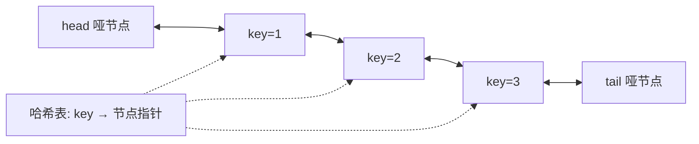

# 第 26 章 设计、数据流与随机化

> 覆盖题号：146, 284, 346, 348, 352, 353, 355, 359, 362, 379, 380, 381, 382, 384, 398

## 26.1 引子：给系统"选零件"

想象你是图书馆管理员，书架上只能摆 100 本书。每天有人借书、还书。书架满的时候，你会把"**最久没人翻过的那本**"撤下来，而不是随便扔一本——因为长期没人看的书，最近大概率也没人看。这个"最久没被用过的先淘汰"策略就是 **LRU（Least Recently Used，最近最少使用）**，Redis、CPU 缓存、浏览器缓存全都在用它。

"设计题"就是给你一张**需求清单**（要支持哪些操作、每个操作要求多快），让你自己挑数据结构、搭出一个能用的类。LeetCode 前 400 题里有 20 来道这样的题：146 LRU 缓存、380 随机集合、352 数据流区间、355 设计推特……它们不考某个具体算法，而考你"**数据结构选型**"的功力：知道每个容器的优势和软肋，再把几个容器拼成"组合拳"。

本章先给一套设计题方法论（26.2），再给算法流程（26.3）、复杂度速查（26.4）和通用工具箱（26.5），然后用 15 道真题逐个拆解（26.6），最后在扩展阅读（26.8）里补 5 道经典锁题。

## 26.2 核心思想

### 26.2.1 设计题方法论：四步走

拿到一道设计题，先别急着写代码。按下面四步走，能避免 90% 的翻车：

| 步骤 | 做什么 | 示例（146 LRU） |
| --- | --- | --- |
| ① 列操作 | 把题里所有方法写出来，标出每个方法的时间复杂度要求 | `get(key)`、`put(key,val)` 都要 O(1) |
| ② 选结构 | 按"组合拳"模板挑容器，一个容器干不了一件事就上两个 | dict 负责找，链表负责顺序 |
| ③ 画状态 | 画一张"数据结构长什么样"的图，标出每个方法动了哪几根线 | 头=最新，尾=最旧，满则弹尾 |
| ④ 写代码 | 先写核心方法，再补边界（空容器、满容量、重复值） | 容量 1、get 不存在的 key |

第 ① 步最关键：**操作清单 + 复杂度要求决定了选型**。要求 O(1) 查找 → 哈希表；要求 O(1) 头部/尾部增删 → 链表或队列；要求 O(1) 随机取一个 → 数组 + 随机下标。第 ③ 步的"状态图"是设计题专属的护身符——数据结构之间怎么互指，画出来就错不了。

### 26.2.2 组合拳一：哈希表 + 双向链表 = LRU

146 题要求 `get` 和 `put` 都是 $O(1)$，还要求"最近使用的排在前面，满了淘汰最久没用的"。逐个分析：

- **只用数组**：`get(key)` 要按 key 找值——数组按下标访问是 $O(1)$，但"按 key 找"得从头扫，$O(n)$。就算再用一个 dict 存 key→下标，插入/删除时数组要搬移元素，$O(n)$；更麻烦的是"访问一个 key 后把它挪到最前"这个操作，数组挪动是 $O(n)$。**数组的软肋是"中间/头部插入删除要搬家"。**
- **只用哈希表**：dict 的插入删除查找都是 $O(1)$，但它**没有顺序**——没法回答"哪个 key 最久没用过"。
- **组合拳**：dict 管"按 key 找到节点"（$O(1)$），手写双向链表管"顺序"（头部=最新、尾部=最旧，插入头部/摘除任意节点/弹出尾部都是 $O(1)$，因为改几个指针就行、不用搬家）。**两个容器各干各的强项，互相补短**，这就是"组合拳"。

> 关键认知：**哈希表给的是"位置"，链表给的是"顺序"**。需要"按名字找到东西 + 东西有先后顺序"时，这对组合几乎是标配（后面 146 的代码里会看到）。

LRU 的整体结构长这样（head 侧是最近使用，tail 侧是最久未使用，满了就摘 tail）：



### 26.2.3 组合拳二：哈希表 + 数组 = O(1) 随机访问

380 题要求三个操作都 $O(1)$：插入、删除、**等概率随机返回一个元素**。

- 只用 dict：插入删除 $O(1)$，但"随机返回一个"没法做——dict 的迭代顺序不保证均匀，把 `keys()` 转成 list 是 $O(n)$。
- 只用 list：随机下标 $O(1)$ 拿到随机元素，但"按值删除"要 $O(n)$ 查找。
- **组合拳**：dict 存"值 → 下标"，list 存值。删除时用"**与末尾元素交换再 pop**"这一招：把要删的值换到数组末尾，`pop()` 掉，顺便更新被换位置那个值的下标——数组删除就从 $O(n)$ 变成 $O(1)$。**dict 给"位置"，数组给"随机访问"，交换删除把两者缝在一起。**

### 26.2.4 组合拳三：双堆 = 中位数

第 13 章的 295 题"数据流的中位数"用的是第三个经典组合：**一个大顶堆存较小的一半，一个小顶堆存较大的一半**，两个堆的堆顶就是中位数的两个候选。这再次说明设计题的本质：**一个容器不够，就两个容器分工**。本章题目用到的组合还有"deque + set = 蛇身"（353）、"deque + set = 电话目录"（379）等，思路完全一致。

### 26.2.5 随机化：Fisher-Yates 洗牌与蓄水池抽样

**Fisher-Yates 洗牌（384 题）**要打乱一个数组，让 $n!$ 种排列等概率出现。做法是**从后往前**：对每个位置 $i$（从 $n-1$ 到 1），随机挑一个 $j \in [0, i]$，交换 `a[i]` 与 `a[j]`。

为什么等概率？位置 $i$ 的元素是从 $[0,i]$ 里均匀挑的，所以"某个元素落在位置 $i$"的概率是 $1/(i+1)$；倒着做一遍，每个排列的总概率都是 $1/n!$。**错误的做法**是每个位置都跟任意位置交换 $n$ 次（概率不均匀），或者生成一个随机排列再整体复制（空间 $O(n)$）。

**蓄水池抽样（382/398 题）**解决的是"**不知道总共有多少元素，但每个元素要被等概率选中**"的问题——典型场景是链表、数据流。单元素版的做法：维护一个候选 `ans`，先取第一个元素；然后对第 $i$ 个元素（$i=2,3,\dots$），以 $1/i$ 的概率把 `ans` 替换成它。

为什么等概率？记第 $k$ 个元素最终被选中。它被选中的概率 = 它进来时被选中（$1/k$）× 后面每个元素都不替换它（第 $i$ 个元素不替换的概率是 $1-1/i=(i-1)/i$）：

$$\frac{1}{k}\times\frac{k}{k+1}\times\frac{k+1}{k+2}\times\cdots\times\frac{n-1}{n}=\frac{1}{n}$$

中间的分数分子分母逐个抵消（这叫** Telescoping，连锁抵消**），最后只剩 $1/n$——完美等概率。手推 $n=3$：第 1 个元素被选中 = 第 2 个不替换（$1/2$）× 第 3 个不替换（$2/3$）= $1/3$；第 2 个 = 进来时选中（$1/2$）× 第 3 个不替换（$2/3$）= $1/3$；第 3 个 = 进来时选中 = $1/3$。

> Python 的 `random.shuffle` 内部就是 Fisher-Yates，但面试要求**手写**；蓄水池抽样没有现成函数，必须手写。两者都只用 `random.randint` 就够了。

### 26.2.6 数据流：增量维护

数据流题的核心是"**数据一个个来，答案要能增量更新，不能每次把历史全重算**"。三个套路本章都会用到：

1. **窗口和**（346）：维护一个"和"，新元素进来加上、老元素出去减掉，平均值的分子就不用每次重新求和；
2. **有序结构 + 二分**（352）：区间按左端点排好序，新数用 `bisect` 定位该插哪，再和左右邻居合并，只动受影响的部分；
3. **过期弹出**（362）：时间戳按顺序进队列，查询时先把过期的从队头弹出，队里剩下的就是答案。

数据流的共同点：**把"历史"组织成方便增量更新的结构（队列/有序列表/计数器），而不是存原始数据流**。

## 26.3 算法流程

**设计题四步法**（26.2.1 的浓缩版）：

```text
第 1 步  列操作: 把所有方法写出来, 标出每个方法的时间复杂度要求
第 2 步  选结构: 按"组合拳"模板挑容器(哈希/链表/数组/堆/队列)
第 3 步  画状态: 画"数据结构长什么样", 标出每个方法动了哪些部分
第 4 步  写代码: 先写核心方法, 再补边界(空容器、满容量、重复值)
```

**LRU 的 `put` 流程**：

```text
put(key, value):
    if key 在缓存里:
        更新节点的值, 把节点移到链表头部(刷新"最近使用")
    else:
        新建节点, 插入链表头部, 写入哈希表
        if 缓存大小 > 容量:
            弹出链表尾部节点(最久没用), 从哈希表删掉它
```

**Fisher-Yates 洗牌**：

```text
shuffle(a):
    for i = n-1 downto 1:
        j = random.randint(0, i)     # 与 [0, i] 中随机一个交换
        交换 a[i] 与 a[j]
```

**蓄水池抽样（取一个）**：

```text
getRandom():
    ans = 第一个元素
    for 第 i 个元素 (i = 2, 3, ...):
        if random.randint(1, i) == 1:    # 概率 1/i
            ans = 第 i 个元素
    return ans
```

**数据流三件套**：

```text
移动平均(346): deque 存窗口元素 + 一个窗口和
    next(val): 入队, 窗口和加 val; 队太长就出队并减掉; 返回 窗口和/队列长度
数据流区间(352): 有序区间列表 intervals
    addNum(val): 二分定位插入位置; 与左区间合并(相邻也算); 向右吞并所有相邻区间
敲击计数(362): deque 存时间戳
    getHits(t): 弹出所有 <= t-300 的时间戳; 返回队列长度
```

## 26.4 复杂度分析：设计题速查表

| 题号 | 核心结构 | 单次操作时间 | 额外空间 |
| --- | --- | --- | --- |
| 146 | dict + 双向链表 | get/put 均摊 O(1) | O(capacity) |
| 380 | dict + list | 插入/删除/getRandom 均摊 O(1) | O(n) |
| 381 | dict(值→set) + list | 同上 O(1) | O(n) |
| 384 | 数组原地 | shuffle O(n)、reset O(n) | O(n)（存原始副本） |
| 382 | 链表 | getRandom O(n) | O(1) |
| 398 | 数组 | pick O(n) | O(1) |
| 284 | 迭代器 + 预取缓存 | next/peek/hasNext 均摊 O(1) | O(1) |
| 352 | 有序区间列表 + bisect | addNum 均摊 O(n)、getIntervals O(k)（k=区间数） | O(k) |
| 346 | deque + 窗口和 | next O(1) | O(size) |
| 348 | 行/列/对角线计数器 | move O(1) | O(n) |
| 353 | deque + set | move O(1) | O(蛇身长度) |
| 355 | dict 时间线 + 关注表 | post/follow/unfollow O(1)、feed O(总推文数) | O(总推文数) |
| 359 | dict（消息→时间） | O(1) | O(不同消息数) |
| 362 | deque | hit/getHits 均摊 O(1) | O(300 秒内打点数) |
| 379 | deque + set | get/check/release O(1) | O(maxNumbers) |

两个观察：**① "均摊 O(1)" 意味着偶尔慢一下没关系，看总账**（第 01 章讲过）；**② 几乎所有设计题都是拿空间换时间**——多开一个 dict/数组，把某个 $O(n)$ 操作降成 $O(1)$，这就是"组合拳"的本质。

## 26.5 Python 实现：设计题工具箱

做题之前，先备好两个"公共零件"：**手写双向链表**（146 等题的基础，标准库里没有现成的双向链表，必须自己写）和**标准库速查**：

| 标准库工具 | 用途 | 本章用在哪 |
| --- | --- | --- |
| `collections.deque` | 双端队列，两端增删 O(1) | 346 窗口、353 蛇身、362 时间戳、379 号码池 |
| `collections.OrderedDict` | 带顺序的 dict（**偷懒版 LRU**，面试更认手写版） | 146 可对比 |
| `random.randint/choice/shuffle` | 随机整数 / 随机取一 / 洗牌 | 380~398 全部 |
| `bisect` | 有序列表二分定位 | 352 区间 |
| `heapq` | 堆 | 355 取最近 10 条 |

下面把**手写双向链表**这个核心零件写成一个可运行的工具箱（带哑头哑尾，插入/删除/移动/弹尾全部 $O(1)$）：

```python
class Node:
    """双向链表节点: 存 key 和 val, 方便以后做缓存"""

    def __init__(self, key=0, val=0):
        self.key = key
        self.val = val
        self.prev = None
        self.next = None


class DoublyLinkedList:
    """带哑头哑尾的双向链表: 头插 / 删除 / 移动到头部都是 O(1)"""

    def __init__(self):
        self.head = Node()          # 哑头(哨兵), 不存数据
        self.tail = Node()          # 哑尾(哨兵)
        self.head.next = self.tail
        self.tail.prev = self.head
        self.size = 0

    def add_to_head(self, node):
        """把节点插到哑头后面(最新)"""
        node.prev = self.head
        node.next = self.head.next
        self.head.next.prev = node
        self.head.next = node
        self.size += 1

    def remove(self, node):
        """把节点从链上摘下来, 不关心它在哪, 都是改两个指针"""
        node.prev.next = node.next
        node.next.prev = node.prev
        self.size -= 1

    def move_to_head(self, node):
        """先摘下来再插到头部: 两步都是 O(1)"""
        self.remove(node)
        self.add_to_head(node)

    def remove_tail(self):
        """弹出最久没用的节点(哑尾前一个)"""
        if self.size == 0:
            return None
        node = self.tail.prev
        self.remove(node)
        return node

    def to_list(self):
        """把链表拍平成 [(key, val), ...], 方便断言"""
        out = []
        cur = self.head.next
        while cur is not self.tail:
            out.append((cur.key, cur.val))
            cur = cur.next
        return out


if __name__ == "__main__":
    lst = DoublyLinkedList()
    a, b, c = Node(1, 10), Node(2, 20), Node(3, 30)
    lst.add_to_head(a)                      # 1
    lst.add_to_head(b)                      # 2 -> 1
    lst.add_to_head(c)                      # 3 -> 2 -> 1
    assert lst.to_list() == [(3, 30), (2, 20), (1, 10)]
    lst.move_to_head(a)                     # "访问"了 1, 把它提到最前
    assert lst.to_list() == [(1, 10), (3, 30), (2, 20)]
    assert lst.remove_tail().key == 2       # 最久没用的是 2
    assert lst.to_list() == [(1, 10), (3, 30)]
    assert lst.remove_tail().key == 3
    assert lst.remove_tail().key == 1
    assert lst.remove_tail() is None        # 空链表边界
    print("双向链表工具箱验证通过！")
```
## 26.6 LeetCode 真题精讲

### 146. LRU 缓存（中等）

**题意**：实现 `LRUCache`，支持 `get(key)` 和 `put(key, value)`，容量满时淘汰"最久没被使用"的 key，要求两个操作都是 $O(1)$。

**思路**：26.2.2 的组合拳：dict 存 key → 节点（$O(1)$ 定位），手写双向链表维护"最近使用顺序"（头部最新、尾部最旧）。`get` 时把节点挪到头部（访问即刷新）；`put` 时若 key 存在就更新值并挪到头部，否则新建节点插头部，超容量就弹尾部并从 dict 删除。手推容量 2 的序列：

```text
put(1,1) → 头部 1            链表: 1
put(2,2) → 头部 2            链表: 2 -> 1
get(1)   → 1 被访问, 挪到头部  链表: 1 -> 2
put(3,3) → 满了, 淘汰尾部 2    链表: 3 -> 1
get(2)   → -1 (已被淘汰)
```

```python
class Node:
    def __init__(self, key=0, val=0):
        self.key = key
        self.val = val
        self.prev = None
        self.next = None


class LRUCache:
    """哈希表 dict + 手写双向链表: get/put 均摊 O(1)"""

    def __init__(self, capacity):
        self.cap = capacity
        self.cache = {}             # key -> 节点
        self.head = Node()          # 哑头: head.next 是最新使用的
        self.tail = Node()          # 哑尾: tail.prev 是最久没用的
        self.head.next = self.tail
        self.tail.prev = self.head

    def _remove(self, node):
        node.prev.next = node.next
        node.next.prev = node.prev

    def _add_to_head(self, node):
        node.prev = self.head
        node.next = self.head.next
        self.head.next.prev = node
        self.head.next = node

    def _move_to_head(self, node):
        self._remove(node)
        self._add_to_head(node)

    def _pop_tail(self):
        node = self.tail.prev
        self._remove(node)
        return node

    def get(self, key):
        if key not in self.cache:
            return -1
        node = self.cache[key]
        self._move_to_head(node)    # 访问了就要"刷新"顺序
        return node.val

    def put(self, key, value):
        if key in self.cache:
            node = self.cache[key]
            node.val = value
            self._move_to_head(node)
            return
        node = Node(key, value)
        self.cache[key] = node
        self._add_to_head(node)
        if len(self.cache) > self.cap:      # 超容量: 淘汰最久没用的
            tail = self._pop_tail()
            del self.cache[tail.key]


if __name__ == "__main__":
    cache = LRUCache(2)
    cache.put(1, 1)
    cache.put(2, 2)
    assert cache.get(1) == 1        # 访问 1, 顺序变成 1,2
    cache.put(3, 3)                 # 容量满, 淘汰最久没用的 2
    assert cache.get(2) == -1
    assert cache.get(3) == 3
    cache.put(4, 4)                 # 淘汰 1 (3 刚被访问过)
    assert cache.get(1) == -1
    assert cache.get(3) == 3
    assert cache.get(4) == 4

    c1 = LRUCache(1)                # 容量为 1 的边界
    c1.put(2, 1)
    assert c1.get(2) == 1
    c1.put(3, 2)                    # 直接淘汰 2
    assert c1.get(2) == -1
    assert c1.get(3) == 2
    print("146 LRU 缓存验证通过！")
```

**复杂度分析**：`get`/`put` 均摊 $O(1)$——dict 查找 $O(1)$，链表的摘除/插入/弹尾都是改常数个指针。空间 $O(capacity)$。

**易错点**：
1. `get` 也要刷新顺序——题目说"访问"算使用，不挪到头部就会错误淘汰；
2. 哑头哑尾必须存在——没有哨兵，头插和弹尾都要特判空链表，容易写崩；
3. 淘汰时**先取节点再删 dict**：`tail = self._pop_tail()` 之后 `del self.cache[tail.key]`，顺序别反。

### 380. O(1) 时间插入、删除和获取随机元素（中等）

**题意**：实现 `RandomizedSet`，支持 `insert`、`remove`（不存在返回 False）、`getRandom`（等概率返回一个现有元素），全部 $O(1)$。

**思路**：26.2.3 的组合拳：dict 存"值 → 下标"、list 存值。难点在删除：list 按值删要 $O(n)$，但**把要删的值与末尾元素交换，再 `pop()`，就变成 $O(1)$**——代价是要同步更新被换过来那个值的下标。手推 `vals=[10,20,30]`，删 `10`（下标 0）：

```text
交换: vals = [30,20,10]   (把 10 换到末尾)
更新: pos[30] = 0         (被搬过来的 30 现在在下标 0)
pop:  vals = [30,20]      (末尾的 10 被弹出)
删:   del pos[10]
```

```python
import random


class RandomizedSet:
    """dict(值->下标) + list(值): 插入/删除/随机取都是 O(1)"""

    def __init__(self):
        self.pos = {}       # 值 -> 在数组里的下标
        self.vals = []      # 存所有值

    def insert(self, val):
        if val in self.pos:
            return False
        self.pos[val] = len(self.vals)
        self.vals.append(val)
        return True

    def remove(self, val):
        if val not in self.pos:
            return False
        idx = self.pos[val]
        last = self.vals[-1]
        # 把最后一个元素搬到 idx 处, 覆盖被删的值
        self.vals[idx] = last
        self.pos[last] = idx
        self.vals.pop()
        del self.pos[val]
        return True

    def getRandom(self):
        return random.choice(self.vals)


if __name__ == "__main__":
    random.seed(42)
    # LeetCode 官方示例序列
    rs = RandomizedSet()
    assert rs.insert(1) is True
    assert rs.remove(2) is False
    assert rs.insert(2) is True
    assert rs.getRandom() in (1, 2)     # 随机取, 两个都在集合里
    assert rs.remove(1) is True
    assert rs.insert(2) is False
    assert rs.getRandom() == 2          # 只剩 2, 必然返回 2
    # 随机操作与 set 参照物对照
    rs2 = RandomizedSet()
    ref = set()
    for _ in range(1000):
        op = random.randint(0, 2)
        v = random.randint(0, 5)
        if op == 0:
            assert rs2.insert(v) == (v not in ref)
            ref.add(v)
        elif op == 1:
            assert rs2.remove(v) == (v in ref)
            ref.discard(v)
        else:
            if ref:
                assert rs2.getRandom() in ref
    print("380 随机化集合验证通过！")
```

**复杂度分析**：三个操作均摊 $O(1)$（`getRandom` 是 `random.choice`，对数组按下标取，$O(1)$）。空间 $O(n)$。

**易错点**：
1. 删除时**先更新 `pos[last]` 再删 `pos[val]`**——如果先 `del`，被搬元素的下标就更新不到（`last` 和 `val` 相同时更要小心，顺序不能反）；
2. 删除"恰好是最后一个元素"的情况：`idx == len(vals)-1` 时交换是自我赋值，逻辑依然正确，不用特判；
3. 重复插入要返回 `False`，不能把同一个值塞进数组两次。

### 381. O(1) 时间插入、删除和获取随机元素 - 允许重复（困难）

**题意**：380 的困难版：**允许重复值**，`insert` 总是返回 True，`remove(val)` 只删掉一个 `val`，`getRandom` 等概率返回任意一个元素（重复值按出现次数加权）。

**思路**：把 380 的"值 → 下标"升级成"**值 → 下标集合（set）**"。插入时把新下标加进对应 set；删除时从该值的 set 里任取一个下标 `idx`，仍然"与末尾交换再 pop"，但被搬动的那个末尾值要**在它自己的 set 里改下标**（删掉旧下标 `len-1`、加上新下标 `idx`）。手推 `insert 1,1,2` 后删一个 `1`：

```text
vals = [1,1,2],  pos = {1:{0,1}, 2:{2}}
删 1: idx = 0 (set 里任取), last = 2
搬:  vals[0] = 2          → [2,1,2]
改:  pos[2] 从 {2} 变成 {0}  (末尾下标 2 换成了 0)
删:  pos[1] 去掉 0 → {1}
pop: vals = [2,1]
```

```python
import random


class RandomizedCollection:
    """dict(值->下标集合) + list: 允许重复值的 O(1) 随机化集合"""

    def __init__(self):
        self.vals = []          # 存所有值
        self.pos = {}           # 值 -> 该值所有下标的集合(set)

    def insert(self, val):
        self.pos.setdefault(val, set()).add(len(self.vals))
        self.vals.append(val)
        return True

    def remove(self, val):
        if val not in self.pos or not self.pos[val]:
            return False
        idx = self.pos[val].pop()           # 取一个该值的下标, 追踪关系随之删除
        last = self.vals[-1]
        last_idx = len(self.vals) - 1
        if idx != last_idx:                 # 不是末尾: 把末尾元素搬过来
            self.vals[idx] = last
            self.pos[last].discard(last_idx)    # 末尾值改下标: 删旧加新
            self.pos[last].add(idx)
        self.vals.pop()
        if not self.pos[val]:               # 该值没有剩余下标了
            del self.pos[val]
        return True

    def getRandom(self):
        return random.choice(self.vals)


if __name__ == "__main__":
    random.seed(7)
    rc = RandomizedCollection()
    ref = {}
    for _ in range(2000):               # 随机操作与"计数参照物"对照
        op = random.randint(0, 2)
        v = random.randint(0, 4)
        if op == 0:
            assert rc.insert(v) is True
            ref[v] = ref.get(v, 0) + 1
        elif op == 1:
            expected = ref.get(v, 0) > 0
            assert rc.remove(v) == expected
            if expected:
                ref[v] -= 1
                if ref[v] == 0:
                    del ref[v]
        else:
            if ref:
                assert rc.getRandom() in ref
    # 标准示例: 插入 1,1,2; 删一个 1; 剩下 {1,2} 里随机
    rc2 = RandomizedCollection()
    rc2.insert(1)
    rc2.insert(1)
    rc2.insert(2)
    assert rc2.remove(1) is True
    assert rc2.getRandom() in (1, 2)
    assert rc2.remove(1) is True
    assert rc2.getRandom() == 2
    print("381 允许重复的随机化集合验证通过！")
```

**复杂度分析**：均摊 $O(1)$——set 的增删查都是 $O(1)$（`next(iter(set))` 取一个元素也是 $O(1)$）。空间 $O(n)$。

**易错点**：
1. 取下标用 `set.pop()`——它一步完成"取出并移除追踪关系"；若用"取出再手动 discard"，末尾也是 val 时会残留脏下标，下次 `remove` 越界；
2. 被搬的末尾值要**同时改它自己的 set**（删 `len-1`、加 `idx`），漏掉就产生脏下标；
3. 某个值的 set 空了要 `del self.pos[val]`，否则下次 `remove` 会误判存在。

### 384. 打乱数组（中等）

**题意**：实现 `Solution`，`reset()` 返回原始数组，`shuffle()` 返回一个**等概率随机排列**。

**思路**：26.2.5 的 Fisher-Yates，从后往前每个位置 $i$ 与 $[0,i]$ 中随机一个位置交换。`reset` 只需要保存一份原始副本，每次 `shuffle` 在原地打乱当前数组。手推 `[1,2,3]`：

```text
i=2:  j=randint(0,2) 假设 0 → 交换 → [3,2,1]
i=1:  j=randint(0,1) 假设 1 → 交换 → [3,1,2]   (最终排列)
```

```python
import random


class Solution:
    """Fisher-Yates 洗牌: 从后往前, 每个位置与 [0, i] 随机位置交换"""

    def __init__(self, nums):
        self.orig = list(nums)      # 保存原始副本
        self.nums = list(nums)

    def reset(self):
        self.nums = list(self.orig)
        return self.nums

    def shuffle(self):
        n = len(self.nums)
        for i in range(n - 1, 0, -1):       # 从后往前
            j = random.randint(0, i)        # 与 [0, i] 中随机一个交换
            self.nums[i], self.nums[j] = self.nums[j], self.nums[i]
        return self.nums


if __name__ == "__main__":
    random.seed(123)
    s = Solution([1, 2, 3, 4])
    for _ in range(20):
        assert sorted(s.shuffle()) == [1, 2, 3, 4]   # 洗牌后必须是原数组的排列
    assert s.reset() == [1, 2, 3, 4]                 # reset 恢复原顺序
    random.seed(123)
    s2 = Solution([1, 2, 3, 4])
    seen = set()
    for _ in range(10):
        seen.add(tuple(s2.shuffle()))
    assert len(seen) >= 2                            # 10 次洗牌至少出现 2 种结果
    print("384 打乱数组验证通过！")
```

**复杂度分析**：`shuffle` $O(n)$（一趟交换），`reset` $O(n)$（复制）。空间 $O(n)$（存原始副本）。

**易错点**：
1. **必须从后往前**（或等价写法）——从前往后且每个位置和任意位置交换，概率不均匀；
2. `reset` 要返回**副本**，不能直接返回内部数组让调用者改掉它；
3. 洗牌是"原地打乱再返回"，LeetCode 上返回的是同一个数组对象也没关系，值正确即可。

### 382. 链表随机节点（中等）

**题意**：给一个单链表的头节点，实现 `getRandom()` 等概率返回链表中一个节点的值。链表很长、且不知道长度——这正是蓄水池抽样的舞台。

**思路**：26.2.5 的蓄水池抽样：维护候选 `ans`，先取第一个；走到第 $i$ 个节点时以 $1/i$ 概率替换 `ans`。数学上已证明每个节点被选中的概率都是 $1/n$。**为什么不能用"先数长度再随机下标"？** 因为要遍历两遍，而且蓄水池抽样可以处理"无限长/长度未知"的流——这正是它存在的意义。

```python
import random


class ListNode:
    def __init__(self, val=0, next=None):
        self.val = val
        self.next = next


def from_list(vals):
    dummy = p = ListNode()
    for v in vals:
        p.next = ListNode(v)
        p = p.next
    return dummy.next


class Solution:
    """蓄水池抽样: 维护一个候选值, 第 i 个节点以 1/i 概率替换它"""

    def __init__(self, head):
        self.head = head

    def getRandom(self):
        cur = self.head
        i = 1
        ans = cur.val
        while cur:
            if random.randint(1, i) == 1:   # 以 1/i 概率替换候选
                ans = cur.val
            cur = cur.next
            i += 1
        return ans


if __name__ == "__main__":
    random.seed(2024)
    s = Solution(from_list([1, 2, 3]))
    n = 30000
    cnt = {1: 0, 2: 0, 3: 0}
    for _ in range(n):
        cnt[s.getRandom()] += 1
    # 每个值概率约 1/3, 30000 次采样偏差不应太大
    for v in (1, 2, 3):
        assert 8000 < cnt[v] < 12000, cnt
    # 单节点边界
    s1 = Solution(from_list([9]))
    assert s1.getRandom() == 9
    print("382 链表随机节点验证通过！计数:", cnt)
```

**复杂度分析**：`getRandom` $O(n)$（必须走完链表才能确定"最后谁是候选"），空间 $O(1)$（只存一个候选值）。

**易错点**：
1. `random.randint(1, i) == 1` 才是 $1/i$ 概率——写成 `randint(0, i-1) == 0` 也行，别把区间弄反；
2. 候选要"边走边换"，不能最后再选——否则没记住每个节点的信息；
3. 单节点链表直接返回该值（`i=1` 时必然替换，逻辑天然正确）。

### 398. 随机数索引（中等）

**题意**：给一个可能含重复值的数组，实现 `pick(target)`：等概率返回数组中任意一个值等于 `target` 的下标。

**思路**：还是蓄水池抽样，只不过"流"是数组里所有值等于 `target` 的下标。遍历数组，遇到 `target` 时计数 `cnt += 1`，以 $1/cnt$ 概率把答案换成当前下标——于是每个匹配下标被选中的概率都是 $1/匹配总数$。**为什么不用 `random.choice([i for i,x in enumerate(nums) if x==target])`？** 那要先建一个列表，多花 $O(m)$ 空间；蓄水池只需要 $O(1)$ 空间，且思路是 382 的直接复用。

```python
import random


class Solution:
    """蓄水池抽样在数组上的应用: pick(target) 等概率返回任一等于 target 的下标"""

    def __init__(self, nums):
        self.nums = nums

    def pick(self, target):
        cnt = 0
        ans = -1
        for i, x in enumerate(self.nums):
            if x == target:
                cnt += 1
                if random.randint(1, cnt) == 1:   # 第 cnt 个候选以 1/cnt 概率成为答案
                    ans = i
        return ans


if __name__ == "__main__":
    random.seed(99)
    s = Solution([1, 2, 3, 3, 3])
    n = 30000
    cnt = {2: 0, 3: 0, 4: 0}
    for _ in range(n):
        cnt[s.pick(3)] += 1
    # 三个值为 3 的下标(2,3,4) 各约 1/3
    for v in (2, 3, 4):
        assert 8000 < cnt[v] < 12000, cnt
    assert s.pick(1) == 0               # 只出现一次
    print("398 随机数索引验证通过！计数:", cnt)
```

**复杂度分析**：`pick` $O(n)$（扫一遍数组），空间 $O(1)$。

**易错点**：
1. 计数的 `cnt` 是**匹配个数**，不是数组长度——概率分母写错就完全不均匀；
2. `ans` 初始值无所谓，因为第一个匹配必然以概率 1 成为候选；
3. 如果 `target` 不在数组里（题面保证存在，但自测时注意），会返回初始值 `-1`。

### 284. 顶端迭代器（中等）

**题意**：给一个只有 `next()` 和 `hasNext()` 的迭代器，包装成支持 `peek()` 的迭代器：`peek()` 返回下一个元素但**不消耗它**。

**思路**：**预取缓存**——构造时先把第一个元素取出来存在内部变量里；`peek()` 直接看缓存（O(1)）；`next()` 返回缓存，然后立刻从底层迭代器预取下一个；`hasNext()` 就是"缓存里还有没有货"。**为什么数组不行**：底层迭代器可能是链表/流，只能往前走，缓存恰好一个元素就够，数组反而要处理"缓存区多长"的问题。

```python
class ListIterator:
    """模拟 LeetCode 的 Iterator 接口: 只有 next() 和 hasNext()"""

    def __init__(self, data):
        self.data = list(data)
        self.i = 0

    def next(self):
        val = self.data[self.i]
        self.i += 1
        return val

    def hasNext(self):
        return self.i < len(self.data)


class PeekingIterator:
    """顶端迭代器: 内部缓存下一个元素, peek 就是看缓存"""

    def __init__(self, iterator):
        self._it = iterator
        self._cache = None
        self._has = False
        if self._it.hasNext():          # 预取第一个
            self._cache = self._it.next()
            self._has = True

    def peek(self):
        return self._cache

    def next(self):
        val = self._cache
        self._has = False
        if self._it.hasNext():          # 预取后面一个
            self._cache = self._it.next()
            self._has = True
        else:
            self._cache = None
        return val

    def hasNext(self):
        return self._has


if __name__ == "__main__":
    it = PeekingIterator(ListIterator([1, 2, 3]))
    assert it.next() == 1
    assert it.peek() == 2
    assert it.next() == 2
    assert it.next() == 3
    assert it.hasNext() is False
    # peek 不消耗元素: 连续 peek 两次结果一致
    it3 = PeekingIterator(ListIterator([7, 8]))
    assert it3.peek() == 7 and it3.peek() == 7
    # 空迭代器边界
    it2 = PeekingIterator(ListIterator([]))
    assert it2.hasNext() is False
    print("284 顶端迭代器验证通过！")
```

**复杂度分析**：`peek`/`next`/`hasNext` 均摊 $O(1)$（每个元素恰好被底层迭代器取一次）。空间 $O(1)$。

**易错点**：
1. `next()` 返回缓存后**必须立刻预取下一个**，否则下一次 `peek` 看到的还是旧值；
2. 底层迭代器耗尽后，要把 `_cache` 置空、`_has` 置 False，防止 `peek` 返回幽灵值；
3. 构造时就要预取第一个元素——`hasNext` 的实现依赖缓存状态。

### 352. 将数据流变为多个不相交区间（困难）

**题意**：数据流不断 `addNum(val)`，随时调用 `getIntervals()` 返回当前所有不相交区间的升序列表（相邻的区间要合并，如 `[1,2]` 和 `[3,4]` 合并成 `[1,4]`）。

**思路**：**有序区间列表 + 二分**（26.2.6）。维护 `intervals` 按左端点升序、互不相交且不相邻。`addNum` 四步：① 用 `bisect` 找到第一个左端点 ≥ val 的区间位置 `i`；② 若左邻居的右端点 ≥ val-1（重叠或相邻），并入左邻居，否则在 `i` 处插入 `[val,val]`；③ 向右吞并所有"左端点 ≤ 当前右端点+1"的区间；④ 结束。手推 `addNum` 序列 `1,3,7,2,6`：

```text
加 1 → [1,1]
加 3 → [1,1],[3,3]
加 7 → [1,1],[3,3],[7,7]
加 2 → 2 与 [1,1] 相邻 → 合并 → [1,3],[7,7]
加 6 → 6 与 [7,7] 相邻 → 合并 → [1,3],[6,7]
```

```python
import bisect


class SummaryRanges:
    """用升序的不相交区间列表 + 二分查找, 增量维护数据流"""

    def __init__(self):
        self.intervals = []     # [[l, r], ...] 按 l 升序, 互不相交且不相邻

    def addNum(self, val):
        starts = [it[0] for it in self.intervals]
        i = bisect.bisect_left(starts, val)     # 第一个左端点 >= val 的位置
        left = i - 1
        if left >= 0 and self.intervals[left][1] >= val - 1:
            # 与左区间合并(相邻也算)
            self.intervals[left][1] = max(self.intervals[left][1], val)
            l = left
        else:
            self.intervals.insert(i, [val, val])
            l = i
        # 向右吞并所有相邻/重叠的区间
        r = l + 1
        while r < len(self.intervals) and self.intervals[r][0] <= self.intervals[l][1] + 1:
            self.intervals[l][1] = max(self.intervals[l][1], self.intervals[r][1])
            del self.intervals[r]

    def getIntervals(self):
        return [list(it) for it in self.intervals]


if __name__ == "__main__":
    sr = SummaryRanges()
    for v in [1, 3, 7, 2, 6]:
        sr.addNum(v)
    assert sr.getIntervals() == [[1, 3], [6, 7]]
    sr.addNum(5)
    assert sr.getIntervals() == [[1, 3], [5, 7]]
    sr.addNum(4)
    assert sr.getIntervals() == [[1, 7]]
    # LeetCode 官方示例序列
    sr2 = SummaryRanges()
    sr2.addNum(1)
    assert sr2.getIntervals() == [[1, 1]]
    sr2.addNum(3)
    assert sr2.getIntervals() == [[1, 1], [3, 3]]
    sr2.addNum(7)
    assert sr2.getIntervals() == [[1, 1], [3, 3], [7, 7]]
    sr2.addNum(2)
    assert sr2.getIntervals() == [[1, 3], [7, 7]]
    sr2.addNum(6)
    assert sr2.getIntervals() == [[1, 3], [6, 7]]
    print("352 数据流区间验证通过！")
```

**复杂度分析**：`addNum` 均摊 $O(n)$（二分 $O(\log n)$，但插入/删除区间要搬移列表，最坏 $O(n)$；区间数量通常远小于数据量，实践中很快）；`getIntervals` $O(k)$（k=区间数，要复制返回）。空间 $O(k)$。

**易错点**：
1. **相邻也算合并**——判断条件写 `>= val - 1` 和 `<= r + 1`，漏掉 +1/-1 会把 `[1,2]`、`[3,4]` 误判成两个区间；
2. 吞并用 `while` 不是 `if`——一次 `addNum` 可能连续吞掉多个区间；
3. `getIntervals` 要返回**副本**（`list(it)`），否则调用方改返回结果会污染内部状态。
### 346. 数据流中的移动平均值（简单，付费）

**题意**：实现 `MovingAverage`，`next(val)` 返回**最近 size 个**数的平均值。

**思路**：**deque + 窗口和**（26.2.6）。deque 只保留最近 size 个元素，窗口和 `total` 增量维护：新元素进来 `total += val`，窗口超出大小就把最老的弹出并 `total -= 它`。**为什么不用 list 存全部历史再每次求和？** 那样每次 `next` 都要 $O(size)$ 甚至 $O(n)$ 重算；用窗口和，每次只加一个减一个，$O(1)$。

```python
from collections import deque


class MovingAverage:
    """滑动窗口平均值: deque 只保留最近 size 个元素, 用窗口和避免重复求和"""

    def __init__(self, size):
        self.size = size
        self.window = deque()
        self.total = 0

    def next(self, val):
        self.window.append(val)
        self.total += val
        if len(self.window) > self.size:      # 窗口满了, 弹出最老的
            self.total -= self.window.popleft()
        return self.total / len(self.window)


if __name__ == "__main__":
    m = MovingAverage(3)
    assert m.next(1) == 1.0
    assert m.next(10) == 5.5
    assert m.next(3) == 14 / 3.0
    assert m.next(5) == 6.0                  # 窗口变成 [10,3,5]
    m2 = MovingAverage(1)
    assert m2.next(4) == 4.0
    assert m2.next(7) == 7.0                 # 容量 1: 窗口永远只有最新一个
    print("346 数据流中的移动平均值验证通过！")
```

**复杂度分析**：`next` $O(1)$（入队/出队都是双端操作）。空间 $O(size)$。

**易错点**：
1. 弹出时**先减后弹**或**先弹后减**顺序要一致——弹之前先把它的值从 `total` 里减掉；
2. 窗口没满时平均分母是 `len(window)`，不是 `size`（如 `next(1)` 返回 `1.0`）；
3. 返回浮点数——Python 3 里 `/` 自动是浮点除，别用 `//`。

### 348. 判定井字棋胜负（中等，付费）

**题意**：实现 `TicTacToe(n)`，`move(row, col, player)` 在 `n×n` 棋盘落子（1 或 2），若该玩家因此获胜返回玩家号，否则返回 0。

**思路**：**计数器**——不需要棋盘！一行/一列/两条对角线各用一个计数器：玩家 1 落子 +1，玩家 2 落子 −1。某行/列/对角线的计数器绝对值达到 `n`，就说明被一个玩家填满。手推 `n=3` 时玩家 1 依次下 `(0,0),(2,2),(2,0),(2,1)`：第 2 行三个位置全是玩家 1，`rows[2]` 计数到 3，获胜。

```python
class TicTacToe:
    """行/列/两条对角线各一个计数器: 玩家1 加 1, 玩家2 减 1"""

    def __init__(self, n):
        self.n = n
        self.rows = [0] * n
        self.cols = [0] * n
        self.diag = 0           # 主对角线 \
        self.anti = 0           # 副对角线 /

    def move(self, row, col, player):
        delta = 1 if player == 1 else -1
        self.rows[row] += delta
        self.cols[col] += delta
        if row == col:
            self.diag += delta
        if row + col == self.n - 1:
            self.anti += delta
        if (abs(self.rows[row]) == self.n or abs(self.cols[col]) == self.n
                or abs(self.diag) == self.n or abs(self.anti) == self.n):
            return player
        return 0


if __name__ == "__main__":
    # LeetCode 官方示例
    t = TicTacToe(3)
    assert t.move(0, 0, 1) == 0
    assert t.move(0, 2, 2) == 0
    assert t.move(2, 2, 1) == 0
    assert t.move(1, 1, 2) == 0
    assert t.move(2, 0, 1) == 0
    assert t.move(1, 0, 2) == 0
    assert t.move(2, 1, 1) == 1     # 玩家 1 填满第 2 行
    # 副对角线获胜
    t2 = TicTacToe(2)
    assert t2.move(0, 0, 2) == 0
    assert t2.move(0, 1, 1) == 0
    assert t2.move(1, 1, 2) == 2     # 玩家 2 填满副对角线
    print("348 判定井字棋胜负验证通过！")
```

**复杂度分析**：`move` $O(1)$（只更新 4 个计数器）。空间 $O(n)$（两个长度为 n 的数组 + 2 个标量）。

**易错点**：
1. 副对角线条件是 `row + col == n - 1`，不是 `row == col`——两个都判断，别漏；
2. 用 `abs(...) == n` 判胜，因为玩家 2 的计数是负数；
3. 计数可能因对方落子回落（如一行先 +1 再 −1），所以用"绝对值到达 n"而不是"计数从 0 涨到 n"。

### 353. 贪吃蛇（中等，付费）

**题意**：实现 `SnakeGame(width, height, food)`，`move(direction)`（"U"/"D"/"L"/"R"）返回移动后的得分；撞墙或撞到自己返回 −1，游戏结束。

**思路**：**deque 存蛇身 + set 判撞**。每次移动：① 算新蛇头位置；② 撞墙 → −1；③ 判断是否吃到食物（食物在蛇头位置）：吃到就**不缩尾**（蛇变长）且得分 +1，没吃到就先弹出尾巴（蛇往前走一格）；④ 新蛇头撞到身体 → −1（没吃到时尾巴已先移走，所以"新头 == 旧尾"是合法的）；⑤ 蛇头入队。手推示例 `width=3, height=2, food=[[1,2],[0,1]]`：

```text
R → (0,1)  没吃到, 缩尾     得分 0
D → (1,1)  没吃到, 缩尾     得分 0
R → (1,2)  吃到食物! 不缩尾   得分 1, 蛇长 2
U → (0,2)  没吃到, 缩尾     得分 1
L → (0,1)  吃到食物! 不缩尾   得分 2
U → (-1,1) 撞墙 → -1
```

```python
from collections import deque


class SnakeGame:
    """deque 存蛇身(头在左端) + set 存蛇身坐标用于 O(1) 判撞"""

    def __init__(self, width, height, food):
        self.w = width
        self.h = height
        self.food = food
        self.score = 0
        self.snake = deque([(0, 0)])
        self.body = set([(0, 0)])

    def move(self, direction):
        dr, dc = {"U": (-1, 0), "D": (1, 0), "L": (0, -1), "R": (0, 1)}[direction]
        hr, hc = self.snake[0]
        nr, nc = hr + dr, hc + dc
        # 撞墙
        if not (0 <= nr < self.h and 0 <= nc < self.w):
            return -1
        # 判断是否吃到食物(得分 < 食物总数 且 新头在下一个食物上)
        eating = (self.score < len(self.food)
                  and (nr, nc) == tuple(self.food[self.score]))
        if not eating:
            tail = self.snake.pop()     # 没吃到: 尾巴先缩一格
            self.body.remove(tail)
        # 撞身体
        if (nr, nc) in self.body:
            return -1
        self.snake.appendleft((nr, nc))
        self.body.add((nr, nc))
        if eating:
            self.score += 1
        return self.score


if __name__ == "__main__":
    game = SnakeGame(3, 2, [[1, 2], [0, 1]])
    assert game.move("R") == 0
    assert game.move("D") == 0
    assert game.move("R") == 1
    assert game.move("U") == 1
    assert game.move("L") == 2
    assert game.move("U") == -1              # 撞墙
    # 撞自己: 吃到食物变长后回头撞身体
    game2 = SnakeGame(3, 1, [[0, 1], [0, 2]])
    assert game2.move("R") == 1              # 吃到食物, 蛇长 2
    assert game2.move("R") == 2              # 再吃一个, 蛇长 3
    assert game2.move("L") == -1             # 回头撞到自己的身体
    print("353 贪吃蛇验证通过！")
```

**复杂度分析**：`move` $O(1)$（deque 两端操作 + set 增删查）。空间 $O(蛇身长度)$。

**易错点**：
1. **吃到食物时尾巴不缩**——缩了蛇就变短，下一格撞自己就判错；
2. 判撞顺序：没吃到时**先缩尾再判撞**，这样"新头 == 旧尾"是合法移动（蛇往前走，尾巴让开了）；
3. 食物的判断用 `self.score` 作为下标（吃掉的顺序就是 food 数组的顺序），不是随便哪个食物。

### 355. 设计推特（中等）

**题意**：实现 `Twitter`：`postTweet(userId, tweetId)` 发推；`getNewsFeed(userId)` 返回该用户**自己和所有关注者**最近的 10 条推文 id（新的在前）；`follow/unfollow` 管理关注关系。

**思路**：**两个 dict + 全局时钟**。`tweets[userId]` 存该用户按时间倒序的推文列表（用全局时钟 `clock`，每次发推减 1，时间越小越新）；`follows[userId]` 存关注集合（自己默认在 feed 里，无需显式关注自己）。取 feed 时把"自己 + 关注对象"的推文全部收集起来，用堆/排序取时间最小的 10 条。手推官方示例：

```text
postTweet(1,5); getNewsFeed(1) → [5]
follow(1,2); postTweet(2,6); getNewsFeed(1) → [6,5]
unfollow(1,2); getNewsFeed(1) → [5]
```

```python
import heapq


class Twitter:
    """每个用户维护自己的推文时间线 + 关注表; 取 feed 时合并各时间线"""

    def __init__(self):
        self.tweets = {}        # userId -> [(时间, tweetId), ...], 时间越小越新
        self.follows = {}       # userId -> set(关注的 userId)
        self.clock = 0          # 全局时钟, 每次发推减 1

    def postTweet(self, userId, tweetId):
        self.tweets.setdefault(userId, []).append((self.clock, tweetId))
        self.clock -= 1

    def getNewsFeed(self, userId):
        users = self.follows.get(userId, set()) | {userId}
        cand = []
        for u in users:
            cand.extend(self.tweets.get(u, []))
        # 时间越小越新, 取最小的 10 个
        return [tid for _, tid in heapq.nsmallest(10, cand)]

    def follow(self, followerId, followeeId):
        if followerId != followeeId:        # 关注自己没有意义
            self.follows.setdefault(followerId, set()).add(followeeId)

    def unfollow(self, followerId, followeeId):
        self.follows.get(followerId, set()).discard(followeeId)


if __name__ == "__main__":
    t = Twitter()
    t.postTweet(1, 5)
    assert t.getNewsFeed(1) == [5]
    t.follow(1, 2)
    t.postTweet(2, 6)
    assert t.getNewsFeed(1) == [6, 5]
    t.unfollow(1, 2)
    assert t.getNewsFeed(1) == [5]
    # 超过 10 条只取最近的 10 条
    t2 = Twitter()
    for i in range(15):
        t2.postTweet(1, i)
    assert t2.getNewsFeed(1) == [14, 13, 12, 11, 10, 9, 8, 7, 6, 5]
    t2.follow(1, 1)                         # 关注自己不改变 feed
    assert t2.getNewsFeed(1)[0] == 14
    print("355 设计推特验证通过！")
```

**复杂度分析**：`postTweet`/`follow`/`unfollow` $O(1)$；`getNewsFeed` $O(T \log 10) = O(T)$（T=自己+关注对象的推文总数，`nsmallest` 只维护 10 个元素的堆）。空间 $O(总推文数 + 关注关系)$。

**易错点**：
1. 自己的推文**永远在 feed 里**，即使没有关注任何人——`users` 要并上 `{userId}`；
2. 用"时钟递减"而不是递增：递增的话"最新"是最大时间，取最值要反过来，容易搞混；
3. `unfollow` 用 `discard`（不存在也不报错），且用户没关注过任何人时 `follows.get(...)` 返回空 set 也不崩溃。

### 359. 日志速率限制器（简单，付费）

**题意**：实现 `Logger`，`shouldPrintMessage(timestamp, message)`：同一 message 在**10 秒窗口内**只能打印一次（返回 True 表示允许打印）。

**思路**：**dict 存每个消息的上次打印时间**。规则：消息没出现过，或 `timestamp - 上次时间 >= 10`，放行并更新时间；否则拒绝（且**不更新**时间）。为什么不用队列？消息之间没有顺序关系，dict 按消息单独记录就够，$O(1)$。

```python
class Logger:
    """记录每个消息上次打印的时间; 10 秒窗口内相同消息只允许一次"""

    def __init__(self):
        self.last = {}      # message -> 上次打印的时间戳

    def shouldPrintMessage(self, timestamp, message):
        if message in self.last and timestamp - self.last[message] < 10:
            return False
        self.last[message] = timestamp
        return True


if __name__ == "__main__":
    lg = Logger()
    assert lg.shouldPrintMessage(1, "foo") is True
    assert lg.shouldPrintMessage(2, "bar") is True
    assert lg.shouldPrintMessage(3, "foo") is False     # 3-1=2 < 10, 拒绝
    assert lg.shouldPrintMessage(8, "bar") is False
    assert lg.shouldPrintMessage(10, "foo") is False    # 10-1=9 < 10, 仍拒绝
    assert lg.shouldPrintMessage(11, "foo") is True     # 11-1=10, 窗口已过, 放行
    print("359 日志速率限制器验证通过！")
```

**复杂度分析**：$O(1)$ 时间，$O(不同消息数)$ 空间。

**易错点**：
1. 拒绝时**不更新时间戳**——否则会被"刷屏"持续压住窗口，永远放行不了；
2. 边界是 `>= 10` 放行（10 秒整算窗口外），用 `< 10` 拒绝；
3. 不同消息互不影响，各自独立计时。

### 362. 敲击计数器（中等，付费）

**题意**：实现 `HitCounter`，`hit(timestamp)` 记录一次敲击，`getHits(timestamp)` 返回**过去 300 秒内**（不含 300 秒外，含边界 `t-300`）的敲击次数。

**思路**：**deque 按时间升序存时间戳**（26.2.6 的"过期弹出"）。`getHits(t)` 先把队头所有 `<= t-300` 的过期时间戳弹出（均摊 O(1)），剩下的长度就是答案。为什么高效？时间戳单调递增，队列天然有序，过期的一定在队头；用 list 每次清空要 $O(n)$，deque 从队头弹出是 $O(1)$。

```python
from collections import deque


class HitCounter:
    """deque 按时间升序存打点; getHits 先把 300 秒外的过期打点弹出再数长度"""

    def __init__(self):
        self.hits = deque()

    def hit(self, timestamp):
        self.hits.append(timestamp)

    def getHits(self, timestamp):
        while self.hits and self.hits[0] <= timestamp - 300:
            self.hits.popleft()
        return len(self.hits)


if __name__ == "__main__":
    hc = HitCounter()
    hc.hit(1)
    hc.hit(2)
    hc.hit(3)
    assert hc.getHits(4) == 3
    hc.hit(300)
    assert hc.getHits(300) == 4          # 边界: 300 在窗口内(300-300=0 是界)
    assert hc.getHits(301) == 3          # 只有 1 过期(<= 301-300=1)
    assert hc.getHits(302) == 2          # 2 也过期
    assert hc.getHits(600) == 0          # 全过期
    print("362 敲击计数器验证通过！")
```

**复杂度分析**：`hit` $O(1)$；`getHits` 均摊 $O(1)$（每个时间戳最多被弹出一次）。空间 $O(300 秒窗口内的打点数)$。

**易错点**：
1. 窗口边界是 `<= t - 300` 弹出——`t-300` 本身**在窗口内**（题目要求含 `t-300`）；
2. 只在 `getHits` 里弹出，`hit` 不用管过期——反正查询时统一清；
3. 假设时间戳**单调递增**（题面保证），队列才有序，别打乱插入。

### 379. 电话目录管理系统（中等，付费）

**题意**：实现 `PhoneDirectory(maxNumbers)`：`get()` 分配一个空闲号码（没有返回 −1），`check(number)` 判断号码是否空闲，`release(number)` 释放号码。

**思路**：**deque 存空闲号 + set 存已分配号**。初始化时 deque 装 0 到 maxNumbers-1（deque 保证分配顺序确定，方便测试）；`get` 从队头取一个；`release` 只在号码"确实已分配"时才放回。**为什么用 deque 而不用 set 直接 pop**：set 的弹出顺序不确定，deque 让 `get()` 的表现可预测（先分配小的）；两个结构一个管"下一个给谁"，一个管"谁在用"。

```python
from collections import deque


class PhoneDirectory:
    """deque 存空闲号码 + set 存已分配号码: get/check/release 都 O(1)"""

    def __init__(self, max_numbers):
        self.free = deque(range(max_numbers))   # 还没分配的号, 按从小到大排队
        self.used = set()                       # 已分配的号

    def get(self):
        if not self.free:
            return -1
        num = self.free.popleft()
        self.used.add(num)
        return num

    def check(self, number):
        return number not in self.used

    def release(self, number):
        if number in self.used:                 # 只有确实占用着才释放
            self.used.remove(number)
            self.free.append(number)


if __name__ == "__main__":
    pd = PhoneDirectory(3)
    assert pd.get() == 0
    assert pd.get() == 1
    assert pd.check(2) is True
    assert pd.check(1) is False
    pd.release(1)               # 释放 1
    assert pd.check(1) is True
    assert pd.get() == 2        # 先分配完剩下的 2
    assert pd.get() == 1        # 释放的 1 再次被分配
    assert pd.get() == -1       # 号用完
    print("379 电话目录管理系统验证通过！")
```

**复杂度分析**：三个操作都是 $O(1)$（deque 两端操作 + set 增删查）。空间 $O(maxNumbers)$。

**易错点**：
1. `release` 要先 `check` 是否真的占用——释放一个没占用的号会让它重复入队，`get` 可能两次拿到同一个号；
2. 释放的号**追加到队尾**，不会插队；
3. `get` 在号码耗尽时返回 −1，别抛异常。

## 26.7 本章小结

1. **设计题四步法**：列操作与复杂度要求 → 选结构 → 画状态 → 写代码。第 ① 步的"复杂度要求"直接决定选型。
2. **组合拳的本质**：一个容器有软肋，就配一个补软肋的容器。本章三套经典组合：**哈希 + 双向链表 = LRU**（dict 给位置、链表给顺序）、**哈希 + 数组 = O(1) 随机访问**（dict 给下标、数组给随机、交换删除保 O(1)）、**双堆 = 中位数**（第 13 章）。
3. **两个随机化技巧**：Fisher-Yates 洗牌（从后往前，`i` 与 `[0,i]` 随机交换，等概率）；蓄水池抽样（第 $i$ 个元素以 $1/i$ 概率替换候选，连锁抵消证明每个元素概率 $1/n$）。
4. **数据流 = 增量维护**：不重算历史，只更新受影响的部分。套路：窗口和（346）、有序结构 + 二分（352）、过期弹出（362）、预取缓存（284）。
5. **"画状态"防翻车**：dict 与链表/数组怎么互指、删除时先改谁的引用——画出来就错不了。

**常见错误清单（面试前过一遍）**：

- LRU 忘记"get 也刷新顺序"、忘记哑头哑尾；
- 380/381 删除时更新下标的顺序写反（先删 dict 后改被搬元素的下标 → 脏下标）；
- 蓄水池抽样的概率写成 `1/n` 而不是 `1/i`；
- 352 合并区间忘了"相邻也算"（±1）；
- 353 吃到食物还缩尾、没吃到却不先缩尾就判撞；
- 284 `next` 之后忘了预取下一个；
- 359 被拒绝的消息还更新了时间戳；
- 362 忘了窗口边界 `t-300` 在窗口内。

## 26.8 扩展阅读：更多经典锁题

锁题（付费题）同样值得练：它们要么是真题的"前置接口"（157/158 的 read4），要么是设计思想的直接复用（251/281 是迭代器，271 是编码解码）。下面每道都给出**思路 + 经过验证的完整代码**。

### 157. 用 Read4 读取 N 个字符（付费）

**题意**：实现 `read(buf, n)`，用给定的 `read4(buf4)`（每次最多读 4 个字符到 buf4，返回实际个数）把**最多 n 个**字符读进 `buf`，返回实际读到的个数。本版 `read` 只调用一次。

**思路**：循环调 `read4`，把读到的字符拷进 `buf`，直到凑够 n 个或源文件读完。注意 `n` 不是 4 的倍数时，最后一次只拷需要的个数（多读的 4 个里剩下的字符在本版**直接丢弃**——这正是 158 要解决的问题）。

```python
class Reader4:
    """模拟 read4 接口: 每次最多读 4 个字符到 buf4, 返回实际读到的个数"""

    def __init__(self, content):
        self.content = content
        self.pos = 0

    def read4(self, buf4):
        cnt = 0
        while cnt < 4 and self.pos < len(self.content):
            buf4[cnt] = self.content[self.pos]
            self.pos += 1
            cnt += 1
        return cnt


class Solution:
    """循环调用 read4 读取 n 个字符(注意: 本版不跨调用保留缓冲, 见 158)"""

    def __init__(self, reader4):
        self.reader4 = reader4

    def read(self, buf, n):
        total = 0
        buf4 = [''] * 4
        while total < n:
            cnt = self.reader4.read4(buf4)
            if cnt == 0:                    # 源文件读完了
                break
            take = min(cnt, n - total)      # 只取还需要的个数
            for i in range(take):
                buf[total + i] = buf4[i]
            total += take
        return total


if __name__ == "__main__":
    buf = [''] * 10
    assert Solution(Reader4("abc")).read(buf, 4) == 3 and ''.join(buf[:3]) == "abc"
    buf2 = [''] * 10
    assert Solution(Reader4("abcdefgh")).read(buf2, 4) == 4 and ''.join(buf2[:4]) == "abcd"
    buf3 = [''] * 10
    assert Solution(Reader4("abcdefgh")).read(buf3, 5) == 5 and ''.join(buf3[:5]) == "abcde"
    print("157 用 Read4 读取 N 个字符验证通过！")
```

**复杂度分析**：时间 $O(\min(n, 文件长度))$，空间 $O(1)$（只开一个 4 格缓冲）。

**易错点**：
1. `n` 不是 4 的倍数时，最后一次 `take = min(cnt, n-total)`，不能把 4 个全拷进去；
2. 读满 n 个就停，别继续调 read4；
3. `buf` 是长度足够的列表，按 `buf[total+i]` 就地写，别用 `append`。

### 158. 用 Read4 读取 N 个字符 II（付费）

**题意**：157 的加强版：`read` 会被**多次调用**，上一次 read4 多读的字符必须留给下一次 `read`，不能丢。

**思路**：给 Solution 加内部缓冲：`buf4`（4 格）、`cnt`（缓冲内有效字符数）、`ptr`（读到哪了）。`read` 循环里**优先消耗缓冲**，缓冲空了才再调 read4 填满。手推 `content="abcdefgh"` 连续三次 `read(3)`：

```text
第 1 次: read4 读入 a,b,c,d; 取 a,b,c; 缓冲剩 d
第 2 次: 先取 d; 再 read4 读入 e,f,g,h; 取 e,f; 缓冲剩 g,h
第 3 次: 取 g,h; 再 read4 返回 0, 结束 → 共 2 个
```

```python
class Reader4:
    """模拟 read4 接口"""

    def __init__(self, content):
        self.content = content
        self.pos = 0

    def read4(self, buf4):
        cnt = 0
        while cnt < 4 and self.pos < len(self.content):
            buf4[cnt] = self.content[self.pos]
            self.pos += 1
            cnt += 1
        return cnt


class Solution:
    """read 可被多次调用: 用内部缓冲 + 指针把读多了的字符存下来"""

    def __init__(self, reader4):
        self.reader4 = reader4
        self.buf4 = [''] * 4    # 内部 4 格缓冲
        self.cnt = 0            # 缓冲里有效字符数
        self.ptr = 0            # 缓冲读到的位置

    def read(self, buf, n):
        total = 0
        while total < n:
            if self.ptr < self.cnt:             # 缓冲还有货, 先取缓冲
                buf[total] = self.buf4[self.ptr]
                self.ptr += 1
                total += 1
            else:                               # 缓冲用完, 再读 4 个
                self.cnt = self.reader4.read4(self.buf4)
                self.ptr = 0
                if self.cnt == 0:
                    break
        return total


if __name__ == "__main__":
    s = Solution(Reader4("abcdefgh"))
    buf1 = [''] * 10
    assert s.read(buf1, 3) == 3 and ''.join(buf1[:3]) == "abc"
    buf2 = [''] * 10
    assert s.read(buf2, 3) == 3 and ''.join(buf2[:3]) == "def"
    buf3 = [''] * 10
    assert s.read(buf3, 5) == 2 and ''.join(buf3[:2]) == "gh"
    # 读满 4 的倍数再接着读
    s2 = Solution(Reader4("abcdef"))
    b = [''] * 10
    assert s2.read(b, 4) == 4 and ''.join(b[:4]) == "abcd"
    assert s2.read(b, 4) == 2 and ''.join(b[:2]) == "ef"
    print("158 用 Read4 读取 N 个字符 II 验证通过！")
```

**复杂度分析**：时间 $O(n)$，空间 $O(1)$（固定 4 格缓冲，与数据量无关）。

**易错点**：
1. 每次 `read` 开头**先取缓冲**，缓冲空了才调 read4——顺序反了会丢字符；
2. `read4` 返回 0 表示源文件读完，要 `break`，别死循环；
3. 缓冲状态（`cnt`/`ptr`）是实例变量，跨调用保留——这正是本版和 157 的唯一区别。

### 251. 展开二维向量（付费）

**题意**：实现 `Vector2D(vec)`，`next()` 返回下一个元素，`hasNext()` 判断还有没有，把二维列表拍平成一维迭代。注意**行可能是空的**。

**思路**：两个指针 `i`（行）、`j`（列）+ 一个 `_advance()`：只要当前行空（`j` 越界）就 `i += 1, j = 0` 跳到下一行。`next()` 先 `_advance` 再取值并 `j += 1`；`hasNext()` 也先 `_advance` 再看 `i` 是否越界。**为什么不用 `itertools.chain` 或提前拍平**：那要 $O(总元素)$ 空间；指针法 $O(1)$ 空间，且不复制数据。

```python
class Vector2D:
    """双指针逐行展开: i 是行, j 是列; _advance 跳过空行"""

    def __init__(self, vec):
        self.vec = vec
        self.i = 0
        self.j = 0

    def _advance(self):
        while self.i < len(self.vec) and self.j >= len(self.vec[self.i]):
            self.i += 1
            self.j = 0

    def next(self):
        self._advance()
        val = self.vec[self.i][self.j]
        self.j += 1
        return val

    def hasNext(self):
        self._advance()
        return self.i < len(self.vec)


if __name__ == "__main__":
    it = Vector2D([[1, 2], [3], [4, 5, 6]])
    out = []
    while it.hasNext():
        out.append(it.next())
    assert out == [1, 2, 3, 4, 5, 6]
    # 空行夹在中间
    it2 = Vector2D([[1], [], [2], [], []])
    out2 = []
    while it2.hasNext():
        out2.append(it2.next())
    assert out2 == [1, 2]
    # 全空
    it3 = Vector2D([[], []])
    assert it3.hasNext() is False
    print("251 展开二维向量验证通过！")
```

**复杂度分析**：`next`/`hasNext` 均摊 $O(1)$（每个空行最多被跳一次）。空间 $O(1)$。

**易错点**：
1. `_advance` 是 `while` 不是 `if`——可能连续多个空行；
2. `hasNext` 也要 `_advance`——否则 `[[1],[],[2]]` 这种中间空行会让 `hasNext` 误报；
3. `next` 先 `_advance` 再取值，`j += 1` 在取值之后。

### 271. 字符串的编码与解码（付费）

**题意**：实现 `Codec`：`encode(strs)` 把字符串列表编码成一个字符串，`decode(s)` 还原。字符串里可能出现任何字符（包括 `#`、数字、空串），所以不能只用分隔符。

**思路**：**长度前缀编码**：每个字符串编码成 `"长度#内容"`，拼接。解码时读长度，再按长度截取内容——内容里不管有什么字符都不怕，因为长度是数字、分隔符固定，且长度**决定了内容边界**。手推 `["a","b c"]`：编码 `1#a3#b c`，解码先读 `1` 取出 `a`，再读 `3` 取出 `b c`。

```python
class Codec:
    """长度前缀编码: 每个字符串编码成 "长度#内容", 长度在前决定边界"""

    def encode(self, strs):
        return "".join(str(len(s)) + "#" + s for s in strs)

    def decode(self, s):
        out = []
        i = 0
        while i < len(s):
            j = s.index("#", i)             # 找长度与内容的分隔符
            length = int(s[i:j])
            start = j + 1
            out.append(s[start:start + length])
            i = start + length
        return out


if __name__ == "__main__":
    c = Codec()
    cases = [
        ["hello", "world"],
        ["", "a", "#", "12#x", "中文", "a b"],
        [],
        [""],
        ["a" * 300],                        # 长字符串
    ]
    for strs in cases:
        assert c.decode(c.encode(strs)) == strs
    print("271 字符串的编码与解码验证通过！")
```

**复杂度分析**：时间 $O(总字符数)$，空间 $O(总字符数)$（编码结果）。

**易错点**：
1. 必须带长度前缀——只用分隔符会在内容含分隔符时解码错误；
2. 空串编码成 `"0#"`，解码时 `length=0` 截取空串，别当成结束；
3. 解码用 `s.index("#", i)` 从 `i` 开始找，别用 `find` 从头找（会找到前面的分隔符）。

### 281. 锯齿迭代器（付费）

**题意**：实现 `ZigzagIterator(v1, v2)`，交替返回两个列表的元素：`v1[0], v2[0], v1[1], v2[1], ...`；某个列表先耗尽时，剩下全取另一个。

**思路**：两个下标指针 + 一个"当前该取哪个列表"的标记 `active`。`_advance()` 负责让 `active` 指向下一个**还有元素**的列表（两个列表都试一遍）。`next()` 取 `active` 列表的当前元素、下标 +1、切换 `active` 并 `_advance`。手推 `v1=[1,2], v2=[3,4,5]`：

```text
取 1 → 取 3 → 取 2 → 取 4 → v1 耗尽, 之后全取 v2 → 取 5
结果: 1,3,2,4,5
```

```python
class ZigzagIterator:
    """两个指针 + active 标记: 轮流取, 某个耗尽就全取另一个"""

    def __init__(self, v1, v2):
        self.vs = [v1, v2]
        self.p = [0, 0]
        self.active = 0
        self._advance()

    def _advance(self):
        """让 active 指向下一个还有元素的列表(两个都试一遍)"""
        for _ in range(2):
            if self.p[self.active] < len(self.vs[self.active]):
                return
            self.active = (self.active + 1) % 2

    def next(self):
        val = self.vs[self.active][self.p[self.active]]
        self.p[self.active] += 1
        self.active = (self.active + 1) % 2
        self._advance()
        return val

    def hasNext(self):
        self._advance()
        return self.p[self.active] < len(self.vs[self.active])


if __name__ == "__main__":
    it = ZigzagIterator([1, 2], [3, 4, 5])
    out = []
    while it.hasNext():
        out.append(it.next())
    assert out == [1, 3, 2, 4, 5]
    # 一个列表为空
    it2 = ZigzagIterator([1], [])
    assert it2.hasNext() is True and it2.next() == 1
    assert it2.hasNext() is False
    # 都为空
    it3 = ZigzagIterator([], [])
    assert it3.hasNext() is False
    print("281 锯齿迭代器验证通过！")
```

**复杂度分析**：`next`/`hasNext` 均摊 $O(1)$。空间 $O(1)$。

**易错点**：
1. `_advance` 循环次数固定为"列表个数"，不能写成 `while True`——两个都耗尽时会死循环；
2. `hasNext` 也要 `_advance`，否则取完一个列表的最后一个元素后，`active` 还指着空列表；
3. 取完元素要**先 `active` 切换再 `_advance`**，顺序反了 `_advance` 会误判。

